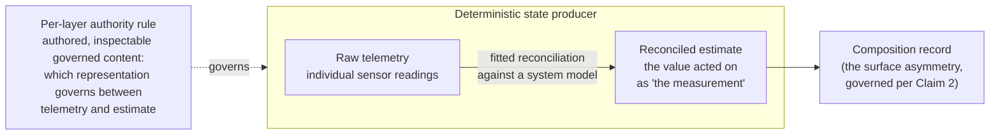
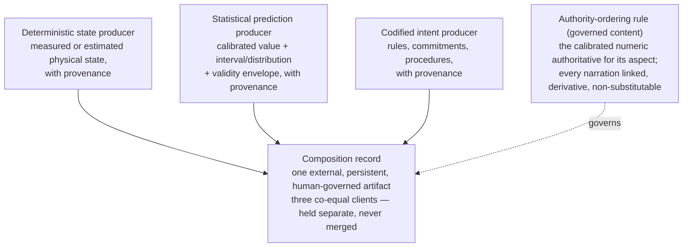
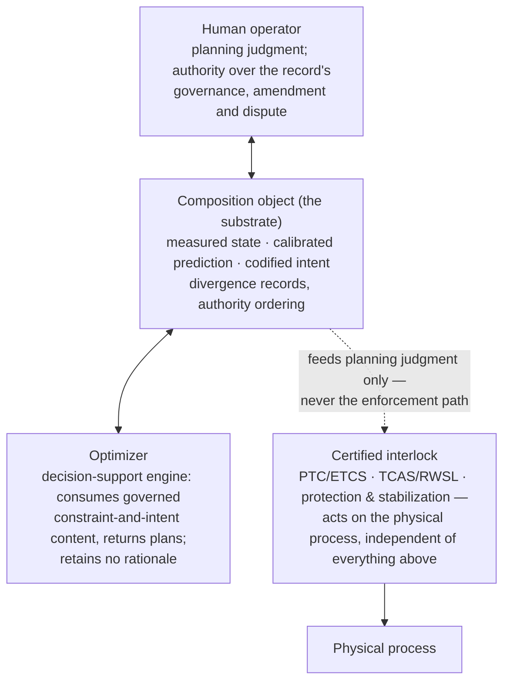

# Composition Outside the Model: A Governed Substrate for Physical State, Statistical Prediction, and Linguistic Intent

**Wenxin Li**

*Independent Researcher*

ORCID: 0009-0004-8065-3235

July 2026

---

## Abstract

In mature safety-critical control rooms — rail dispatch, airport operations, the energy grid — three independently maintained bodies of world-knowledge must be brought together before anyone can act: engineered deterministic state (measured physics, position, and motion), calibrated statistical prediction (learned forecasts carrying known uncertainty), and codified linguistic intent (the requirements, procedures, and priority rules that state what ought to happen). Each is a mature achievement of its own field, and none composes with the others anywhere but inside an expert operator's head — from which the composition cannot be inspected, retained across a shift, transferred to a successor, or governed. This paper specifies that missing composition as an external, inspectable, human-governed record, extending the Coordination Knowledge Substrate pattern from coordination knowledge to world-knowledge composition, and defends it through three claims: the composition point is a design object standing outside every contributing model; disagreement between measurement and representation is a distinct, governed conflict class carrying three-way attribution across sensor, model, and decision logic; and the calibrated statistical output crosses as the authoritative record, with its linguistic narration ordered beneath it as separate, derivative content.

The paper's central finding is sharper than its architecture: across the safety-critical domains examined, the deployed systems already compute the divergence and the trust decision and discard exactly the governed, attributed record — keeping a generic quality flag where the record could stand. The pattern is realized in two structurally different physical regimes — a kinematic regime, covering rail dispatch and airport operations, and a flow regime, covering the energy grid — as its first instances. The contribution is a design pattern, specified and instantiated, not an empirical evaluation; its operational consequence, a widened decision window, is stated as specifiable and measurable, not measured.

**Keywords.** coordination knowledge substrate; world-knowledge composition; measurement versus representation; calibrated uncertainty; control-room human factors; governed record; design pattern.

---
# 1. Introduction

## 1.1 The composition problem — three mature bodies of world-knowledge, no medium between them

In a mature safety-critical control room, one person holds the working picture of the world. A rail dispatcher reads the track occupancy and the signalling state off the display, recalls the delay pattern that has been building along the corridor since the morning, holds in mind the freight priority and the crew-hours rule that will force a decision within the hour, and fuses the three into a single judgment about which train waits and which runs — in real time, under load, while the next call is already coming in. The air traffic controller does the same with the radar picture, the forecast weather, and the procedure that governs the sector. The grid operator does it with telemetry, a load forecast, and a dispatch instruction. In each case the raw materials of the judgment arrive in different forms from different kinds of source, and in each case they are brought together nowhere but in the operator's head.

Behind that scene sit three independently mature bodies of world-knowledge, and the rest of the paper turns on their separateness. The first is **engineered deterministic state** — physics, kinematics, geometry, and sensor-derived position and motion: high-certainty, short-horizon, machine-produced knowledge of where things are and how they are moving. The second is **validated statistical prediction** — learned models fitted to decades of operational history, producing forecasts with calibrated uncertainty and known validity envelopes: probabilistic, longer-horizon, machine-produced knowledge of what is likely to happen next. The third is **codified linguistic intent** — the requirements, commitments, procedures, regulations and priority rules that state what ought to happen and under what constraints: human-authored, expressed in language, maintained on a policy timescale. Each of the three is a genuine achievement of its field, refined over decades and trusted in operation. Each works. None composes with the others.

**The composition medium, today, is a human being.** The join happens inside the expert, and it happens well: these are among the most reliable coordination systems humans operate. It is precisely because the arrangement works that its limits are structural rather than incidental, and there are four of them. The integrated picture does not scale beyond one person's span of attention. It does not persist across a shift boundary, but is reconstructed by the next operator from the external data and a verbal handover rather than handed over intact. It degrades under fatigue and workload. And it is treated across the safety-critical industries as at risk when the person who holds it retires. The evidence for these limits is uneven in strength, and the paper is careful about which parts it leans on. The non-persistence of the integrated picture across shifts is well supported: controllers' working representations are characterized in the human-factors literature as selective, dynamic, person-specific and fragile rather than as durable external artifacts, and the field describes them as recoverable only by probing the operator, not by replaying the radar and flight data (Isaac & Ruitenberg 2017; HSE OTO 96 003; Parke, Hobbs & Kanki 2010). The degradation under fatigue and workload is directionally supported across all three domains but not cleanly quantified, and the paper claims no figure for it. The retirement concern is scoped rather than asserted flatly: aging-workforce knowledge loss is documented as a serious operational risk by regulators and industry bodies in grid and nuclear operations, while for air traffic control the paper found the concern raised in the abstract but not tied to any specific documented incident, and it states the clause at that strength rather than a stronger one.

The core observation follows directly. The composition of these three kinds of world-knowledge is real work, it is consequential, and in mature instrumented domains it is performed in the one place from which it cannot be inspected, retained, transferred, or governed — a human head under load. **The core claim of this paper is that this composition can and should become an external, governed, inspectable artifact, and that the Coordination Knowledge Substrate (CKS) is a design pattern suited to being that artifact.** What the paper contributes is not the observation that a person carries the load; that observation is not ours, and §1.2 concedes it. What the paper contributes is the response.

## 1.2 Composition as an artifact of the expert human head — the diagnosis, conceded

The observation that the operator is the point at which heterogeneous information is integrated into a single actionable picture is not this paper's discovery. It is a settled finding of control-room human factors, made across four decades and three domains by field observation, cognitive task analysis and situation-assessment research: rail dispatching's situation model is, in the field's own words, "not fully codified in documents or systems" (Roth, Malsch & Multer 1998; Golightly & Young 2022); the air traffic controller's picture is selective, dynamic, controller-specific and fragile, not recoverable by replaying the external data (Isaac & Ruitenberg 2017; Niessen & Eyferth 2001); and grid operators mentally re-integrate an overview that screen-based energy-management systems fragment across displays (PNNL-16780; Afzal et al. 2022). The three literatures were built independently, on different methods, and they converge. The paper concedes the diagnosis here, explicitly and early, so that the novelty it later claims attaches where it belongs — to the architectural response, not to the description of the problem — and it engages the literature in full once, in §3.1, where the unsettled debate over whether "situation awareness" names a real cognitive property is also settled for the paper's purposes. The rest of the paper argues in terms that debate does not reach: which information was available, what was integrated, what was recorded, what persisted past the shift, and what transferred to the next participant. In every one of the three domains the answer is the same — the integration is performed, it is consequential, and it is not retained anywhere as an addressable artifact. That is the gap. It was named by others; the paper takes it as given.

## 1.3 Scope — bounded, instrumented, high-stakes domains

The argument is bounded. It applies to domains that are instrumented (the physical state is measured, not inferred from unaided observation), high-stakes (errors carry real operational or safety consequence), and bounded (the space of relevant world-knowledge is finite and largely codified rather than open-ended). Rail dispatch, air traffic control and grid operation are the paper's worked settings, and the scope restriction is a restriction on where *this argument* applies, not a retreat from the tool-agnosticism CKS commits to elsewhere; the pattern is general, and the paper simply makes its case where the three producers are all present in mature form.

One disambiguation belongs in the same breath as the scope statement: this paper is **not the fourth rung of the trilogy's scope ladder.** It holds the scope where the trilogy's applications already sit and crosses a *content-type boundary* instead — from coordination knowledge, the subject of the trilogy, to world-knowledge composition, the subject here. §2.3 develops the distinction; it is flagged here because the scope section is where the misreading starts.

## 1.4 Position on "understanding" — early and explicit

A single terminological commitment removes the paper's largest attack surface, and it is made here rather than deferred. This paper makes no claim about machine *understanding* of physics. Whether a model understands the physical world in any strong sense is the object of the perception-first world-model research program, and it is a hard and contested question the paper neither needs nor addresses. In bounded, high-stakes, instrumented domains the operative goal is not understanding but **operational competence**: correct, timely, auditable, governed action under real constraints. Understanding was, for this class of problem, the wrong target — a system that composes measured state, calibrated prediction and codified intent into an inspectable, governed record does what the domain requires whether or not anything in it understands anything. Where a perception-first system must build competence by coming to understand the physical world from raw signal, the domains this paper addresses already hold their world-knowledge in three mature, externally maintained forms; the problem is not to acquire understanding but to compose what is already known, and operational competence is the standard against which that composition is rightly judged. The paper concedes the word freely and returns to operational competence whenever the stronger notion threatens to creep back into the argument. The concession costs nothing the paper wanted, and it is reinforced by the cognitive-science material of §2.4: if physical prediction and linguistic representation are functionally separable even in people, then operational competence — not understanding — is all the more clearly the right target for an architecture that composes their outputs.

## 1.5 Contribution statement — the response, not the diagnosis

The contribution of this paper is the response, not the diagnosis, and the theorization and governance, not the structure. The structure — an external artifact at which measured state, statistical prediction and linguistic intent are brought together — is repeatedly precedented in operational practice across unrelated sectors, and it is nowhere governed; practitioners built it, independently, many times over, and no research venue theorizes it. Sharper still, in several of the paper's domains the system **already computes the divergence and the trust decision and discards the governed record**, keeping only a generic quality flag where an attributed, persistent, human-governed record could have been. The contribution is to name, theorize and govern what practice arrives at piecemeal and research does not treat: to take a structure that is precedented but ungoverned and specify the governance layer it has always lacked. The response is developed as the core theory of Part 1; the precedent it answers to — the recurring operational structure and the discarded record — is set out as the operational-ancestor pattern in §3.8. The ancestor pattern is the paper's strongest framing asset and, unengaged, its strongest available objection; both are taken up in full there.

## 1.6 Roadmap

The paper is organized in three parts, and it signposts its own structure as it goes. Part 1 states and defends the core theory through three claims: that the composition point between physical state, statistical prediction and linguistic intent is a design object belonging outside every contributing model (§4); that disagreement between measurement and representation is a distinct conflict class requiring asymmetric, governed handling (§5); and that calibrated statistical output crosses into the substrate as the authoritative record while its linguistic interpretation persists as separate, derivative content (§6). A fourth chapter states the architectural commitments the claims rest on — governance and data temporality, and risk-proportional granularity — without the claim apparatus, and closes by exhibiting the general schema of the record the three claims assert (§7). Part 2 realizes the core mechanisms concretely in two structurally different physical regimes: constrained-network kinematics, covering rail dispatch and airport operations (§8), and flow-and-constraint systems, covering the energy grid (§9). Part 3 discusses what the architecture commits to and what it does not, situates the two regimes as first instances, returns the result to mainstream world-model research, and states the scope, limits and open questions (§10–§11). The contribution is a design pattern, not an empirical evaluation; the architectural commitments are rendered confidently, and the empirical status of what the pattern would achieve in deployment is rendered with calibrated humility throughout.

---
# 2. Framing and Scope

## 2.1 CKS commitments inherited — stated compactly, defended elsewhere

This paper is standalone in framing: a reader who has not read the trilogy can follow it, and this section states what the paper inherits from Papers 1 through 3, and where that inheritance is defended, without redefending it.

The **Coordination Knowledge Substrate (CKS)** is a design pattern in which the knowledge a system coordinates around — together with the governance semantics and conflict-handling logic that structure it — lives in a persistent, human-governed substrate outside the learned model rather than inside its inference. Paper 1 defended the pattern through six architectural commitments, and this paper carries them unchanged: the substrate and the model divide labor at the **governance boundary**, the substrate holding coordination and governance and the model holding high-dimensional reasoning; contradictions are **preserved as first-class substrate state** rather than silently resolved; authority over substrate content, structure and rules is **human-governed**, though the labor of authoring may fall to humans or to models operating under human direction; the model acts as **substrate mediator**, reading, writing, interpreting and composing substrate content rather than holding authority over it; the pattern is **tool-agnostic**, instantiable in any environment that supports persistent structured state under human read/write access; and it scales at **linear cost** in storage and composition. Paper 2 added the internal structure the later chapters draw on where needed — the separation of durable rule-like content from instance state, and the separation of fast precompiled handling from deliberate reasoning as independently governed layers — and Paper 3 extended the pattern across organizational boundaries. These commitments hold within this paper's scope; the paper inherits and extends them, and the defence is the trilogy's, not repeated here.

One inheritance does load-bearing work in the later chapters. Human-governed is not the same as human-authored: what the architecture requires is that authority over structure, rules and rights sits with humans, not that humans perform the labor. That distinction — authority, not labor — is Paper 1's, and it carries this paper's account of measurement authority in §5 and elsewhere.

## 2.2 The cross-claim spine — outside-the-model, in new territory

The architectural move this paper makes is the same one Paper 1 made, carried into new territory, and the continuity is named once here. Paper 1 observed coordination knowledge — what was decided, by whom, under what authority, with what rationale — living in expert heads and in fragmented artifacts, and argued that it should instead be an addressable, human-governed substrate outside the model. This paper observes the same of world-knowledge composition: the join of measured state, predicted consequence and codified intent lives in expert heads and in transient artifacts, and the paper argues that it, too, should be an addressable, human-governed substrate outside every contributing model. The three properties Paper 1 required of coordination knowledge are the three this paper requires of the composition: that it be addressable, so a later participant or session can inspect it rather than reconstruct it; that it persist, so it survives the boundary at which the operator's picture is lost today; and that it be human-governed, so authority over what the record says and how conflicts within it are handled sits with people. The load-bearing phrase Paper 1 introduced for the move — **outside-the-model vs. inside-the-model** — carries through this paper unchanged. It names where the composition, its governance, and its conflict-handling live: in the substrate, inspectable and governed, rather than inside a learned model's inference or inside the unexternalized judgment of an operator. Everywhere the paper distinguishes what it proposes from an opaque model that composes the same inputs internally — whether that opacity is a single learned artifact or a language model laid over a state model — this is the distinction it is drawing.

## 2.3 Content-type extension, not a scope rung

The trilogy is a ladder of scopes, and this paper is not its next rung; §1.3 flagged the point and this section states it in full, because it is the single framing decision most likely to be misread by a trilogy reader. Across Papers 1 through 3 the architectural commitment held constant and the *scope* grew — the coordination cell, the AI Self, the inter-Self perimeter, and population register — the trilogy's largest scope, the governed registry of a population of coordinating Selves — formed four rungs of one ladder, each scaling the same substrate-mediated coordination to a larger organizational object. This paper keeps the scope where the trilogy's applications already sit and moves along a different axis entirely: it extends the substrate commitment across a **content-type boundary**, from coordination knowledge to world-knowledge composition. The object being governed changes — from decisions, rationale and authority to measured state, statistical prediction and linguistic intent — while the governing commitments stay the trilogy's own. This is why the paper is standalone in framing rather than sequential: it does not depend on the ladder having reached a particular rung, because it is not on the ladder. A reader who approaches it looking for the scope after population register will not find one, and should not; what is new here is the content type, and the architecture is the inheritance.

## 2.4 Language and physical knowledge: warrant, not grounding

The paper composes linguistic intent with physical and statistical knowledge, and a reader is entitled to ask whether that composition is even a real problem — whether language is not simply the universal medium into which the other two can be rendered, so that a written substrate suffices to hold all three. This subsection answers that question, and it does so in the manner Paper 2 used with the Kahneman two-systems literature: the cognitive-science lineage supplies *warrant* for treating the composition as real, and the architecture carries itself. The lineage is not evidence for the design; it establishes that the design is answering a genuine question rather than a manufactured one. Two things follow from the evidence: that physical prediction and linguistic representation are separable systems, and that language is the wrong medium into which to collapse the others.

The first is a functional dissociation, and it is the section's anchor. Physical prediction and linguistic representation are separable systems in people, each independently established as necessary, and the field has no architectural account of where they compose. The neuroimaging is the decisive result: intuitive physical reasoning recruits a frontoparietal network that does not overlap the language network, a finding recently established with the conclusion, in the authors' words, that "physical reasoning does not rely on linguistic representations, nor exclusively on the domain-general abstract reasoning that the [multiple-demand] system supports" (Kean et al. 2025), replicating an earlier identification of a physics-reasoning network dissociable from generic reasoning (Fischer et al. 2016). Intuitive physics is modelled computationally as approximate probabilistic simulation without linguistic representations (Battaglia, Hamrick & Tenenbaum 2013); and severe language loss spares the relevant reasoning, with individuals in global aphasia performing near controls on judging the plausibility of depicted physical events (Ivanova et al. 2021), whose formulation — that the language system is "recruited but not necessary for processing complex nonverbal meanings" — is the precise one, and with severely agrammatic patients shown to retain causal reasoning and even multi-digit arithmetic (Varley & Siegal 2000). The dissociation is strong but it is not settled, and the paper says so: the aphasia evidence rests on very few cases and concerns adult cognition rather than lifetime linguistic influence, and some patients diagnosed with global aphasia retain inner language (Sierpowska et al. 2020). The architectural claim survives the hedge, because it needs only separability enough to make composition a real problem, not the strong claim that language is absent from thought — a claim the paper neither needs nor makes.

Separability is not the stronger claim that language is a mere communicative addition to an otherwise complete non-linguistic system, and the paper is careful not to drift into it. The current position across the field of grounded cognition treats language as a constitutive substrate for conceptual content, particularly for abstract concepts (Dove 2023; Reilly et al. 2025; Borghi 2020; Barsalou 2026), and the paper adopts that position rather than the superseded one; separability of physical prediction from linguistic representation is compatible with language being deeply woven into conceptual thought, and the paper claims only the former.

What language does contribute lies elsewhere, and stating it precisely keeps the argument honest. Language enriches, stabilizes and extends abstraction rather than creating it — abstraction is present pre-linguistically and in non-human primates, and language sharpens and transmits it rather than founding it (Lupyan 2012; Gentner 2016; Ferry, Hespos & Gentner 2015; Mandler 2004; Fagot & Thompson 2011). And it is decisively the best medium for transmitting complex technical procedure, which is exactly this paper's third producer: in controlled transmission-chain experiments, the fidelity of complex procedural skill improves with teaching and particularly with language, but not with imitation or emulation alone (Morgan et al. 2015). Both claims are scoped rather than sweeping. Cumulative culture in general does not require language, so the transmission advantage is claimed for the complex technical and procedural content the paper cares about, not as a universal claim about culture. And there is one bounded exception on the abstraction side that the paper states before a reviewer produces it: spatial language correlates with later performance on non-verbal spatial tasks (Pruden, Levine & Huttenlocher 2011; Verdine et al. 2016; Pyers et al. 2010), but the effect is correlational rather than demonstrated causal, the researchers' own proposed mechanism is attention and relational encoding rather than improved physical prediction, and no evidence reaches intuitive physics — a gap the literature records as genuine rather than merely unsearched. The exception qualifies the picture; it does not disturb the dissociation.

The second point corrects a medium argument the paper explicitly does *not* make. The tempting version — that language compresses the world well, so a written substrate suffices to hold physical and statistical knowledge alongside intent — is wrong, and the evidence points the other way. Language is a poor medium for fine-grained continuous and spatial structure; diagrams, notation and numeric representation map onto those dimensions directly, and text imposes memory and search demands that make some inferences difficult to draw from it at all (Larkin & Simon 1987; Stenning & Oberlander 1995; Zhang & Norman 1994; Kirsh 1995). The convergent position across this literature is **complementarity**: each format carries what it carries well — numeric and diagrammatic representations the continuous and spatial structure, language the norms, exceptions, conditionals and intent that only language expresses — and no single format subsumes the others. The argument the evidence supports is therefore not that language is a sufficient medium but that **each format retains its own character, and what is needed is a governance regime over the composition of formats** rather than a translation of everything into one. A second tradition reaches the same structure from a different direction: the qualitative-physics literature finds that people represent physical systems in intermediate formats that are neither raw sensorimotor simulation nor natural language, communicable and generalizable precisely because they trade fine-grained quantitative accuracy for structure (Forbus 2018; de Kleer 1993). Two independent literatures, one on external representations and one on qualitative reasoning, converge on formats that are complementary rather than substitutable — which is the direct cognitive-science warrant for the paper's commitment to hold formats separate under governed composition (developed in §6). The substrate's decisive properties — persistence, inspectability, accumulation, verification — belong to *writing*, not to language as such; literacy does not automatically confer general reasoning advantages, its effects depending on how writing is used rather than on the medium itself (Scribner & Cole; Street), so the paper claims those specific capacities and nothing broader. And compression is used here as an analogy, not a result: there is no cross-domain estimate of how much information is lost from a physical scene to its linguistic rendering, and the paper claims no number.

## 2.5 Measurement and representation: the epistemic asymmetry

The second lineage subsection supplies warrant for the paper's treatment of measurement; the charting and boundary-object material a reader might expect here is held in-chapter where the claims it serves are developed (§4.7). The move is the same as §2.4's: the lineage licenses the question, and the architecture carries itself.

The lineage is the philosophy and epistemology of measurement, and its relevant doctrine is that measurement outcomes occupy an epistemically privileged position relative to model predictions and asserted claims, so that a divergence between what is measured and what a model or an authored representation says is not a discrepancy to be averaged away but a fault to be diagnosed. The tradition theorizes measurement-model divergence as demanding **diagnosis of which is at fault** rather than reconciliation, merger, or peaceful coexistence: a functionalist account of the epistemic privilege of measurement (Ohnesorge 2023, *Philosophy of Science* 90(5), 1396–1406, DOI 10.1017/psa.2023.47); the account of measurement as an iterative exchange between top-down adjustment of models and bottom-up adjustment of material artifacts (Tal; Mari, Wilson & Maul; Boumans); and the broader treatment of epistemic iteration and of the standing of models against data (Chang, *Inventing Temperature*; van Fraassen; Teller). The paper draws the doctrine, not a quotation; its own thesis about measurement authority is a functionalist account in this lineage's sense, and the background structure it takes from the lineage is characterized rather than quoted.

What the lineage licenses is bounded, and the paper marks the boundary. It licenses one thing: that the asymmetry between measurement and representation is a real epistemic structure, not an engineering convention of convenience. It does not license the architectural claim — that one should therefore build the asymmetry into governed software as a persistent, attributed, human-governed record — and the paper does not pretend that it does; that claim carries itself, on architectural grounds, in §5. The distinction matters because the asymmetry does appear, everywhere, as *mechanism* — as precedence orderings, fusion weighting, voting schemes, entrenchment rankings — and nowhere as a stated principle that measurement and authored claim are categorically different kinds of assertion whose disagreement demands diagnosis. The null takes two characteristic forms. In belief revision and truth discovery, source difference is treated as a difference of *degree* on a credibility ordering, never as a categorical difference in kind. In digital-twin and cyber-physical-systems work, measurement authority is presupposed in the correction direction — the model is adjusted toward the sensor, not the reverse — and stated nowhere as a governed principle. The paper found this uptake absent as a stated governance principle over persistent records across the venue classes it searched; the null's authoritative scope — nine venue classes, running from software and systems engineering through metrology and evidence law to financial reconciliation and machine-learning governance — is enumerated once, in §5.2. The null is stated with its scope named — it is a claim about the venue classes searched, not an unbounded assertion that no such treatment exists anywhere — and it is what makes the asymmetry available as unoccupied territory for the governance layer §5 proposes.

## 2.6 What this paper is not

A short run of disambiguations bounds the paper's scope, each naming a neighbour into which the argument is commonly collapsed and the property that distinguishes it, in the parallel construction Paper 1 used for the same purpose. This paper is **not the fourth rung of the trilogy's scope ladder**: it is a content-type extension of a fixed commitment, not a further scope (§2.3). It is **not a claim about machine understanding of physics**: the operative goal is operational competence, and understanding is conceded to the world-model research program (§1.4). It is **not a competitor to perception-first world models**: those approaches rediscover physical structure from raw perception, and this paper composes structure the domains already hold in three mature forms, so the two are complementary by scope. It is **not a proposal to replace certified safety systems**: the interlocks that physically stop a train, issue a collision-avoidance advisory, or shed load act above the architecture and are never displaced by it. It is **not an empirical evaluation**: the contribution is a design pattern, and the value it would deliver in deployment is specifiable as future measurement, never reported as a measured result. It is **not an integration-framework paper**: only machine learning that produces world-state claims enters the composition — machine learning in general does not — and that restriction keeps the argument from widening into the coupling of arbitrary systems. It is **not a proposal to extract or replace expert tacit knowledge**: the three producers are already-explicit artifacts, and the architecture composes existing explicit content rather than eliciting what an operator cannot articulate. And it is **not a claim that the structure is unprecedented**: the structure is precedented, repeatedly and independently, in operational practice, and what is unprecedented — and what the paper claims — is the governance layer over it (§3.8).

---
# 3. Landscape

This chapter is the paper's map of adjacent work. It positions the contribution against everything the argument sits near, concedes the ground that is already occupied, and states once the one structural finding on which the whole paper turns — the operational-ancestor pattern of §3.8. The full differentiation against the closest neighbours is the work of the claim chapters (§4–§6); this chapter draws those differentiations only to map depth, and stands afterward as the paper's standing reference for where each neighbour stops.

## 3.1 Control-room human factors and the operator as integrator — the diagnosis, conceded

The observation that the operator is the point at which heterogeneous world-knowledge is fused into a single actionable picture belongs to control-room human factors, which made it across four decades and three domains, and §1.2 conceded it there. This section engages that literature directly and settles one debate it raises, so that the rest of the paper can lean on the diagnosis without inheriting the debate. The field's own account of the integration act is detailed and, in places, prescriptive: cognitive task analysis of rail dispatching itemized the integration inputs from field observation and found the resulting situation model "not fully codified in documents or systems" (Roth, Malsch & Multer 1998; Golightly & Young 2022); the air-traffic literature describes the controller's picture as selective, dynamic, controller-specific and fragile, recoverable only by probing the controller rather than by replaying the radar and flight data (Isaac & Ruitenberg 2017; Niessen & Eyferth 2001); train traffic controllers sustain high performance alongside low scores on explicit situation-assessment probes (Lo, Sehic & Meijer 2014) — observable evidence of an integrated model verbal probing does not recover, whatever that model is made of; and grid human-factors work traces the integration load to the fragmentation of a once-unified overview across screens and applications (PNNL-16780; Afzal et al. 2022). Where this literature turns prescriptive, it prescribes better displays, better decision support, better handover protocols and better work-domain analysis — it does not propose that the composed interpretation itself become a persistent, governed, inspectable artifact. That gap, not the diagnosis, is the paper's territory, and the difference between the two is a difference of purpose rather than an oversight the field committed: an analytical literature that characterizes a cognitive act is not obliged to propose an architecture for externalizing it.

One debate in these same venues has to be settled here rather than left to recur, because the paper repeatedly describes what the operator holds and could otherwise be read as depending on a contested construct. There is a live and unresolved dispute over whether **situation awareness** names a real cognitive property or a folk construct that explains human performance only circularly (Dekker & Hollnagel 2004; Sarter & Woods 1995), against a canonical defence that the construct rests on a substantial empirical base and remains viable (Parasuraman, Sheridan & Wickens 2008; Endsley 2015). The paper takes no side. It argues instead in observable terms — what information was available, what was integrated, what was recorded, what persisted past the shift, and what transferred to the next participant — and where it cites a source that uses the construct, it cites the finding rather than the construct's explanatory power: that verbal probing fails to recover what an operator is evidently using, that artifacts carry part of the picture, that structured handover reduces omissions. The case the paper makes does not require situation awareness to be valid, and it does not require it to be a folk model; it requires only that the composed picture is performed, is consequential, and is not retained anywhere as an addressable artifact, all of which are observable and none of which the debate reaches.

## 3.2 Human-in-the-loop digital twins and LLM-with-digital-twin integration

This is the neighbourhood the paper was once thought to sit in, and it is the one a reader arriving from the world-model and digital-twin literature will look to first. The human-in-the-loop digital-twin survey literature recognizes the human as central, motivates the human's involvement by the demands of fidelity, and reports that in practice that involvement is limited (Deufel & Lazarova-Molnar 2025) — the paper takes only what the verified abstract and bibliographic record support and asserts nothing about the survey's unread full text. The highest-value neighbour here is Ndum Ndum et al. (2026), an LLM-assisted digital twin for reactor operation in which the language model's output is governed by procedural and control-loop safeguards — retrieval grounding over validated domain knowledge, a reference governor in the control path — rather than by a record architecture, with no treatment of calibration loss when numeric output is narrated. It is the paper's setup with the answer missing: the same problem, the same setting, and no persistent, attributed, governed record where the composed judgment could live. The wider digital-twin and cyber-physical-systems literature presupposes measurement authority in the correction direction — the twin is updated toward the sensor, never the reverse — and states it nowhere as a governed principle, a point taken up under Claim 2; here it is enough to record that the neighbourhood motivates the problem the paper addresses and stops short of the record the paper proposes.

## 3.3 External artifacts in control rooms

Control rooms have externalized part of the composed picture into artifacts for as long as control rooms have existed, and the distributed-cognition literature establishes this as a general pattern rather than a peculiarity of any one domain (Hutchins 1995; Halverson 2002). Paper flight progress strips are the closest operational ancestor of the paper's proposition, and a controller's own description of them — "you have got to have a complete picture of what should be in your sector and what should be in your sector is on those strips" — very nearly states the paper's thesis (Bentley et al. 1992; Mackay 1999); the strip is engaged at claim depth in §4.5. Nautical charts are the second and stronger ancestor: a governed composition of survey measurement, modelled and interpolated content, and legally authored content, carried under a layered standards-and-maintenance regime (IHO S-44, S-57/S-100; SOLAS) and engaged at claim depth in §4.5. The rail train diagram composes scheduled intent and actual running on one artifact for real-time regulation in the paper's own first domain, and its computerization preserved rather than lost the composed function; airport Collaborative Decision Making (A-CDM) maintains a governed, persistent, shared picture of measured milestones, predicted target times and authored constraints across organizations — the paper's first cross-organizational ancestor, engaged in full at §8.3; and the grid mimic board and one-line supply the within-room ancestor of composed measured state, its computerization documented as modernization rather than as the loss of a composed artifact.

The military common operational picture is the same shape at its most formalized, and it must be engaged here because on its face it is the closest single occupant of Claim 1's content-type triple anywhere in the landscape. The JC3IEDM information-exchange data model, maintained under the Multilateral Interoperability Programme and ratified as NATO STANAG 5525, composes fused sensor tracks, assessments and estimates, and orders, plans and formal commander's intent in one persistent, governed, standards-maintained model spanning organizations, and requires that sources of information, reporting times and an indication of the validity of the data be identified. The concession is made accordingly, and the differentiation then holds on the terms the claim's verdict will make precise: what the model carries for source difference is a credibility indicator — a rating of degree, the belief-revision pattern §2.5 named — not an authority ordering by epistemic kind; its conflicts resolve through staff process rather than through stated conflict semantics; the estimates it composes carry no calibrated uncertainty, so the triple's *with its uncertainty intact* qualifier is unmet; and the command-and-control research literature that theorizes it theorizes shared awareness and command arrangements, not the composition as a governed record type.

Three neighbouring literatures theorize this artifact-bearing work and each stops short of the paper's object: distributed cognition documents artifacts carrying genuine cognitive work but proposes no artifact intended to outlive the episode and be inspected afterward (Hutchins 1995); Distributed Situation Awareness treats artifacts as awareness-holding agents but analyses them for their moment-by-moment contribution, prescribing no class of persistent, governed awareness records (Stanton et al. 2006; Salmon & Plant 2022); and Ecological Interface Design, the closest prior prescription to externalize the composition, renders the work domain's means-ends structure onto a display at design time rather than into a per-episode operational record (Vicente 1999; Rasmussen 1985) — each engaged at claim depth in §4.6. What every one of these artifacts and frameworks lacks is what the paper adds: the artifacts are within-shift and scoped to a position or sector, retained as auditable records nowhere, and the frameworks that theorize them are descriptive and design-oriented by purpose. The ancestry is warrant; the distinction is the contribution, developed in full at §3.8 and Claim 1.

## 3.4 Divergence records in practice

Persistent, identity-bearing records of divergence are established industrial practice, not a research proposal. Aerospace and defence discrepancy reporting, reliability FRACAS programmes, and pharmaceutical deviation and CAPA management each assign a discrepancy a persistent unique identifier, a defined lifecycle with states, an assigned owner, retention beyond the incident, and referenceability by later records — in three unrelated industries, over decades (MIL-STD-2155; NASA PRACA; GEIA-STD-0009; NASA-STD-8729.1A; ICH Q10; 21 CFR 211). What none supplies is a source-attribution taxonomy that distinguishes measurement cause from analytical-model cause from control-logic cause, a discrepancy category for divergence between a measured and a modelled value, or any statement of which representation governs: cause is captured as narrative free text, sometimes supported by site-specific codes, and the standardized taxonomies that exist are generic — design, manufacturing, material, process, human — rather than sensor, model and logic. The primary standard text for several of these systems was not obtained in this study's searches, so the engagement characterizes them rather than quoting them.

The closest neighbour to the object of Claim 2 found anywhere is financial reconciliation break management, where a "break" is a persisted, owned, lifecycle-managed divergence record carrying investigation and a configurable root-cause categorization (SmartStream, Duco, Gresham). It is the seventh confirmation that the principle Claim 2 states is unoccupied, and it is prior practice from which the claim's mechanism must be differentiated; the three-part differentiation a reviewer will ask for is stated in full at §5.7.

## 3.5 Numeric and narrative separation in practice

Structural separation of a numeric result from its narrative interpretation is universal and operational, not novel or rare, and Claim 3 concedes as much before differentiating. The ECHA/OECD (Q)SAR prediction reporting format retains, per individual prediction, the predicted value, its narrative commentary, a constrained applicability-domain determination with its justification, and the regulatory interpretation, in distinct linked fields (QPRF v2.0); clinical informatics separates the same elements universally and operationally across FHIR, HL7 v2's OBX segment, LOINC's scale types, DICOM Structured Reporting and the CLIA retention regulations (FHIR R4; HL7 v2; LOINC; DICOM PS3.16; 42 CFR 493). What neither venue supplies is a statement that the quantity governs and the narrative is derivative: three of the property's four parts are met, and the fourth — the numeric authoritative, the interpretation subordinate — is stated nowhere. Both venues are engaged at claim depth in §6.2 and §6.5.

## 3.6 Shared-artifact and integration architectures

Two famous architectures are the ones a reviewer supplies from memory as prior occupants of Claim 1. Blackboard architectures share a structure that heterogeneous knowledge sources read and write, but the blackboard is runtime working memory — the state of processing during a run — not a persistent governed external record (Hearsay-II, Erman et al. 1980; Nii 1986); mediators are a schema-mediation service layer whose own foundational statement warns against giving mediators responsibility for persistent storage (Wiederhold 1992). Both are disarmed at claim depth in §4.3 and §4.6.

The integration and governance architectures a reviewer would raise next each govern a shared artifact without governing the epistemic triple: the digital thread and its authoritative-source-of-truth doctrine (DoD Digital Engineering Fundamentals 2022), the ISO 19650 common data environment, the canonical data model — genuinely external to every participating application, the tightest standalone match to the paper's externality commitment (Hohpe & Woolf 2003) — master data management's configured survivorship, and the power-systems Common Information Model's measured-versus-estimated source distinction (IEC 61970). Each carries genuine governance — access control, roles, stewardship, provenance — over content that is not the triple, and none couples that governance to the composition across epistemic kinds, the joint presence Claim 1 asserts; the per-neighbour engagement is §4.3's and §4.6's.

## 3.7 ML model-observability and data-quality tooling

An engineering reviewer will observe, once the paper's mechanism reads as "persist what the model computes," that a mature tooling ecosystem already persists what models compute. Model-observability platforms and data-quality frameworks (Evidently, Arize, SageMaker Model Monitor; Great Expectations, dbt, Monte Carlo) raise metrics, scores, alerts and pass-or-fail flags — engineering telemetry rather than a governed record, carrying no identity-bearing divergence object, no epistemic attribution across sensor, model and logic, and no authority ordering; the generic quality flags they persist are structurally the grid's per-point quality codes, a marker attached to a value rather than a composed, attributed, human-governed record of what diverged and what it means. The observation bears on Claim 2, whose divergence object it is nearest to, and Claim 3, whose calibrated-numeric-as-record it does not retain; both engagements are completed in §5.6 and §6.6.

## 3.8 The operational-ancestor pattern

The preceding sections report the same shape from unrelated sectors, and stated once it becomes the paper's strongest framing asset. **Across the control-room, divergence-record, and numeric-narrative literatures, practitioners in unrelated sectors converged independently on the structure this paper proposes, built it, and have run it for decades; no research venue theorizes it, and none of the implementations carries the governance layer.** Air traffic control externalized the controller's composed picture onto strips; charting composed measurement, inference and legal intent into one governed artifact; aerospace, defence and pharmaceutical manufacturing built identity-bearing persistent divergence records; chemical regulation and clinical medicine separated the quantity from its narrative and linked them. Sharper still, and this is the observation §1.5 pointed here: in several of these domains the system **already computes the divergence, the residual, and the trust decision and discards exactly the governed attributed record**, keeping only a generic quality flag where an attributed, persistent, human-governed record could have been. The contribution is to persist and govern what the mechanism already computes; the record that would do so is specified in §7.5 and instantiated per domain in §8 and §9.

Naming this pattern also supplies the paper's own strongest objection, and the objection has to be answered here. The objection is that the pattern is not a contribution but a renaming: discrepancy records have existed since the 1960s, clinical laboratories have separated numeric from narrative for as long as there have been clinical laboratories, and a per-prediction validity field sits in the ECHA format — so the paper has described existing practice and given it a new name. The answer is the governance layer, and it takes the same three-part form at every ancestor. **The ancestor supplies the structure. What no ancestor supplies is (i) an authority ordering — a stated rule that the measured or numeric record governs and the narrative account of it is derivative; (ii) stated conflict semantics — a rule that disagreement between them is a distinct class of conflict requiring diagnosis rather than reconciliation or coexistence; and (iii) the record as an architectural type under human governance, rather than a compliance workflow, a documentation convention, or a data-model convenience.** Where an ordering does exist in an ancestor's practice it is content-domain-specific rather than a principle by epistemic kind — charts prefer observed depths as a safety-of-navigation convention; cadastre runs the ordering the other way, with the legal boundary governing and the survey as evidence; negotiable-instruments law codifies, at UCC §3-114, that words prevail over numbers and handwritten terms over typed over printed — a statutory rule stating which representation governs, run in the reverse direction for fraud-resistance, and mirrored in bills-of-exchange law elsewhere; standards bodies designate a prevailing text or authoritative notation when renderings of one specification diverge; and reconciliation tie-breaks are configured per source — which is exactly why none of them states the ordering as architecture: each ordering is fixed by its content domain's purpose, and where a codified rule stating which representation governs exists at all, it is a content-domain convention of exactly this kind, never a principle by epistemic kind.

The pattern is not stated as a discovery about the paper's originality but as a structural observation about the field, and it is the strongest available answer to the reviewer's first question — if this is so useful, why has nobody done it? — because the answer is that everybody did, piecemeal, and nobody theorized or governed it. And the ancestors are not deficient: each works, in its domain, for its purpose, and lacks an authority ordering only because nothing in its domain required one. No count of ancestors is given, because the set is open — several members were found by searches not designed to find them — and naming a number would invite a reviewer to supply one more as though it were a refutation.

## 3.9 LLM uncertainty and calibration

The literature on the calibration of language-model output is adjacent to the paper and mature, and its maturity is what makes the specific gap the paper names read as an oversight rather than a non-problem. Verbalized model confidence is documented as consistently over-confident, and the tendency of under-expressed uncertainty to raise human reliance is well attested (Savage et al. 2025; Steyvers & Peters 2025). The paper concedes the degradation freely and claims none of it as its own observation. What this literature does not supply, and what the paper contributes, is the architecture that satisfies the emerging audit obligation — a record in which the calibrated quantity crosses as the authoritative content and the model's interpretation of it persists as separate, derivative content, developed in Claim 3.

## 3.10 Fault detection, residuals, runtime verification and runtime fidelity

The computational machinery for detecting divergence between a measured and a modelled value is mature and ubiquitous, and it is uniformly transient, which is the whole of the neighbourhood's relation to the paper. Residuals — the differences between measured and model-predicted values — are the foundation of model-based fault detection and isolation, and are treated throughout that literature as transient computational signals inside diagnostic algorithms; where an object is persisted, it is the derived fault, not the residual, and no framework promotes a residual-exceedance to an addressable object with identity, ownership and lifecycle (Isermann; Blanke). The consistency-based branch of the same neighbourhood — model-based diagnosis, founded in Reiter's theory of diagnosis from first principles (1987) and de Kleer and Williams' General Diagnostic Engine (1987) — defines diagnosis over the discrepancy between observation and system description, and is engaged at claim depth in §5.2; here it is enough to record that its diagnostic outputs, like the residuals, are transient, with no persistent governed record of the divergence. Runtime verification detects property violations and reports them as transient verdicts or events, addressable by timestamp or trace position rather than by an identifier on a typed object, with ownership and lifecycle semantics living in issue tracking outside the formalism (Falcone et al. 2013; Basin et al. 2008) — a difference of purpose, not an oversight. Runtime-fidelity work compares live data to twin state and treats the discrepancy as a fidelity metric rather than an addressable object (Muñoz et al. 2024), and the closest neighbour on the mechanism of Claim 2 localizes attribution to model components only, rather than carrying it as a stored schema element (Hosseinkhani et al. 2024). Detection is a solved problem the paper proposes nothing new in; what it claims is the governed record the detection discards.

## 3.11 Perception-first world models

Perception-first world-model research is complementary to the paper by scope, not competing with it. That program builds world models by learning physical structure from raw perception in open domains, and asks a different question from the paper's — how a system comes to represent a world it must discover from signal, rather than how already-mature representations of a world are composed and governed (JEPA and the world-model literature). The paper's domains already hold their world-knowledge in three externally maintained forms, so the paper composes what these systems must first acquire; the two are complementary, and the paper's concession on understanding in §1.4 is what keeps them so. The complementarity is confirmed from the systems side: robotics and autonomy world models are runtime internal state or machine-oriented representations for planning and replay, not human-maintainable external records with stewardship and mixed epistemic content, and where the field considers persistence it considers runtime governance of agent state rather than an inspectable operational record. Data-assimilation practice, which deliberately blends observation and model into a single best estimate with the observed contribution only partially recoverable, runs opposite to the paper's commitment to hold the formats separate under governed composition, and is a foil rather than a neighbour.

## 3.12 Classical optimization and domain automation

The operations-research landscape that the application domains actually run on is a decision-support layer that consumes pre-authored content and retains no rationale, and naming it precisely sets up the optimizer boundary of §8.5. Rail rescheduling, airport arrival and departure management and surface sequencing, and grid security-constrained unit commitment and economic dispatch each solve a pre-specified mathematical model, taking the network, the constraints, the objective weights and the operator's intent as exogenous, pre-authored input, and returning a schedule or dispatch with its objective value (Cacchiani & Toth 2012; Corman & Meng 2015; Bertsimas & Odoni 1997; the CAISO market formulation). The field describes itself as a decision-support engine rather than a preference-elicitation or explanation-preservation system: the reasons a solution was selected over its rejected alternatives are reduced to objective and constraint values and discarded once the run ends, and no standard optimizer treats the rationale as a durable output. Interactive and explainable multi-objective optimization comes nearest to governing the input and the rationale, but keeps preferences and explanations as in-loop signals rather than as governed, versioned, retained records (the Miettinen-group work). The architecture supplies the governed constraint-and-intent content the optimizer consumes and preserves the rationale it discards; the boundary between the two is drawn at §8.5.

## 3.13 Where this paper sits

The region the paper occupies is visible now as the intersection of what each neighbour holds and what each lets go. Control-room human factors made the diagnosis and prescribed better displays and handovers, not a persistent governed record of the composition; the external-artifact traditions built composed pictures that are erased at the end of the shift and theorized them as moment-by-moment media; the divergence-record industries built persistent identity-bearing records without an authority ordering or a stated conflict semantics; the numeric-narrative venues separated the quantity from its narrative without ordering them; the integration architectures governed a shared artifact without governing the epistemic triple; the observability and detection tooling computes divergence and retains telemetry rather than a governed record; the calibration literature documented the degradation without specifying the architecture that answers it; the world-model program learns a world the paper's domains already hold; and the optimizer consumes pre-authored content and discards its rationale. Each of these works, in its own terms, for its own purpose, and the paper argues against none of them. What is unoccupied, across all of them, is a single object: an external, persistent, human-governed record at which measured state, calibrated prediction and codified intent are composed, in which divergence between measurement and representation is a distinct governed conflict class, and in which the calibrated quantity is the authoritative content and its narration is derivative. The structure is precedented, repeatedly and independently; the governance over it is not, and that is where this paper sits — naming, theorizing and governing what practice arrived at piecemeal and research has not treated.

---
# 4. Claim 1 — The Composition Point as a Design Object Outside Every Model

The three claims of the core theory are taken in an order that is not arbitrary, and this chapter states the first and foundational one. Claims 2 and 3 govern what happens *inside* a particular object — how disagreement between measurement and representation is handled within it, and how calibrated statistical output crosses into it — and they can do that work only once the object itself has been established. This chapter establishes it: the claim and what it inherits, the foil at this scope, the occupancy verdict that is the heart of the argument, the nulls around it, the ancestors and neighbours engaged at claim depth, the lineage that warrants the object, and the objections and downstream inheritance. The novelty throughout is the response and not the diagnosis; the diagnosis — that the composition is performed today in the operator's head — was conceded in §1.2, and is not reclaimed here.

## 4.1 The claim, and what it inherits

The claim is stated plainly. The point at which engineered physical state, validated statistical prediction and codified linguistic intent are brought together is itself a **design object** — a thing that can be specified, built, versioned, governed and inspected — and it belongs **outside every model that contributes to it**, rather than inside any one of them and rather than inside the unexternalized judgment of an operator. The **composition point** is not a by-product of the three producers, not the merged result they yield, and not the agent or pipeline that performs the merge; it is the standing, persistent join at which their outputs meet, and the claim is that this join is the thing to design and to place under governance.

The move is the one Paper 1 made, carried across the content-type boundary §2.3 drew, and its load-bearing phrase — **outside-the-model vs. inside-the-model** — carries through unchanged. Paper 1 pulled the *record of a decision* out of the model's inference and the participant's memory; Claim 1 pulls the *join of measured state, predicted consequence and codified intent* out of every contributing model and out of the operator's head, and requires of it the same three properties Paper 1 required of coordination knowledge — addressable, persistent, human-governed (§2.2). That this is a content-type extension and not a fourth scope rung is §2.3's argument.

Two consequences of the claim's foundational position shape what the chapter must and must not do. Because Claims 2 and 3 operate *over* this object, the chapter establishes the object as a designed, governed, external artifact and no more; the asymmetric handling of measurement-versus-representation disagreement is Claim 2's, and the authority ordering between a calibrated quantity and its narration is Claim 3's. And because the diagnosis is conceded, the entire novelty of Claim 1 rests on the *response* — on the assertion that the join is a design object at all, and on the conjunction of properties that assertion carries — so the occupancy argument is about that conjunction, not about the observation that a person carries the load.

## 4.2 The named foil at this scope

The primary foil is the one the whole paper is set against and it is an honest one: **implicit composition** — the join performed inside the expert head, unexternalized, unauditable, non-persistent and non-transferable. It is the status quo, it works, and its limits are structural rather than incidental, which is exactly why it is the foil worth beating rather than a straw one; §1.1 set out the four structural limits and §1.2 conceded that naming them is not this paper's contribution. Against implicit composition the claim's distinction is the externalization itself — that the join becomes a thing outside every head and every model, inspectable after the fact by someone who was not present.

At Claim 1's scope the foil sharpens into two partial-automation forms, and it is against these that the claim's real work is done, because each already externalizes the composition in some degree and cannot be answered by the externalization argument alone. The first is the **opaque model that composes the three inputs internally** — a single learned artifact taking measured state, statistical prediction and intent and emitting an action or judgment, the composition happening inside its weights. The second is the **language model laid over a state model** — a linguistic layer reading the numeric producers and narrating a composed picture, the join occurring in the pass from number to prose. Both compose the same three kinds of world-knowledge; neither yields an external, inspectable, governed join-object. Against both, the claim's distinction is not that a composition happens — it does — but that it is *outside every contributing model and inspectable*: the opaque artifact composes where no one can read the result, and the narrating layer composes into a form that has already lost the calibrated quantity, the precise mechanism of that loss being Claim 3's. Externality and inspectability, not the fact of composition, separate Claim 1 from its two sharpest foils.

## 4.3 The four-component occupancy verdict

Claim 1 is the paper's foundational claim and, uniquely, it received a dedicated occupancy check aimed at the one failure mode that would sink it: not an obscure venue but a canonical, famous, decades-old work — blackboard architectures, mediators, boundary objects — that a reviewer supplies from memory. The check ran on the discipline of searching the *architectural prescription* rather than the problem domain, and it decomposed the claim into four components so that any occupancy would land on a nameable one. The claim survives on all four. The verdict is rendered component by component, so that the result is checkable rather than asserted. The four are the **pattern** — the join itself as a designed object; the **content-type triple** — measurement, prediction and intent as co-equal clients; the **governance layer** over the composition; and the **externality commitment**.

The pattern is unoccupied. No body of work designs the join *itself* — a persistent artifact standing at the meeting point of the sources, which is neither a source's output, nor the merged result, nor the mechanism that merges. The field designs the result (the merged view, the golden record, the unified model), the process (the pipeline, the workflow, the fusion routine), the composing agent (the mediator, the orchestrator, the platform), or the connector as a technical linkage — architectural-description work making connectors and interfaces first-class precisely as *the mechanism of composition*, not as a standing join-object that sources write into and that outlives the run. That a shared structure heterogeneous sources write to is repeatedly precedented — the blackboard, the canonical data model, the common data environment — the paper concedes at once through the operational-ancestor pattern (§3.8); what is unoccupied is the framing of that meeting point as a *designed, governed, persistent artifact* rather than as working memory or a technical convenience.

The content-type triple is unoccupied, and this is the cleanest and most discriminating of the four results — the component that carries the claim. No work spans engineered physical state, statistical prediction *with its uncertainty intact*, and human-authored intent as three **co-equal clients** of one artifact. The verdict must be read with the precision the paper's own concessions require, because §3.3's ancestors — the chart, airport Collaborative Decision Making, the military common operational picture — visibly hold measured, predicted and authored content together, and §4.5 concedes as much at claim depth. What the triple names, and what is unoccupied across the venue classes searched, is the composition of the three *as distinct epistemic kinds* — the statistical client entering with its calibrated uncertainty intact, each kind first-class and separately governed as the kind it is — not the mere co-presence of the three contents on one artifact. An artifact can hold all three contents and still not hold the triple: the chart composes them for the purpose of safe navigation, A-CDM holds them as co-equal operational data with no epistemic-kind structure, and JC3IEDM, the closest single occupant found, carries source difference as a credibility degree with no calibrated uncertainty (§3.3). The remaining near matches are two-way rather than three-way, and naming them is what makes the result a finding rather than an assumption: hard-versus-soft data fusion distinguishes sensor data from human reports, but as a two-way reliability-and-processing difference and with no authored-intent client; and the power-systems Common Information Model distinguishes a measured from a state-estimated value, but again two ways, by source, with no policy content and no ordering. Across every venue the check swept — blackboards over domain and control knowledge, mediators over heterogeneous schemas, master data management over reference entities, data mesh over per-domain products, coordinative artifacts over work state — the triple as three co-equal epistemic kinds in one governed artifact was absent. This is the component that does the differentiating work, and the chapter leans on it accordingly.

The governance layer is the one component that is *not* wholly unoccupied, and the verdict must not overclaim it. Governance over a shared artifact plainly exists, and must be conceded: the digital thread and its authoritative-source-of-truth doctrine carry genuine governance — access control, provenance, acceptance criteria; the ISO 19650 common data environment carries roles, information states and archival retention; master data management carries stewardship and survivorship over reference entities. The component is therefore **occupied in general over shared artifacts, and unoccupied only over the composition** — none of these couples its governance to the epistemic triple, none governs measurement, prediction and intent as co-equal kinds, and the narrower question of authority over *structure as first-class designed content* — the right to alter the artifact's shape, made part of what the architecture proposes rather than left to access control or an operating model — returned a clean null distinct from the general substrate-authority claim Paper 1 already owns. The triple and the composition-governance are what carry Claim 1.

The externality commitment is unoccupied in combination. Externality on its own is not novel and is not claimed to be: the canonical data model is genuinely independent of every participating application and is the tightest standalone match to the commitment that the join sit outside every contributing model. But it models business entities and transactions, not the triple; the blackboard is external to its knowledge sources yet internal to the episode; robotics world models are component-internal runtime state. No work pairs externality with the triple and the composition-governance — and that joint presence, not externality alone, is what the claim asserts.

## 4.4 Three clean nulls

Three nulls surround the verdict, each scoped to the venue classes actually searched rather than asserted without bound, because "no work exists" is falsifiable by a single counterexample and the paper prefers the defensible construction that names its search.

The first is that governed composition *across representational formats* is undesigned. Searched across the cognitive-science literature on multiple external representations, formal-methods work on heterogeneous reasoning, model-driven engineering's view-consistency tradition, semiotics and documentation theory, and — added by this claim's own check — the provenance literature, no work treats the relationship between numeric, diagrammatic and natural-language representations as an explicit, designed, governed artifact carrying rules about representational authority and permitted translation. Each of these literatures addresses cross-format relations, and each treats them as a cognitive process, a logical soundness constraint, or a tool-enforced technical property; W3C PROV, the venue a reviewer reaches for first, records that one thing was *derived from* another, which is derivation and not authority. The advice and the machinery exist; the governed artifact does not.

The second is that externalizing the operator's *integrated picture* into a persistent, human-readable, human-maintained record intended to outlive the shift is unproposed, and this null carries four independent confirmations from four differently framed searches, which is what converts it from an assumption into a demonstration. Three came from the human-factors and cognitive-engineering side — a direct search, the common-operational-picture and command-and-control angle, and the Distributed Situation Awareness literature specifically — and the fourth from the robotics and autonomy systems side, where world models are runtime internal state or machine-oriented representations for planning and replay rather than human-maintainable external records with stewardship and mixed epistemic content. Two properties of the null hold together: no source says the externalization *should* be done, which is the gap the claim occupies, and no source says it *cannot* be done, which means the claim is not overturning a settled position it would then have to name.

The third null — that no codified rule prohibits the replacement of a numeric representation by prose — was found in this claim's neighbourhood but belongs to Claim 3, and the handoff is noted here rather than developed. It was rescoped into Claim 3's authority-ordering argument, where the numeric-as-authoritative and the narrative-as-derivative are the object of the claim; at Claim 1's scope it is enough to record that the null exists, scoped to the documentation, technical-writing, information-design and formal-methods venues searched. Advice about clarity exists across those venues; the codified prohibition does not.

## 4.5 The operational ancestors at claim depth

The landscape introduced Claim 1's operational ancestors at map depth and established the canonical differentiator against them once, in §3.8; this section does the differentiating work at claim depth. The ancestors are the paper flight progress strips and, stronger, the nautical charts, with the rail train diagram, airport Collaborative Decision Making and the grid mimic board as the further instances the landscape named (§3.3).

Flight strips are the closest operational ancestor, and their strength at claim depth is that they already carry two of the properties the claim is built on: a strip is a record of intent *alongside* action taken — the planned level and sequence annotated next to the clearances actually issued and confirmed — and it carries, in the field's own description, who authorized those actions and how, which is provenance, in an operational artifact, from the early 1990s. That is why the strip is an ancestor and not a foil. But it is within-shift, sector-scoped, and retained as an auditable record nowhere; erased at the end of the shift by design, it lacks the one property the claim turns on — that the artifact outlive the episode and be inspectable afterward by someone who was not present — as no strip system, paper or electronic, ever has.

Nautical charts are the stronger ancestor, and they raise the bar on the differentiator further than any other member of the set, which is exactly why they must be engaged rather than waved at. A chart is a governed composition of survey measurement, modelled and interpolated content, and legally authored content, carried under a layered standards-and-maintenance regime: it has an explicit lifecycle through revision cycles, Notices to Mariners and new editions; it carries per-feature provenance through the Zone of Confidence scheme; it has designated stewardship in the hydrographic offices; and it has real legal carriage authority. It supplies, in other words, most of the governance layer the claim requires. The daylight that remains is stated in the paper's canonical three-part form: **the ancestor supplies the structure. What no ancestor supplies is (i) an authority ordering — a stated rule that the measured or numeric record governs and the narrative account of it is derivative; (ii) stated conflict semantics — a rule that disagreement between them is a distinct class of conflict requiring diagnosis rather than reconciliation or coexistence; and (iii) the record as an architectural type under human governance, rather than a compliance workflow, a documentation convention, or a data-model convenience.** For a chart, which already carries lifecycle, stewardship, provenance and legal authority, the operative part of that differentiator is sharply located: the remaining daylight is the **triple as three co-equal clients** — a chart composes measurement and inference and authored intent, but for the purpose of safe navigation rather than as three co-equal epistemic kinds under one governance regime — and the **authority ordering stated as architecture rather than as safety convention**. Where a chart does prefer observed depths over predicted ones, it does so as a safety-of-navigation convention, not as a stated principle that measurement and authored claim are categorically different kinds of assertion (§3.8). The rail train diagram, airport Collaborative Decision Making and the grid mimic board carry the same lesson at the map depth of §3.3 — each composes, none orders by epistemic kind as architecture, and their computerization preserved the composed function rather than losing it.

## 4.6 The closest neighbours

The landscape mapped Claim 1's neighbours in §3.6; here each is engaged at the depth of stating exactly what it fails to meet, rather than redrawing the map. The failing element, in every case, is the joint presence the four-component verdict named: an external, persistent, governed artifact composing the epistemic triple as co-equal clients. Each neighbour holds part of that and lets go of the rest.

Distributed Situation Awareness holds that awareness is distributed across human and non-human agents and that artifacts act as awareness-holding agents, but it analyses those artifacts for their moment-by-moment contribution and prescribes no class of persistent awareness records intended to outlive the episode and be audited — failing the persistence-and-governance half of the conjunction, by purpose rather than oversight. Ecological Interface Design comes closest to a prior prescription to externalize the composition — it renders a work domain's means-ends structure onto the interface so operators need not build it entirely in the head — but its scope is design-time, onto a display, with no per-episode record carrying lifecycle, provenance and governed amendment rights. Model-driven engineering's view-consistency tradition enforces agreement across representations, but as a tool-enforced technical property, format-blind at the governance level and expressing no human-authored policy about representational authority; and W3C PROV, once more, records derivation and not authority. The two named fears a reviewer supplies from memory are disarmed the same way: the blackboard is runtime working memory heterogeneous in domain and algorithm rather than in epistemic kind, silent on persistence, stewardship and authority over structure; and mediators are a schema-mediation service layer, not a composition across epistemic kinds, whose own foundational statement warns against giving them responsibility for persistent storage. And the governance and integration set — the digital thread, the ISO 19650 common data environment, the canonical data model, master data management, and the Common Information Model — each governs a shared artifact without governing the composition across epistemic kinds, ordering by source, by lifecycle phase or by configured survivorship, never by epistemic kind as a stated principle. None couples its governance to the triple — the pairing Claim 1 asserts — and the fuller map is §3.6's.

## 4.7 The boundary-object lineage — warrant, not grounding

One lineage is held in this chapter rather than in §2, and it is engaged compactly, as a warrant and not as a grounding. Boundary objects — plastic enough to adapt to local needs yet robust enough to hold a common identity across the communities that share them (Star & Griesemer 1989; Carlile 2002) — are the sociological theory of exactly the kind of thing Claim 1 builds: a shared object that different communities use differently while it remains one object. This is the same move §2.4 and §2.5 made with their lineages: the lineage licenses the question, and the architecture carries itself. What the lineage warrants is bounded: it establishes that a composition object shared across communities of practice is a *real recurring kind* rather than a construct the paper invented, which is what a reviewer doubting the object's reality needs. What it does not do is ground the architecture, and the boundary-object literature supplies the reason it cannot: the concept was never turned into a governed design artifact with lifecycle, stewardship and authority over structure, and Star's own 2010 restatement warns *against* flattening it into a generic designable artifact. The lineage does one job — it licenses that the kind is real — and the governed, external, triple-composing artifact is the paper's to carry on the architectural grounds the four-component verdict already gave.

## 4.8 Reviewer objections, and the inheritance to Claims 2 and 3

The strongest objection is the one the ancestors and neighbours together invite: that some canonical shared-artifact work — the blackboard, PROV, the digital thread, boundary objects — *already occupies* this, so that Claim 1 has renamed existing practice. The answer is the four-component verdict, given once and consistently: the blackboard is runtime working memory spanning two symbolic content kinds, not the epistemic triple; PROV records derivation, not authority; the digital thread governs a toolchain across lifecycle phases, with no rule that one kind governs another; boundary objects are a sociological theory whose own literature warns against architecturalizing it. In each case the missing element is the same — the joint presence of the triple as co-equal clients in one external, persistent, human-governed artifact (§4.5, §3.8). The structure is precedented, repeatedly and independently; the governance over the composition across epistemic kinds is not.

The claim then hands off cleanly to the two that follow. Claim 1 establishes the object and no more: an external, persistent, human-governed artifact at which the three kinds of world-knowledge are composed as co-equal clients. How disagreement *within* that object between a measured and a represented value is handled is Claim 2's; how a calibrated statistical output *crosses into* it is Claim 3's. The design object is established here, and the next two chapters govern what happens inside it.

---
# 5. Claim 2 — Measurement Against Representation as an Asymmetric, Governed Conflict Class

Claim 1 established the object: an external, persistent, human-governed artifact at which measured state, calibrated prediction and codified intent are composed as co-equal clients. It established that the join exists and can be inspected; it said nothing about what happens when the clients disagree. This chapter takes up the first and hardest of the two questions that arise inside that object, and it is the paper's strongest position. Disagreement between what is measured and what is represented is not one more instance of the conflict Paper 1 already governs. It is a distinct conflict class, it demands an asymmetric response, and that response is realized as an identity-bearing diagnostic object that carries attribution across three sources. The chapter is built in the three parts the claim actually has — a **principle**, a **mechanism**, and a **warrant**. The principle carries the claim; the mechanism and the warrant make it buildable and make it credible.

## 5.1 The claim, and what it inherits

The claim is stated plainly. **Disagreement between a measurement and an authored representation is a distinct conflict class, categorically different from disagreement between two authored claims, and it requires an asymmetric governance response — diagnosis of which is at fault rather than reconciliation, merger, voting, precedence or coexistence — realized in the substrate as an identity-bearing diagnostic object that carries three-way attribution across sensor, model and decision logic.** It operates entirely within the object Claim 1 built: the disagreement it governs is a disagreement *inside* the composition artifact, between two of the co-equal clients that write into it, and the claim presupposes rather than re-argues that the artifact is external, persistent and inspectable. One apparent tension with Claim 1 dissolves on statement and is dissolved here once: the three producers' contents are **co-equal as first-class content types of the artifact** — none enters as a second-class citizen of the record — while under conflict a measurement and an authored representation are **not peers as kinds of assertion**; co-equality is a property of standing in the artifact, peerhood a property of epistemic kind, and the two answer different questions.

One inheritance from Paper 1 is load-bearing and must be named at the outset, because the entire epistemic-character argument of §5.4 rests on it. Paper 1 committed the architecture to **preservation of contradiction as first-class substrate state**: when two pieces of substrate content disagree, the divergence is not silently collapsed but held, persisted, and surfaced for human decision, and humans decide the resolution and may legitimately decide to retain both. Claim 2 does not weaken that default, replace it, or make an exception to it. It inherits it unchanged and then makes a claim about the *character* of one kind of contradiction that lives under it — the kind that arises between a measurement and a representation — and about what that character demands. The distinction between inheriting the default and adding to it is the whole of §5.4: the preservation is Paper 1's, and what Claim 2 adds is a reading of why, for this conflict class, preservation is not merely permitted but required.

## 5.2 The principle — measurement and authored representation are not peer claims

The heart of the claim, and its strongest part, is a principle about kinds. A measurement and an authored representation are not two differently-reliable sources of the same kind of assertion; they are **two different kinds of assertion**, and their disagreement therefore means something that the disagreement of two authored claims does not. When two authored claims conflict, both may be legitimate — they may encode different commitments, different priorities, different readings of an underspecified rule, and coexistence is a valid resolution, which is exactly the case Paper 1's preservation default was built for. When a measurement and a representation conflict, both cannot be right: one of them is factually wrong about the world, even when it is not yet known which. That is not a difference of degree along a credibility ordering. It is a difference in kind, and the response it demands is not a preference but a **diagnosis** — an inquiry into whether the sensor drifted, the model diverged, or the authored claim is simply mistaken.

This principle is unoccupied, and it is unoccupied in a specific and checkable way across a wide field. The paper searched for it as a *stated governance principle over persistent records* — not for the phenomenon, which is everywhere, but for any venue that names measurement and authored claim as categorically different kinds of assertion whose disagreement demands diagnosis, stated as a principle governing a persistent record rather than presupposed inside an algorithm's construction. It found none, and the null's authoritative scope is enumerated once, here, and pointed to wherever the paper invokes it: software, systems and requirements engineering; safety engineering, dependability and assurance; data management, knowledge representation, belief revision and truth discovery; digital twins and cyber-physical systems; metrology; evidence law; clinical informatics; financial reconciliation; and machine-learning and AI governance. In every one of these the asymmetry is present, and present only as **mechanism** — as precedence rules, sensor-fusion trust weighting, voting architectures, plausibility and range checks, fault-tolerance source selection, epistemic entrenchment orderings, credibility and reliability scores. Every one of these encodes a preference between sources; not one states what kind of thing the sources are. The null is scoped to the venue classes searched rather than asserted without bound — the claim is that no such principle was found across these venues, not that none could exist anywhere — and it is that scoping, together with the account of *how* each venue frames the problem instead, that converts the null from a bare absence into a positive finding.

The null takes two characteristic forms. The first is the sharpest: in belief revision and truth discovery — the AGM tradition, truth-maintenance systems, data fusion, source-credibility models — source differences are treated as **differences of degree** on a credibility or entrenchment ordering, never as categorical differences in kind. Such a system resolves a conflict by preferring the more entrenched or more credible belief; the principle here holds that neither is preferred until diagnosis completes, because entrenchment is the wrong operation on a disagreement where one party is simply wrong. The second form is the more useful, because it explains why the territory looks occupied without being occupied: in digital-twin and cyber-physical-systems work the asymmetry is **implicit everywhere in the correction direction** — the twin is updated to match the sensor, never the reverse — and stated nowhere as a governed principle. An asymmetry that lives only as a direction of correction is a design assumption baked into a data flow; it cannot be inspected, amended, or reasoned about, and it produces no record. This is a stronger null than a bare absence, and a reviewer who raises digital twins as a prior occupant is supplying the paper's confirmation rather than its refutation. The philosophy-of-measurement lineage that warrants treating this asymmetry as a real epistemic structure rather than an engineering convenience is §2.5's.

One engineering field must be engaged by name, because its founding formulation states the asymmetry as a definition and a diagnosis-community reviewer will produce it at once. Model-based diagnosis was founded on exactly the structure this claim governs: Reiter's theory of diagnosis from first principles (1987, *Artificial Intelligence* 32(1), 57–95) frames a system as a system description, its components and a set of observations, and defines a diagnosis as the set of components which, assumed abnormal, explains the discrepancy between observed and predicted behaviour; de Kleer and Williams' General Diagnostic Engine (1987, *Artificial Intelligence* 32, 97–130) computes failure candidates as minimal sets of violated assumptions. Here, in a foundational engineering formulation spanning circuits, medicine and database updates, a divergence between observation and authored description is not reconciled, averaged or voted — it triggers diagnosis of which authored assumptions must be retracted. The concession is made in full, and the differentiation then holds on three counts. In model-based diagnosis the asymmetry is a modelling presupposition, not a stated governance principle: observations are axioms by construction, the same shape as the correction-direction null just named. The presupposition is also revocable in a way a principle is not — the moment sensor faults are themselves modelled as components, which is standard practice in the field, the observation loses its privileged status and becomes one more component to suspect — which confirms rather than threatens the finding, because it shows an engineering venue holding the measurement-versus-representation distinction as a convenience of formulation rather than as a principle. And the field's outputs are transient diagnostic candidates: nothing in it persists a governed, attributed record of the divergence and its resolution. Engaged, the founding formulation of the diagnosis field becomes a further confirmation of the null in its stated form — the asymmetry is everywhere as mechanism and presupposition, and stated nowhere as a governance principle over persistent records.

## 5.3 The measured state is often itself a model output — the asymmetry is layered

The principle as stated could be misread as naive — as though the paper held that the sensor is always right and the model always suspect. It holds nothing of the kind, and a refinement that emerged late in the analysis is what makes the difference. In mature instrumented domains the privileged "measurement" is frequently not a raw reading at all but a **fitted reconciliation**: a state estimate computed by adjusting raw telemetry against a model of the system it measures. The grid state estimator is the conceptual illustration; the domain realization is developed in §9. The estimator reconciles raw telemetry against a network model, and the value the operator acts on is the reconciled estimate, not the individual meter reading. The same structure recurs, industry-independently, in process data reconciliation: chemical and refinery operations adjust raw plant measurements against mass- and energy-balance model constraints by weighted least squares, with gross-error detection run on the residuals — a second, unrelated domain in which the "measured" state acted on is itself a fitted reconciliation against a model, confirming that the layering is a general feature of mature instrumentation rather than a grid peculiarity. So the very thing the principle treats as the measurement pole of the asymmetry is, one level down, itself the output of a model reconciling other measurements.

The consequence is not that the principle collapses but that it **layers**. The measurement-versus-representation asymmetry can recur inside the estimator, between the raw telemetry and the reconciled estimate, and it must be governed there as much as at the surface. What the architecture governs is therefore not "the sensor is always right" but a more precise and more demanding question: which representation, at which layer of reconciliation, governs, and by what human-authored rule. This deepens the claim rather than complicating it — it makes the asymmetry the paper governs a layered structure with governance points at each layer, rather than a single naive precedence at the boundary. The consolidation sweep confirmed that this layered framing is unoccupied as a governance principle: model-risk governance treats the reconciled estimate as a validated artifact, not as an inner authority ordering between telemetry and estimate. The nearest adjacent practice is model-risk **attribution analysis**, which separates system, logic and data effects — a decomposition conceptually close to the three-way attribution of §5.5 — but it is run as a periodic validation test rather than persisted as a per-divergence governed record, and the distance between a periodic test and a persisted governed record is exactly the distance the claim's mechanism must cross.

**Figure 1. The layered asymmetry.** The measurement-versus-model line runs *inside* the deterministic state producer: the value the surface treats as the measurement pole is, one level down, itself a model's reconciliation of raw telemetry. The asymmetry therefore recurs per layer, and the rule stating which representation governs at each layer is authored, inspectable content — never a correction direction baked into a data flow (§5.2, §5.4).

## 5.4 The asymmetry is epistemic, not an architectural override

Everything in the claim so far could be misread in one catastrophic way, and this section exists to foreclose it. The asymmetry between measurement and representation is **epistemic, not an architectural override**. It is a statement about what a divergence *means* and what response it *demands*, not a rule wired into the system that makes the measurement win automatically. Getting this wrong would contradict Paper 1 directly.

Begin from what the architecture actually does when a measurement and a representation diverge: the divergence is persisted under Paper 1's preservation default (§5.1) — not silently collapsed toward the sensor, but held and surfaced for human decision. What differs between this case and Paper 1's paradigm is not the mechanics of preservation, which are identical, but the **epistemic character** of the thing preserved. Between two authored claims, coexistence can be the right answer, because both can be legitimate. Between a measurement and a representation, coexistence cannot be the right *final* answer, because one of them is factually wrong; the demanded response is diagnosis, and the retention of both readings is the holding pattern that diagnosis requires, not a settlement. This is why **preservation is required by Claim 2, not merely compatible with it**. The divergence usually cannot be resolved at the moment it surfaces — whether the sensor drifted, the model diverged, or the logic is wrong is precisely what remains to be determined — so both readings must be held until diagnosis completes. Where Paper 1's default permits retaining a contradiction, Claim 2's conflict class *needs* it retained, because collapsing it prematurely would discard the very information a diagnosis operates on.

**Measurement-is-privileged is never an automatic system behaviour.** There is no rule in the architecture that reads "on divergence, take the sensor." Any rule that privileges the measurement — and in many domains such a rule is exactly right — is **human-authored orchestration content** — the governed rule content that directs how substrate contents are read and acted on — sitting at the level of the cell, the bounded coordination unit around which Paper 1's architecture is organized, under Paper 1's two-level structure, where substrate-level preservation is the standing default and cell-level response is decided by a governed, inspectable, amendable rule. The asymmetry the claim asserts is a fact about the epistemic situation that a human governor reasons *with* when authoring that rule; it is not a behaviour the substrate executes on its own. A system that silently corrected toward the sensor would be the digital-twin null of §5.2 rebuilt inside the paper's own architecture — an uninspectable design assumption masquerading as governance — and it is precisely what the claim is against. The measurement's authority, where it holds, is authored, not automatic; and because it is authored it can be inspected, amended, layered per §5.3, and reasoned about, which is the whole point.

## 5.5 The mechanism — three-way attribution carried in the record

The principle says what a measurement-versus-representation divergence is and what it demands. The mechanism says what the substrate holds so that the demanded diagnosis has something to operate on: a durable, identity-bearing divergence record whose schema carries **attribution across three sources — sensor and instrumentation, analytical model, and decision logic**. When a divergence is surfaced, the question a diagnosis must answer is which of those three is at fault, and the mechanism's commitment is that the three-way attribution is encoded as structured, durable data on the record itself, not left to be recomputed by whoever next inspects it.

The occupancy verdict here is bounded. Existing work **spans two categories at most, and computes rather than stores** — not "unoccupied," which would be false and trivially refuted, but a claim about coverage and persistence that a reviewer can check. Two properties are required: that a single record span all three source categories, and that attribution be carried as schema rather than produced by an algorithm and discarded. Existing work fails on one or both. Model-based diagnosis and digital-twin fault localization span sensor and model partially and compute attribution rather than storing it, logging only the derived result; the closest single work localizes attribution to model components only, computing it rather than storing it as a schema element (Hosseinkhani et al. 2024). Cyber-physical safety attribution spans model and control logic while treating sensors as environment. The FRACAS and PRACA cause taxonomies are generic — design, manufacturing, material, process, human — rather than sensor, model and logic. No incident-reporting taxonomy examined, across aviation, nuclear and rail, provides a three-way attribution structure. And financial reconciliation, the closest neighbour of all, carries a persisted cause label, but the label is operational rather than an epistemic sensor/model/logic decomposition, and "model error" is not a first-class category within it.

## 5.6 The warrant — identity-bearing persistence is not speculative

A reviewer's natural doubt about the mechanism is that a durable, identity-bearing divergence record with a lifecycle and an owner is a speculative construct — that the paper is asking industry to build something no one has found a use for. The warrant answers that doubt by turning what was once treated as a differentiation axis into evidence of feasibility: the persistence property the mechanism requires is **occupied as industrial practice and unoccupied only as architecture**. It is met in full, not partially, by several industries over decades. Aerospace and defence discrepancy reporting, reliability FRACAS programmes, pharmaceutical deviation and CAPA management, industrial alarm management, and financial reconciliation break management each give a divergence a persistent unique identifier, a defined lifecycle with states, an assigned owner, retention beyond the incident, and referenceability by later records. Identity-bearing persistent divergence records are not a proposal; they are established practice in several unrelated sectors, and claiming novelty for the persistence itself would be false and trivially checkable.

Configuration management belongs in the same warrant and carries the concession one step further, because it is an entire discipline about divergence between the measured article and its authored representation. Under EIA-649, the national consensus standard, a variance — a deviation or waiver — is a typed, identity-bearing, lifecycle-managed record of a departure from approved product configuration documentation, categorized by severity, prepared and dispositioned under a stated doctrine: conform the article to the documentation, or change the documentation — a decision, never an average — with functional and physical configuration audits institutionalizing the check of the as-built article against its authored baseline. The differentiation holds on the pattern's own terms: the ordering runs authored-baseline-governs — the content-domain direction the cadastre also runs (§3.8); the taxonomy is operational, major or minor by impact, rather than an epistemic sensor, model and logic attribution; and the record is engineering nonconformance under a compliance workflow, not a governed epistemic record with stated conflict semantics.

What is absent is not the persistence but its **architecturalization**, and the absence is confined to the research literature. No research venue defines divergence as a typed persistent object: assurance and through-life safety-case work treats contradictions as defeaters or evidence items feeding argument revision, not as durable typed artifacts; the Open Dependability Exchange metamodel — the one place a typed, identity-bearing divergence element would live if it lived anywhere — has no divergence element at all; runtime verification treats violations as transient verdicts with no identity, ownership or lifecycle inside the formalism; and machine-learning observability tooling persists engineering telemetry, metrics and pass-or-fail flags rather than a governed attributed record. So persistence functions as **warrant, not differentiation**: it establishes that the record the mechanism requires is buildable and has been built, and it locates the paper's actual contribution against the research literature, which has never theorized the object, rather than against industry, which has run it for decades; pretending to differentiate against industry would concede a false novelty.

## 5.7 The closest neighbour — financial reconciliation, and the canonical differentiator

Financial reconciliation break management is the closest neighbour to Claim 2's object found in this study's searches, and a reviewer will raise it, so it is engaged in full. A reconciliation "break" is a persisted, owned, lifecycle-managed divergence record carrying an investigation and a configurable root-cause categorization — which is to say it meets the persistence property of §5.6 completely, and appears at first sight to meet the mechanism of §5.5 as well. It does not, and the differentiation has three parts that must be stated together. First, reconciliation compares **two records** — an internal position against a custodian's statement — so it carries no measurement-versus-representation asymmetry at all: both sides are authored or recorded values, two claims of the same kind, and the disagreement is the very case Paper 1 already governs rather than the case Claim 2 adds. Second, its cause labels are **operational rather than an epistemic sensor/model/logic attribution** — timing, feed, genuine difference — and "model error" is not a first-class category within them. Third, its tie-breaks are **configured per source** rather than ordered by epistemic kind: a break is resolved by a rule that says which feed to trust for this reconciliation, not by a principle that measurement and authored claim are different kinds of assertion. On all three counts reconciliation has the structure and lacks the thing the claim adds. One neighbouring practice in the same industry must be named so the first count is not overread as a statement about finance at large: inventory book-to-physical reconciliation runs the measurement case next door — under the auditing standard for inventories, PCAOB AS 2510, the observed physical count governs, the book records are adjusted to it, and material variances are investigated to root cause — a stated ordering in which the measurement wins, which is nonetheless a content-domain audit convention carrying no epistemic three-way attribution and no record held as an architectural type, and so confirms the pattern rather than puncturing it.

That engagement is one instance of the paper's standing answer to its own strongest objection — that the structure it proposes already exists in operational practice — and the answer takes the same three-part form at every ancestor (§3.8). The canonical differentiator, applied to Claim 2's ancestors:

> Discrepancy reporting in aerospace and defence, reliability FRACAS programmes, and pharmaceutical deviation and CAPA management supply the structure: a divergence is given a persistent unique identifier, a defined lifecycle with states, an assigned owner, retention beyond the incident, and referenceability by later records — in three unrelated industries, over decades. What none of them supplies is (i) an **authority ordering** — a stated rule that the measured or numeric record governs and the narrative account of it is derivative; (ii) **stated conflict semantics** — a rule that disagreement between them is a distinct class of conflict requiring diagnosis rather than reconciliation or coexistence; and (iii) the record as an **architectural type** under human governance, rather than a compliance workflow, a documentation convention, or a data-model convenience.

The concession comes first and it is unusually large here: three unrelated industries, over decades, is the sentence that makes the warrant of §5.6 work. The stopping point is claim-specific: cause is captured as narrative free text under generic taxonomies — design, manufacturing, material, process, human — rather than the sensor, model and logic decomposition the mechanism requires, and where a divergence between a measured and a modelled value is reported at all it is handled under general nonconformance, with no typed category and no authority ordering.

## 5.8 Counter-finding and supporting authority

Two items from evidence law bracket the claim, one against and one for, and both are carried in the open rather than left for a reviewer to supply. The counter-finding is genuine and a careful reviewer will produce it: the US Federal Rules of Evidence, in the business-records exception at Rule 803(6), admit "a record of an act, event, condition, opinion, or diagnosis" — on equal terms, within a single record. Evidence law is the discipline that has theorized the real-versus-testimonial asymmetry, the difference between machine-generated output and human assertion, for centuries; it distinguishes them sharply at the classification boundary, where pure machine output falls outside the hearsay rule because that rule requires a human declarant. And having drawn that distinction at the boundary, it then **declines to carry it inside a business record**, admitting recorded data and human opinion together and leaving their conflict to ordinary weight-of-evidence assessment rather than to any principle that one is a different kind of assertion demanding diagnosis. There is no rebuttal to attempt; the response is that the asymmetry lives, in law, at the level of legal reasoning rather than encoded in the record — a description of where the distinction sits, not a refutation of the counter-finding.

The supporting authority answers the objection that the counter-finding invites — that if the asymmetry mattered, a discipline as old and careful as evidence law would already have encoded it. Andrea Roth argues, in "Machine Testimony" (2017) and "How Machines Reveal the Gaps in Evidence Law" (2023), that the absence of an asymmetry principle for machine evidence is precisely a gap requiring reform — that the law on machine conveyance is confused, and that machine-generated output is under-scrutinized because its flaws cannot be exposed through cross-examination. Roth is a citable authority in the field stating that the thing the paper builds ought to exist, which is the strongest available answer to "if it mattered, someone would have done it": someone in the field argues it should be done, and that it has not been is a recognized gap rather than a settled judgment that it does not matter. Citing Roth concedes the present state in the same breath: she argues for reform, which means the doctrine currently is as the counter-finding describes.

## 5.9 Inheritance accounting

Claim 2 sits between the claim that precedes it and the one that follows, and locating it precisely against both is the chapter's closing work. Against Claim 1: Claim 1 built the object — the external, persistent, governed artifact composing the three kinds of world-knowledge — and Claim 2 governs one kind of disagreement that arises *within* it, the disagreement between a measured and a represented value. Claim 2 does not extend the object or add a client to it; it operates inside the object Claim 1 established and depends on that object being external and inspectable for its own diagnostic record to be inspectable in turn. Against Claim 3: the relationship is general to specific. Claim 2 is the **general conflict class** — measurement against representation, across all three producers, wherever the two kinds of assertion diverge. Claim 3 is the **specific, calibrated case** of how a statistical output crosses into the object with its uncertainty intact and its numeric authority ordered above its narration, which is one particular instance of the measurement-versus-representation ordering applied to the boundary where a calibrated quantity becomes prose. The same asymmetry underwrites both; Claim 2 states it as a conflict class, and Claim 3 applies it to the calibrated crossing, under the same authority ordering the canonical differentiator names.

One forward reference closes the chapter: the layered asymmetry of §5.3 is realized in full in the grid, where the residual and the trust decision are already computed by the estimator and only a generic quality code persists where an attributed, governed divergence record could have been (§9.3). Claim 2 hands the whole forward intact — the principle, the layered refinement, the epistemic-not-override structure, the three-way mechanism and the persistence warrant — and the grid is where that architecture meets a named deployed system.

---
# 6. Claim 3 — The Calibrated Crossing: Numeric Authority Ordered Above Its Narration

Claim 2 stated the general case: measurement against representation is a distinct conflict class, and its divergence demands diagnosis rather than reconciliation. This chapter takes the last and most specific of the three, and it is where the general asymmetry meets its most fragile client. When a calibrated statistical output crosses the boundary from a producer into the composed object, it crosses as a number with an uncertainty attached and a validity envelope around it, and the question this claim answers is which representation of that output governs once a language model has also written a sentence about it. §5.9 handed this forward as the specific, calibrated case of Claim 2's asymmetry, and the chapter builds on that handoff rather than re-deriving it. The claim has two components — an **authority asymmetry** and a **regulatory hook**. The argument runs in the paper's standing shape, response and not diagnosis: the degradation of a calibrated number through narration is documented in the literature and the paper claims none of it as its own observation; the obligation to retain the number is emerging in regulation; and no one has specified the architecture that satisfies it. That last absence is the contribution.

## 6.1 The claim, and what it inherits

The claim is stated plainly. **Calibrated statistical output crosses into the substrate as the authoritative record; the language model's interpretation of it persists as separate, provenance-linked, derivative content; and the same ordering governs the output's conditions of valid application.** It is the specific instance of the measurement-versus-representation ordering Claim 2 stated as a conflict class, narrowed to the one crossing where a continuous, calibrated quantity is most easily lost — the pass from a number to a sentence about it. It presupposes the object Claim 1 built and the asymmetry Claim 2 governs, and adds only what is specific to the calibrated crossing: that the quantity, its uncertainty and its validity envelope are the record, and that any prose narrating them is subordinate content addressable in its own right but never a substitute for the number.

The concrete stake is a single worked example, and everything in the chapter is a response to it. A statistical producer emits `0.7 probability of downstream delay propagation`, a calibrated quantity carrying a confidence interval and a stated validity envelope. A language model reads it and renders it as "there is a significant risk of delays." The number is gone, and with it the interval and the envelope; an uncalibrated layer has been laid over a calibrated one, and nothing in the record marks the sentence as the derivative it is. That this degradation is not a failure of a particular model but the expected behaviour of the medium — language being a poor carrier of continuous quantity, so that diagrams, notation and numeric representation carry what prose cannot — is the cognitive-science warrant of §2.4's medium argument. What Claim 3 adds to that warrant is the governance: the format-complementarity §2.4 establishes becomes, in the substrate, an authority ordering that keeps the number the record and demotes the narration to a linked, derivative account. One consequence of the inheritance supplies a conflict mechanism without new machinery: where the retained quantity and its retained narration diverge — the number says 0.7 and the linked prose reads as a different risk — that divergence is itself an instance of Claim 2's conflict class, raised, attributed and diagnosed under the same divergence record, with this chapter's ordering determining which content governs while the diagnosis runs.

## 6.2 Component (a) — authority asymmetry: structurally occupied, governance-unoccupied

The first component is the heart of the claim, and it is the component most easily overclaimed — a reviewer need only open the reporting format the paper itself relies on and find most of the structure already there. The verdict is that the territory is **structurally occupied, governance-unoccupied**: the structure the claim requires is built and running, and the ordering it requires is stated nowhere.

In the two venues examined at primary level — the ECHA/OECD (Q)SAR prediction reporting format, and clinical informatics — a numeric result is retained as a durable record, its narrative interpretation is retained separately, and the two are explicitly linked. Three of the claim's four properties are therefore met: the quantity is retained as a durable record, the narrative is retained separately, and the two are explicitly linked. The fourth property — that the numeric is authoritative and the narrative derivative — is met nowhere, in either venue, and the direct architectural question, whether any standard, regulation or specification prescribes that ordering, returned clean across records management, data integrity, AI governance, finance, healthcare, scientific computing and legal technology, with the clinical-informatics null searched directly rather than inferred. The count of venues is held at two. Accredited-laboratory and inspection-body reporting are consistent with the pattern in accreditation guidance, but they are not counted: the accredited-laboratory clause text is closed and unresolved, and the inspection-body separation was tested directly and not confirmed.

One body of doctrine in force must be conceded before that verdict stands, because it is the nearest thing found anywhere to the ordering the claim asserts, and a regulated-industry reviewer will produce it at once. The data-integrity doctrine of pharmaceutical regulation — the ALCOA principles (attributable, legible, contemporaneous, original, accurate) anchored in the FDA's data-integrity guidance, extended in the MHRA's ALCOA+ — holds that the original record governs its renderings, and enforces the position concretely: the FDA's guidance states that the printed paper copy of the chromatogram would not be considered a true copy of its electronic original, so the electronic original governs the printed, summarized, human-facing account of it. That is a stated, in-force ordering between a record and a derivative rendering of it — the sharpest analogue to the claim's ordering in any regime examined — and the concession is made in full. The differentiation then holds on two counts. ALCOA orders by derivation position, not by epistemic kind: the original governs the derived, whatever the format — a human-authored original governs its own summaries on exactly the same footing as an instrument's output governs its printout — whereas the claim's ordering holds between kinds of content, the calibrated numeric governing its linguistic narration because of what kind of assertion each is. And ALCOA's doctrine is one of retention and completeness, not of conflict semantics: it states what must be kept and what counts as the original, and carries no semantics for the case where the original and its narration diverge — no conflict class, no demanded diagnosis, no attribution. The directed nearest non-match completes the picture: ISA 230, the audit-documentation standard, orders written documentation over oral explanation — oral explanation may clarify but does not substitute for the documentation — which is again an ordering by derivation and evidentiary position within one epistemic kind, not an ordering between a calibrated quantity and its narration. Both leave the fourth property where the verdict placed it: unmet.

The conditions of valid application fold into this same verdict, and fold cleanly. Per-output validity determination is already occupied: the reporting format carries, per individual prediction, a constrained categorical determination of whether the prediction falls within the model's applicability domain, with exactly three permitted values, structurally separated from its free-text justification. System-level validity is occupied too, by a binding model-risk regime's requirement that the model inventory capture the operating boundaries under which model performance is expected to be acceptable. What is unoccupied for the validity conditions is precisely what is unoccupied for the quantity: the determination is retained, its justification is retained, the two are linked — and nothing states which representation governs when the determination and its narration diverge. The validity envelope, in other words, is governed content subject to the same authority ordering as the quantity it bounds, and it is occupied to exactly the same three-of-four depth. The cognitive-science warrant that the numeric must stay numeric — that the envelope, like the number, degrades when narrated — is §2.4's.

The reporting format's non-mandatory status is not available as a differentiator. That the format is guidance rather than a binding requirement is a regulatory-status difference, not an architectural one, and invoking it would imply that the paper's proposal should be mandatory — which collides directly with the guard, stated next, that Claim 3's regulatory material must not reposition the architecture as compliance tooling. The differentiators the component uses are the ones that are architectural: no authority ordering, and a document attached to a dossier rather than queryable governed data.

## 6.3 Component (b) — the regulatory hook: unoccupied across the regimes examined

The second component locates the obligation the first component's ordering would satisfy, and it locates it as an emerging absence rather than a settled requirement. The obligation to log model outputs is appearing in regulation; no mature model-governance regime examined requires that the number be retained distinct from and ordered above its narrative; and no architecture satisfies the obligation the regulation is groping toward. The finding rests on absence across roughly twenty-one regimes in six-plus sectors, and its strength is in the naming: the claim is not that no regime requires this but that no requirement was found across a named set, so that a reviewer supplying a regime the search missed narrows the scope rather than refuting the claim.

The regimes examined and found silent span banking and financial model risk (the SR 11-7 supervisory guidance and SR 15-18/15-19), insurance and capital modelling (Basel and BCBS 239; Solvency II; the actuarial standards ASOP 41 and 56, ISAP 1, and TAS 100 and 200), prudential model-risk supervision (OSFI Guideline E-23; the EBA internal-model guidance and the ECB Guide to internal models and TRIM), AI management-system and risk standards (ISO/IEC 42001 and 23894; the NIST AI Risk Management Framework), medical-device software (the FDA's Software-as-a-Medical-Device, Good Machine Learning Practice and Predetermined Change Control Plan guidances; the EU Medical Device and In Vitro Diagnostic Regulations; IEC 62304 and 82304-1), nuclear and grid operations (10 CFR 50 Appendix B; NERC CIP; IAEA operating-records guidance), and the structured-documentation family of model cards, datasheets and the EU AI Act technical-documentation templates. Every one of them documents at model, dataset or system level; none requires a quantitative output to be preserved as a record in its own right, distinct from and ordered above any narrative account of it. The scope names its regimes rather than the world: the MAS, APRA and HKMA model-risk regimes are secondary-sourced and are scoped as directionally silent on that basis, and clause text was never seen for ISO/IEC 42001, 23894 or MIL-STD-2155, so those standards are characterized and not quoted. The strongest instance of silence is more than one absence among twenty-one: the ECB Guide is the most documentation-prescriptive regime in the set, carrying registers, archiving and versioning requirements, and it still does not require the separation — which strengthens the claim rather than weakening it, because even the regime that specifies the most about what must be kept stops short of specifying that the number be kept distinct from and above its prose.

One regime is not silent, and it is distinct in kind. The Prudential Regulation Authority's supervisory statement SS1/23 (effective 17 May 2024) does not merely omit the distinction; it collapses it definitionally, defining a model's output as one that "can be quantitative or qualitative." A firm compliant with SS1/23 need never distinguish the number from the prose, because the regime's own definition treats them as interchangeable forms of the same output. Paired with the strongest current LLM-auditing proposal — Mökander, Schuett, Kirk and Floridi's three-layered approach — SS1/23 forms the paper's named foil for the calibrated crossing: a pair of compliant systems that have lost the number. The auditing proposal's output-logging provisions can be satisfied by storing only the model's text — nothing in the three-layered framework requires a numeric output to be retained as a quantity distinct from the generated prose — so a system fully compliant with the strongest available audit guidance can have discarded the authoritative quantity. The two are used in different registers — one a binding regime whose collapse is in its definition, the other a prominent proposal whose collapse is in its schema — and both are presented as permitting the failure mode rather than committing an error, because the register of the foil is diagnostic and not accusatory.

## 6.4 The hook is evidence that the requirement exists, not a compliance-tooling claim

The regulatory hook carries a correctness constraint that the chapter states explicitly rather than leaving implicit, because it is the one place where Claim 3 could be misread into a position the paper does not hold. Regulation is cited here as evidence that the requirement exists — that a real obligation to retain and order model outputs is emerging across the model-governance regimes, unmet by any of them and unmet by any architecture. It is never cited as a claim that the architecture is compliance tooling wrapping the runtime, or that adopting it discharges a regulatory obligation. Paper 1 stated flatly that the substrate is not a governance platform; governance content lives inside the substrate as first-class content, and the architecture is not a layer of compliance machinery laid over a model to satisfy an auditor. The hook is therefore stated as "the obligation exists in emerging regulation, and no architecture satisfies it," and never as "this architecture satisfies your regulatory obligation." The distinction is why the reporting format's non-mandatory status is unavailable as a differentiator, and it is a constraint on the claim's correctness, not a matter of tone.

## 6.5 The operational ancestors — the QPRF and clinical informatics

Claim 3's operational ancestors are the ECHA/OECD prediction reporting format and the numeric-narrative separation of clinical informatics, mapped at §3.5 and engaged here at claim depth. The reporting format is the stronger of the two and was read directly, so the concession to it can be made at the resolution of field numbers and permitted values. Per prediction, the format holds the predicted value and its unit, narrative commentary on it, a constrained determination of whether the prediction falls within the model's applicability domain, that determination's justification, an uncertainty estimate, a reliability conclusion, and the regulatory interpretation of the result — each in a distinct, retained, linked field, retrievable together against the individual prediction. That is most of the structure the claim requires, lacking only the authority ordering. Clinical informatics supplies the same separation universally and operationally, across the FHIR observation resource, the HL7 v2 OBX segment, LOINC's quantitative-versus-narrative scale types, DICOM Structured Reporting's numeric and text content items, and the CLIA requirement that instrument printouts and test reports be retained as distinct artifacts; there the authority-ordering null was searched directly, and HL7 v2's separation guidance is advisory rather than normative in force, which is itself to the point.

The differentiation is stated in the paper's canonical three-part form (§3.8):

> The ECHA/OECD (Q)SAR prediction reporting format and the separation of numeric result from narrative interpretation across clinical informatics supply the structure: per individual prediction or result, the quantity, its unit, its narrative commentary, a constrained determination of whether the prediction falls within the model's applicability domain, that determination's justification, and the regulatory or clinical interpretation each occupy distinct retained fields, explicitly linked and retrievable together. What neither supplies is (i) an **authority ordering** — nothing states that the predicted value governs and the interpretation of it is derivative; (ii) **stated conflict semantics** — where the standards address disagreement between a numeric result and its interpretation at all, they treat it as an error to correct or a report to reconcile; and (iii) the record as an **architectural type** under human governance, rather than a compliance workflow, a documentation convention, or a data-model convenience. The QPRF is a document attached to a dossier rather than queryable data, and the clinical separation is universal in structure and, in HL7 v2, advisory rather than normative in force.

The ancestors are not deficient (§3.8): nothing in REACH requires that a predicted value govern its own narration, and the reporting format is not the worse for omitting a rule its purpose never called for.

## 6.6 The closest neighbours

The neighbours Claim 3 must clear were mapped at §3.5, §3.7 and §3.9; here each is engaged to the depth of naming the conjunction it fails. The auditing proposal and SS1/23 are the closest in framing, and they fail at the layer: both are governance framings that address model outputs, and neither retains the calibrated number as the record with its narration ordered beneath it — the wrong layer, engaged in full as the named foil set out in §6.3. The EU AI Act's Articles 12 and 19 come closest on the obligation, imposing logging of outputs and, with them, retention — but the Act specifies no architecture and draws no distinction between the number and its narration, so it establishes that the obligation is arriving without specifying what would meet it. W3C PROV is the neighbour that recurs across all three claims, and it fails here as it failed for Claims 1 and 2: its derivation relation records that one entity was derived from another, which is dependence and not authority, and it distinguishes no numeric entity from a natural-language one as a different class. Giabbanelli and colleagues' language-model-as-middleware work is translation-motivated and carries no governance, treating the model as a pass-through between representations rather than as a producer whose output must be ordered against the number. Savage and colleagues' work on the calibration of a model's own verbalized confidence concerns a different object — the model's calibration, not the crossing of a separately calibrated statistical output into a governed record. And the model-registry and observability tooling an engineering reviewer will raise persists telemetry — metrics, scores, alerts and pass-or-fail flags — with no identity-bearing record and no authority ordering, logging the calibrated output as one signal among many rather than retaining it as the record of record (§3.7). The conjunction each of these fails is the one Component (a) named: the calibrated quantity retained as the authoritative record, its narration retained as separate and derivative content, under a stated ordering held as an architectural type.

## 6.7 The domain realizations, referenced forward

Claim 3's concrete realizations belong to the application chapters, and the chapter references them forward rather than developing them. The rail case is the Darwin prediction schema, in which measured-versus-forecast separation and provenance are present but the uncertainty and the ordering are absent (§8.3); the aviation case is the trajectory-prediction display that, in the field's own description, "contains uncertainty without displaying it" (§8.3); and the grid case is the flattening of a probabilistic renewable and net-load forecast — the most calibrated uncertainty in the paper — to a scalar upstream of dispatch (§9.3). They carry one framing constraint, stated here so that it is not misread downstream: because deployed systems do not carry the calibrated number to the human anywhere the research probed, the realizations are written as *the architecture has no place to hold the authoritative number and its validity conditions, so it flattens even as the calibrated models behind it mature* — not as *operators discard a number they hold today*. The distinction is accurate to the evidence and is the register the application chapters keep.

## 6.8 Reviewer objections, and the completed triad

The strongest objection is that Claim 3 describes documentation practice under a new name — that clinical laboratories have separated the number from the narrative for as long as there have been clinical laboratories, that a per-prediction validity field already sits in the ECHA format, and that the paper has therefore renamed what practitioners built. The answer is the one Component (a) and the canonical differentiator give together: the structure is conceded in full, and what is claimed is the fourth property the structure never carries — the authority ordering — together with the stated conflict semantics and the record as an architectural type. The variant of the objection that reaches for the reporting format specifically is answered the same way and is answered more strongly for being read directly: the format meets three of the four properties with a specificity the paper concedes down to the three permitted values of its applicability-domain field, and the differentiator is precisely the fourth. A second objection, that the calibration literature already noticed the degradation, is conceded rather than resisted: the degradation is documented, mature and well-cited, and the paper claims none of it — what the literature does not supply, and what the claim contributes, is the architecture that answers the emerging obligation.

The chapter closes by completing the triad: Claim 1 built the object, Claim 2 governs disagreement within it, and Claim 3 governs how its most fragile client crosses into it. The three together specify the composition object, the conflict class inside it, and the authoritative crossing of the client most easily lost — and with that the core theory is complete and the applications' work of realizing it in named domains is ready to begin.

---
# 7. Architectural Commitments

The three claims of the core theory were each defended in the full apparatus the trilogy uses for a claim. This chapter is different: it carries four commitments the three claims rest on, and it carries them *as* architectural commitments rather than as claims — stated confidently, located in the trilogy's inheritance, and defended nowhere here, because their defence is not this paper's to make. Where a commitment touches territory the paper could contest, it is said once and lightly, as a located observation rather than as a claim with a landscape. The chapter closes with what the commitments make possible and the claims require: §7.5 exhibits the record itself — the general schema of the artifact the three claims assert — stated once, at field level, so that the application chapters can instantiate it per domain rather than gesture at it.

## 7.1 Governance temporality — the risk boundary is learned, not predefined

The first commitment concerns how work is divided between the governed substrate and the model over time, and its content is that the boundary between them is learned rather than fixed in advance. The system does not begin by handing the model whatever the model can nominally handle. It begins conservatively: high-risk and uncertain-risk work is held in the governed substrate, and only work that is demonstrably low-risk is routed to the model. The boundary then moves, and it moves from two directions. As operational experience accumulates, humans learn which work is genuinely low-risk — which categories have proven safe to hand over across enough instances to warrant the judgment — and migrate that work outward; and as the model improves through upstream upgrades, work that had to be held becomes eligible for a handover that was not available before. The direction of travel is one way in aggregate but governed at every step, and its consequence is that human attention becomes progressively sparser and progressively more consequential: the substrate holds less as the boundary matures, but what it holds is the work where the stakes are highest and the judgment least reducible to a standing rule.

This inherits directly from Paper 2 (Li, 2026b §8.3), which committed the instinct/reasoning boundary to be governed substrate content that humans tune — content, not a fixed architectural line, with high-stakes decisions pinned to the reasoning layer regardless of how capable the model becomes. What this paper adds is the operational-learning mechanism by which the tuning happens: Paper 2 established that the boundary is humans' to move; this chapter states how they come to know where to move it, through accumulated operational experience on one side and upstream model improvement on the other.

One point of precision is owed here, because it is where this commitment is most easily misread. The routing decision sits on the processing-path axis, not on the content axis. What migrates between the governed substrate and the model is *handling* — whether a given piece of work is dispatched to a precompiled governed path or to fresh reasoning — decided by a governed dispatch rule, and it is never a property of the data's content type. A measured quantity and a probabilistic forecast are not thereby assigned to opposite sides of the boundary; the same datum can take either path, and which path it takes is what the rule decides and what operational learning tunes. The content types the architecture composes and the processing paths by which work is handled are independent axes, and the risk boundary is drawn on the second, never read off the first.

## 7.2 Data temporality — fidelity is per-aspect governed expression

The second commitment concerns temporal resolution, and its content is that there is no single correct sampling rate for a physical reality — that different aspects of the same reality legitimately require different temporal fidelities, and that the substrate holds them as such. An equipment-reliability aspect may need vibration or electrical state at ten hertz to see what it is for; a dispatching aspect over the same asset may need one reading per minute and would be burdened rather than served by more. Neither rate is the true one and the other an approximation; both are legitimate, because the aspect is what fixes the fidelity, not the reality. This is Paper 2's aspects, relational role membership and expression (Li, 2026b §5), extended along a temporal axis: an aspect is a coordination arrangement serving a particular purpose, and the temporal resolution at which it reads the world is one more thing that governed expression selects per purpose.

Two consequences carry the weight of the commitment. The first is that conflict detection is aspect-relative. A divergence plainly visible at ten hertz can be wholly invisible at one reading per minute — a transient that lives and dies inside the minute the coarser aspect never samples — so the absence of a flagged conflict in one aspect is not evidence that there is no conflict, only that none was visible at that aspect's resolution. This is not a subtlety to be left implicit: it is a caveat that must be stated to operators explicitly, as a governed rule attached to the aspect, because an operator who reads "no conflict flagged" as "no conflict" has drawn precisely the inference the resolution does not support. The second consequence is that the derivation rule between fidelities is itself governed substrate content. Moving from a high fidelity to a lower one is lossy, and the method chosen determines which events survive the move: a last-value-per-minute rule erases a five-second anomaly that a maximum-per-minute rule would preserve, and the two produce different records of the same reality. Because the choice determines what the coarser aspect can ever see, it is authored content under human authority — a decision the architecture places in the governed substrate — and not a pipeline detail settled downstream by whatever the instrumentation or the data layer happened to default to.

In surrounding practice, serving the same source at multiple resolutions is common and unremarkable; what is not done is to treat the derivation rule between resolutions as governed, human-authored content with its own authority, or to state the detection-asymmetry caveat as a rule to operators at all. In ordinary practice the downsampling method is an extract-transform-load or firmware configuration, chosen for throughput and storage and rarely surfaced as a governed decision, and the asymmetry it creates is left for operators to rediscover.

These new substrates locate cleanly in Paper 2's DNA/action scheme, and a reader coming from Paper 2 will want them placed. The representation schema, the fidelity rules, the derivation rules and the validity envelopes are DNA-layer content — stabilized orchestration content, human-governed at origin and modification; the instance state data flowing through them is action-layer content, the recorded task instances the DNA shapes but does not itself become. The governed-schema and ungoverned-instance separation the trilogy already draws is exactly the separation this commitment needs. The per-aspect detection rule, with its caveat, is realized concretely in the application chapters: the grid's multi-rate SCADA and phasor-measurement streams and the rail case's ten-hertz and per-minute readings, in §8 and §9. One deployment caveat belongs with it: retaining high-rate data across many objects is a real question, and it is handled per the trilogy's standing discipline, with Paper 1's linear-cost commitment (Li, 2026a §6) underwriting the tractability rather than a new mechanism being proposed here.

## 7.3 Risk-proportional granularity — a register-instantiation

The third commitment concerns the granularity of the substrate itself, and its content is that granularity should be inversely proportional to risk. High-stakes work is decomposed into narrow, individually inspectable units, so that each consequential step can be examined and governed on its own; low-risk work is handed to the model in bulk, undivided, because decomposing it would buy inspection nobody needs at a cost nobody should pay. The finer the possible consequence, the finer the substrate's grain.

This is a register-instantiation move rather than a claim. The principle that governance and audit structures should scale in granularity with risk is not open — it is occupied, and occupied squarely, at the level of policy (Taeihagh 2025; Janssen 2025; Agarwal & Nene 2025), where risk-proportionate and risk-tiered governance is an established position. What is open is only the concrete instantiation of that principle as a software-architecture decomposition pattern, the substrate's grain set by the risk of the work it holds. This is the same move Paper 2 made when it articulated the DNA/action distinction as a formal architectural commitment where the surrounding literature treated policy-versus-state as emerging practice: taking a principle the policy literature already holds and stating it as an architectural commitment at the substrate layer. It is supporting material, not a fourth claim.

## 7.4 Structure seeded from domain expertise, refined through governed experience

The fourth commitment concerns where the substrate's structure comes from, and its content has two parts that must be held together. The structure is seeded from the expertise these industries already hold — the engineered state models, the fitted statistical models, the rulebooks and procedures maintained under formal change control — rather than rediscovered from scratch, so that the architecture does not pay again for what a domain has already documented and certified. And it is then refined through governed operational experience under human authority — corrected, extended and consolidated as the substrate meets actual work, with humans holding authority over each refinement. Seeding supplies the origin; governed experience supplies the improvement; the commitment is both, and neither alone.

This is a primary-origin commitment and never an absolute one, in the discipline Paper 1 drew when it stated the origin of substrate structure as a primary-origin claim rather than a pure one (Li, 2026a §3.2). The structure is seeded from existing expertise as its primary origin; it is not claimed to originate wholly there, and the seeding is not a claim that nothing enters the substrate but what the domain already wrote down. Refinement is the other half, and it is Paper 2's action-feedback evolution (Li, 2026b §7): the governed, human-mediated loop that closes recorded operational experience back into the substrate's stabilized content, under authority, on the substrate's own timescale. The substrate does evolve — that is Paper 2's commitment, inherited here unchanged — and what this commitment adds is only that its starting point is seeded rather than blank. To state the seeding without the refinement would be to say the substrate is fixed at its origin, which contradicts Paper 2 directly and is not what this paper holds; the commitment is that the structure is seeded from existing expertise and refined under governance, both together.

## 7.5 The record, specified

The three claims assert an object, a conflict class within it, and an ordering at its most fragile crossing, and the paper has so far described other communities' records at field level — the delay-attribution record, the prediction reporting format — while describing its own in properties. This subsection closes that asymmetry. It exhibits the general schema of the record the claims assert: what the record would contain, wherever the pattern is realized. Everything in it is a specification of the pattern, not a report of a system; no record described here has been built, deployed, run, measured or evaluated, and the contribution remains a design pattern, not an empirical evaluation. What a specification can do — and what the genre's solution structure requires — is state the fields, the states, and the rule forms precisely enough that a reader could instantiate them, and that is what follows. The schema is structure, and it is exhibited in the format that carries structure best (§2.4): a prose statement per record type, with the divergence record's fields and mechanisms carried in tabular form. The two application chapters then instantiate this schema in the paper's domains: the rail and aviation worked records in §8.3, the grid worked record — including one fully filled-in illustrative instance — in §9.3.

**The composition record** is the minimal unit, and its content is fixed by Claim 1. It would hold the three producer contents as co-equal addressable clients within one cell — the current deterministic state; the current statistical prediction *with its uncertainty intact*, meaning the calibrated value, its interval or distribution, and its validity envelope carried as fields rather than summarized away; and the codified intent bearing on the same aspect — each with its own provenance: the producing source, the production time, and the version of the model or document that produced it. The three are held separate, addressable individually, and never merged into a single reconciled value; the record is the join at which they meet, not the blend they might be averaged into. This is Claim 1's composition point stated as content rather than as position: a reader holding this record sees what was measured, what was predicted with what confidence and under what conditions of validity, and what was intended, each attributable and each inspectable on its own.

**Figure 2. The composition object.** The three producers — engineered deterministic state, validated statistical prediction with its uncertainty intact, and codified linguistic intent — meet as co-equal clients at one governed record, the join that is neither any producer's output nor the merged result nor the merging mechanism (Claim 1). The authority ordering is authored, inspectable governed content over the record, not a behaviour of the software beneath it (Claim 3, §5.4).

**The divergence record** is the schema Claim 2's conflict class calls for, and it is the schema with the most fields, because diagnosis is what it exists to serve. Its fields:

| Field | Content | Permitted values / form | Claim served |
|---|---|---|---|
| Divergent values | The measured value (or the value standing as measurement at that layer of reconciliation, §5.3) and the estimated, predicted or authored value it diverged from | Two typed values, each with provenance: source, production time, producing model or document version | Claims 1, 2 |
| Residual | The difference between the divergent values | Numeric, in the aspect's units | Claim 2 |
| Attribution | Which source class diagnosis assigns the fault to; filled as diagnosis proceeds, revisable under governance | *Sensor and instrumentation* · *analytical model* · *decision logic* | Claim 2 |
| Lifecycle state | Where the record stands; an owner moves it through the states | *Raised* → *under diagnosis* → *attributed* → *accepted or disputed* → *closed-retained* (terminal: the record ceases to demand action and never ceases to exist) | Claim 2 |
| Owner | The party accountable for moving the record through its lifecycle | A named role under the governance model | Claim 2 |
| Retention rule | How long, and at what resolution, the record is kept | Governed content, set per aspect and risk tier | Claim 2 |
| Derivative content | The prose account, categorical rendering or summary of the divergence | Linked fields that cannot stand in for the quantity (no-overwrite, below) | Claim 3 |

Five further elements belong to the schema, and each is a mechanism rather than a descriptor:

| Mechanism | What it does | Claim served |
|---|---|---|
| Linked history | The record links to prior divergence records at the same measurement point, estimator or model, so diagnosis accumulates: the third divergence at one instrument is read against the first two | Claim 2 |
| Attribution-selected response | Sensor-class attribution routes toward instrument inspection and recalibration; model-class toward revalidation and envelope review; logic-class toward governed amendment of the rule at fault — the attribution field directs what happens next, not metadata describing what happened | Claim 2 |
| No-overwrite structure | Derivative and narrative content is stored in fields that cannot stand in for the quantity: no read of the record can return the narration where the number was asked for — subordination as a structural property, not an exhortation | Claim 3 |
| Governed reversible transformation | Where a decision surface must reduce a distribution to something actionable, the reduction rule is itself retained governed content, so the original distribution remains recoverable from what was shown; an irreversible collapse upstream of the surface is what the schema forbids | Claim 3 |
| Prediction–outcome reconciliation | When the predicted quantity's horizon arrives, the realized outcome is written against the retained prediction, so calibration is checked against the record's own contents; a persistent miscalibration is itself a divergence, raised under the same schema | Claim 3 |

**The authority-ordering rule** has a form, and exhibiting the form is what turns Claim 3's ordering from a stated value into specifiable content. Such a rule would mark the calibrated numeric — the value, its uncertainty, and its validity envelope together — as the authoritative content for the aspect it serves, and mark every linguistic rendering of it as linked, derivative, and non-substitutable, in the structural sense the no-overwrite property gives those words. The rule's home matters as much as its form: it is governed content of the substrate's stable layer — DNA-layer content in the trilogy's scheme (§7.2) — authored under human authority, inspectable, and amendable, never a behaviour wired into the software beneath inspection; this is §5.4's discipline, carried into the schema. Where the ordering must layer — because the measured pole is itself a reconciliation, per §5.3 — the rule is stated per layer: which representation governs between raw telemetry and fitted estimate is itself an authored, inspectable rule of the same form.

**The granularity rule** completes the specification, and it is §7.3's commitment stated as this schema's worked consequence: not every divergence receives a record. Which do is decided by three factors held as governed content — the risk tier of the aspect the divergence touches, the persistence of the residual, and the operational consequence of acting or failing to act on it. A transient single-cycle rejection at a low-risk measurement point is handled at the aspect's own resolution and rolls up, at most, into the periodic pattern a linked history reveals; a persistent residual at a high-risk aspect, or any divergence that changed or should have changed an operational decision, receives the full record. The rule is what keeps the schema from decaying into one record per estimator rejection at scan cadence — an alarm flood with a records burden attached — and it maps directly onto established alarm-rationalization practice (ISA-18.2), where the same discipline decides which conditions deserve an alarm at all; because it is governed content, the threshold between recorded and unrecorded divergence is itself inspectable and amendable rather than an accident of configuration.

Stated once, the schema is stated everywhere: the nine places the earlier chapters observed that deployed practice computes a divergence and keeps no governed record of it are nine places this record — the one specified here — would stand. What the record would contain in each of the paper's domains, with the domain's own signals, estimators and rules in its fields, is the work of the two application chapters, and the register there is the register here: the pattern realized, never a system reported.

---
# 8. Constrained-Network Kinematics: Rail Dispatch and Airport Operations

Part 2 turns from the architecture to its realization, and this chapter takes the first of two physical regimes. It covers two domains at once — rail dispatch and airport surface and terminal-airspace operations — and it treats them as one regime rather than two surveys, because at the level the architecture cares about they are the same physical situation: discrete objects moving on a fixed network, with collision avoidance as a hard floor and scheduling intent as the objective above it. The chapter is written accordingly, as one shared architecture given two instance columns; each element of the composition is stated once for the regime and then realized twice, in the rail case and in the aviation case, and where the aviation instance genuinely diverges from the rail shape the divergence is surfaced rather than smoothed over. The material here is supporting material for the core theory, not a fresh contribution: it realizes the mechanisms Claims 1 through 3 established (§4–§6) in named, deployed systems, and it does not re-argue them. One boundary governs the whole chapter, and a practitioner reader needs it first: the architecture proposed here sits *above* the certified safety systems of these domains, the interlocks that physically stop a train or command a collision-avoidance manoeuvre, and it never displaces them (§8.4).

## 8.1 How the domains work today

In both domains a single person holds the working picture of a constrained network and integrates three kinds of input into a live judgment about who moves and who waits. In rail, that person is the **train dispatcher** in North American practice, the **signaller** in British and European practice, and the railway traffic controller or regulator elsewhere; the human decides priority, meets and passes, and movement permission, and issues the governing authority — by signal indication on signalled territory, or by a written authority such as a track warrant under the General Code of Operating Rules (GCOR Ninth Edition, 2025) on non-signalled, so-called dark, territory. Beneath the human sits the system layer that executes the decision: **Centralized Traffic Control (CTC)** lines the route and displays the signals once the human has authorized the movement, and a **traffic management system** — the GE/Wabtec Movement Planner in parts of North America, ERTMS-layer platforms and vendor systems such as Siemens Controlguide or Hitachi's traffic-management suite in Europe, COMTRAC and TDCS/CTC on the Shinkansen and Chinese high-speed networks — computes movement plans, detects conflicts and proposes rescheduling that the human approves or adjusts. What is automatic is route-lining, occupancy tracking, conflict detection and plan computation; what is manual is the decision itself and the issuing of authority.

In aviation the same shape holds with different furniture. The **air traffic controller** holds separation responsibility for a flight within a sector — en-route in an area control centre (the US ARTCC), approach in a TRACON, and aerodrome and ground control in the tower — supported by an automation platform: the US **ERAM** en-route system and **STARS** terminal system, or European platforms such as iTEC and TopSky, which process and display surveillance and flight data, model trajectories, detect conflicts and support handoff. Flight data reaches the controller as electronic strips and data blocks through systems such as the FAA's **TFDM**, NAV CANADA's NAVCANstrips and the European electronic-strip systems, and on the airport surface an **A-SMGCS** fuses surface radar, multilateration and ADS-B into a single ground picture with routing, guidance and safety-support functions. As in rail, the platform automates the labor — surveillance intake, trajectory modelling, conflict detection, data propagation — while the separation decision and the control instruction remain the controller's; the FAA states plainly that STARS "does not relieve the controller of the responsibility" for identification, separation and handoff, which is to say the labor is automated and the authority is not.

Three differences between the two domains bite at exactly this level. The first is that aviation authority passes flight by flight through a chain of sectors by a formal **handoff** — the transferring controller retains separation responsibility until the receiver accepts — and by the **point-out**, a coordination short of transfer in which the aircraft stays under the originating unit's responsibility while an adjacent unit is notified; rail's territory-and-authority-instrument model has no clean analogue to per-flight handoff, and the shared architecture must not pretend it does. The second is a difference in the measured state itself: aviation position, especially ADS-B, is aircraft-derived and continuous, more direct than rail's inference of a train's presence from **track-circuit** or **axle-counter** section occupancy, which reports a block as occupied or clear rather than a position — but the controller's *displayed* track remains a fused, system-estimated composite of primary radar, secondary radar, ADS-B and multilateration, so surveillance is more direct at the source and still an estimate at the display. The third is that the documented record of coordination failure is richer in aviation than in rail: the aviation literature carries clean instances of the controller holding the relevant information and failing to integrate it in time, whereas the North American rail record is structurally thinner, because on dark territory the dispatcher often does not hold the information in the first place — a different failure mode, and one the chapter is careful not to overstate as the same one.

## 8.2 The three producers in this domain

The regime instantiates the paper's three producers concretely, and naming them per domain is what makes the composition a real object rather than an abstraction. The **deterministic state** producer is position and occupancy sensing. In rail it is track circuits and axle counters reporting section occupancy, **balises** giving discrete passing-point fixes, and the multi-sensor onboard estimator of PTC or ETCS that fuses odometry with balise corrections and, sometimes, GNSS into a position carried with a confidence interval that grows between balises and resets at each one. In aviation it is the fused surveillance track already named — primary and secondary radar, Mode S, ADS-B and multilateration — together with the coded barometric altitude the aircraft reports rather than the ground measures. The **statistical prediction** producer is the fitted, calibrated model. In rail it is train-delay prediction and delay-propagation modelling, conflict detection and resolution over a forecast horizon, and predictive-maintenance scoring of track geometry and rolling stock; the calibrated uncertainty these models can carry is real but largely research-stage, as in the uncertainty-aware delay predictors of Spanninger, Wiedemann and Corman (2024). In aviation it is ground and airborne **trajectory prediction** producing four-dimensional paths reduced operationally to estimated and controlled times of arrival, together with demand-capacity, taxi-time, convective-weather and wake models. The **codified intent** producer is the human-authored rule and commitment layer: in rail the rulebook (GCOR, the UK Rule Book), the working timetable and special instructions, temporary speed restrictions and mandatory directives; in aviation ICAO Annex 2 and Doc 4444, the FAA's Order JO 7110.65, letters of agreement and facility procedures, filed flight plans, and live flow restrictions such as calculated take-off times.

Two properties of these producers matter for what follows. First, the "measured state" the operator acts on is frequently not a raw reading but a fitted estimate — the ETCS onboard position is the output of a sensor-fusion estimator, and the controller's surveillance track is a multi-source fusion that filters, coasts and reasonableness-checks its inputs — so the measurement-versus-representation asymmetry the architecture governs can recur one level down, inside the state producer, between the raw sensor and the estimate. This is the layered asymmetry Claim 2 anticipated (§5.3), and it appears in this regime as a concrete feature of surveillance fusion, not a hypothetical. Second, parts of the codified intent layer are already machine-executable rather than merely textual: an ETCS movement authority is a transmitted data object, and a clearance delivered over **CPDLC/Data Comm** becomes a structured message with explicit fields retained in the communications record, while the A-CDM target times (TOBT, TSAT, TTOT) are queryable data shared across organizations. Other parts remain stubbornly textual — the NASA study of letter-of-agreement digitization found that letters of agreement carry generic trajectory constraints, are stored at the controlling facility, and are "not normally machine-readable" — so the intent producer is, in this regime, a mixture of executable data and unstructured authored text, and the composition object must hold both.

## 8.3 Substrate structure and aspect decomposition

Structured for this regime, the composition object — the built instance of the composition point Claim 1 established — holds two machine content stores within the one substrate, one for deterministic state and one for statistical prediction, kept separate within one cell, together with the codified intent layer, and the reason for the separation is the one the architecture gives generally (§4): the two producers fail differently, on different timescales, detectable by different means, so commingling them would leave an operator inspecting an anomaly unable to tell which class of failure is in front of them. Track-circuit dropout and calibration drift are physical, short-timescale faults cross-checked against the immediate physical situation; a delay-propagation model exiting its validity envelope is a statistical, longer-timescale failure detected against realized outcomes. Held apart, the two remain independently legible; the aspects that read them, the fidelity rules that set their temporal resolution, the derivation rules between fidelities and the validity envelopes around the predictions are all governed, DNA-layer content in the trilogy's scheme, while the instance state flowing through them is action-layer content (§7). The per-aspect fidelity method (§7.2) has a ready worked instance here: an equipment-reliability aspect over an asset may need vibration or electrical state at ten hertz, while a dispatching aspect over the same asset needs perhaps one reading per minute, and neither rate is the true one — which carries the governed caveat that a divergence visible at ten hertz can be invisible at one-per-minute, so the absence of a flagged conflict at the coarser resolution is not evidence that there is no conflict.

It is inside this structure that the realization of Claim 2 — the divergence-diagnosis object carrying three-way attribution across sensor, model and decision logic — meets named deployed systems, and the rail case supplies the sharpest worked instance the regime offers. In Great Britain, when a train's measured actual running or dwell time diverges from the scheduled plan, the **TRUST DA** delay-attribution system raises an alert on a delay attributor's screen; a person investigates, using train-running data, control logs and replay, decides whether the delay is new or reactionary, and assigns a responsibility code and a cause code under the **Delay Attribution Principles and Rules (DAPR)**, governed by an independent Delay Attribution Board. The resulting record has genuine identity and lifecycle — it carries a train and incident reference, timestamps, an accountable owner, cause text and codes, and links to related records across a family of deployed systems (the delay-attribution store, the control-centre incident log, the historical performance systems); it can be accepted, disputed and re-attributed; it is retained on defined schedules; and it feeds the Schedule 8 financial settlement between operators. This is an identity-bearing, owned, disputable divergence record, deployed and running at national scale — and it is precisely where the daylight the claim occupies shows: the axis the record attributes along is *responsibility* — who is accountable, what triggered the delay — and not the *epistemic* sensor-versus-model-versus-logic decomposition Claim 2 specifies. No deployed rail taxonomy separates a detection fault from a prediction error from a data or logic error; the attribution is of blame, not of which representation was wrong, and that gap between an attributed responsibility and an attributed epistemic cause is the exact space the claim's diagnostic object fills. The complementary rail instance is loss of shunt, where a track circuit shows a section clear while a train is present and *no divergence is surfaced at all*, because the measured occupancy is taken as truth with no composed cross-check against the axle-counter, train-describer or timetable expectations that could contradict it — a case where the architecture's absence is not a flattened record but a missing one.

Instantiated against §7.5's schema, the rail divergence record can be exhibited concretely — what the record would contain, not what any deployed system holds today. For a delay-attribution divergence, the record would carry the measured actual running or dwell time from the detection and train-describer layer and the scheduled or forecast time it diverged from, each with provenance; the residual in minutes; the three-way attribution field distinguishing a detection fault (a track circuit or axle counter misreporting occupancy), a model error (the running-time or propagation forecast wrong within or outside its validity envelope), and a logic error (a timetable, priority or configuration rule misapplied) — the epistemic decomposition the DAPR responsibility and cause codes do not carry; the lifecycle states §7.5 names, onto which the existing accept-dispute practice maps directly at the attributed and accepted-or-disputed transitions; an owner; and links to prior divergence records at the same location, train class or model, so that a recurring under-forecast at one junction would accumulate into a diagnosable pattern rather than a series of unconnected alerts — with the response selected by the attribution class: inspection and recalibration for the detection class, revalidation for the model class, governed amendment of the rule for the logic class. For loss of shunt, the record is a composed cross-check that exists in no deployed safety layer today: the track circuit's clear indication held against the axle-counter count, the train-describer berth step and the timetable expectation for the same section, with a disagreement among them raised as a divergence record under the same schema — attributed, owned, and linked to the section's prior shunt history — where today the measured occupancy is taken as truth and the contradiction is never surfaced.

The aviation case realizes the same claim through a different pair of instances, and the divergence here is characteristically transient. When two surveillance sources disagree about an aircraft's position — an ADS-B report against an independent radar or multilateration track — the surveillance data processor treats the disagreement as a correlation and fusion problem: it validates the reports against each other on position, velocity, address and altitude, flags suspect ADS-B on poor avionics, a GNSS integrity outage or an implausible position jump, selects a better source under the configured fusion rules, and, having resolved the picture into a single tracked target, *discards* the disagreement. On an automated interfacility handoff where the two facilities' computed positions differ, the controller is told to advise the other facility that a disparity exists; the disagreement is coordinated away, not recorded as an attributed object, and unless a supervisor explicitly disables a source nothing persists. The second aviation instance is **trajectory conformance monitoring** — the monitoring-aids function that compares the measured position against the expected trajectory and raises a controller warning when a lateral, longitudinal or vertical deviation exceeds a configured threshold — which is a transient trigger for the controller's attention, not a diagnosis apportioned across surveillance fault, trajectory-model error or flight-plan intent, and not stored as a persistent record. Across both domains the shape is the one the claim named: the divergence is either resolved and discarded, overwritten by the newest estimate, or surfaced identically regardless of its cause, and in none of these deployed systems is it instantiated as a persistent object carrying the three-way attribution and lifecycle the architecture supplies. In the surveillance-disagreement case and the delay-attribution case alike the system has *already computed* the divergence — the fusion logic has already judged one source suspect, the delay attributor has already reached a finding — and what is discarded, or reduced to a responsibility code, is exactly the governed, attributed, persistent record of that judgment. The mechanism is present; only the record the architecture would keep is absent. TRUST DA supplies the structure — identity, ownership, lifecycle and dispute; what it does not supply is the authority ordering, the stated conflict semantics, and the record as an architectural type rather than a settlement workflow (§3.8).

The aviation instantiation of §7.5's schema is distinct from the rail one in its signals and in where the record's absence bites. For a surveillance-source divergence, the record would carry the ADS-B-reported position and the independent radar or multilateration position with their provenance; the positional residual; and the three-way attribution the fusion logic already partially computes — suspect avionics or a satellite-navigation integrity outage on the sensor side, a tracker or trajectory-model error on the model side, a coupling or flight-plan mismatch on the logic side — persisted with lifecycle, owner and links to that airframe's and that ground sensor's prior divergences, where today the fusion judgment is made and discarded and only a supervisor's explicit disabling of a source persists anything at all. The aviation collapse point for live target times is A-CDM. Airport Collaborative Decision Making maintains this regime's governed, cross-organizational shared picture: measured milestones and actual times, predicted target times (TOBT, TSAT, TTOT) and authored constraints such as the calculated take-off time, held on one information-sharing platform across airport operator, airlines, ground handlers, air traffic control and the Network Manager, with per-element ownership of who may update what, and carried over the System Wide Information Management (SWIM) backbone that shares flight data across the wider network. Its live target-time fields, however, are overwritten by the newest estimate: the platform's recording retains flight-status history and partner actions, not the deviations — so when a target time diverges from the milestone trajectory that was feeding it, the divergence is absorbed into the fresh value rather than raised. Under §7.5's schema each such overwrite would instead instantiate a divergence record — the superseded target, the estimate that displaced it, the residual, the attribution across milestone data, taxi-time model and sequencing logic — linked to the flight's prior target-time divergences, where today the history of targets is retained and the history of disagreements is not.

The realization of Claim 3 — the calibrated statistical output crossing as the authoritative record with its narration ordered beneath it — lands in this regime as a structural absence rather than a live loss. In rail, the Great Britain **Darwin** prediction engine and its Push Port feed already carry part of the structure the claim requires: a train-status message separates the measured actual time from the forecast time and carries provenance for each, and delay reasons are held as a coded category alongside the retained numeric forecast. What the feed does not carry is any confidence, probability or uncertainty field on the forecast, and no authority ordering between the measured and the forecast values — so Darwin is a worked instance of exactly the claim's shape. Realized against §7.5, the rail record for the calibrated crossing is that schema completed: the forecast time carried with the uncertainty field the feed lacks — the prediction interval that uncertainty-aware delay predictors already produce at research stage — and its validity envelope; the measured actual time alongside it, each with the provenance the feed already carries; the authority-ordering rule marking the calibrated forecast-with-interval authoritative for the prediction aspect, with every coded delay reason and prose rendering linked as derivative, non-substitutable content under the no-overwrite structure; and the realized arrival later written against the retained forecast, so the predictor's calibration is checked from the record itself. A second rail flattening locus sits at the dispatcher's own console: the deployed traffic-management optimizers compute run-time forecasts and conflict resolutions internally and present a single recommended plan, with no exposed confidence, predicted-delay figure or scored alternative set — so the internally computed quantities that would populate this record exist at run time and are discarded at the interface, the same shape as the passenger feed's, one layer down. In aviation the equivalent is stronger because it is stated outright: trajectory predictors represent uncertainty internally — from wind, aircraft performance and intent — but it does not survive to the controller, whose radar display, in the field's own description, "contains uncertainty without displaying it" (Hurter et al. 2011), so that the controller integrates the uncertainty mentally while the display carries a single predicted position, and when the controller enters a speed clearance the automation immediately recomputes and shows a fresh single estimate rather than a band. The same flattening runs through arrival management to a single sequence time, through demand-capacity to an overload indication, through convective-weather forecasts to a categorical avoidance region, and through wake modelling to a discrete separation category under RECAT-EU — and the time-based-separation tools take it furthest, computing a required spacing from wind and a time-to-fly profile and presenting the controller a single target-distance indicator rather than the distribution behind it. The time-based-separation case carries a double reading: when the measured wind diverges from the assumptions of the model behind the indicator, the tool silently recomputes and refreshes the target distance — a numeric flattening on Claim 3's axis and, at the same time, an unrecorded measurement-versus-model divergence on Claim 2's, resolved by recomputation with nothing raised. The aviation record for the calibrated crossing, instantiated from §7.5, would hold the trajectory predictor's time-and-position estimate with the uncertainty it already represents internally — from wind, aircraft performance and intent — and its validity envelope, marked authoritative under the ordering rule; the displayed single position, the sequence time, the separation category and the target-distance indicator each stored as governed reversible transformations whose reduction rules are retained, so that the distribution behind the indicator remains recoverable from what was shown; and the realized trajectory written back against the retained prediction. The wind-divergence recomputation would, under the same schema, raise the divergence record the silent refresh discards. This is not a case of operators discarding a calibrated number they hold today: deployed systems do not carry the calibrated number to the human anywhere the research probed, at the passenger layer or the controller layer, in Western or frontier operations; the architecture has no place to hold the authoritative number and its validity conditions, so it flattens the calibrated output into a single value, time, category or alert *even as the underlying statistical models mature*.

## 8.4 Where the certified interlock sits

The certified safety layer is the part of these domains a practitioner will check first, and the architecture's relation to it is simple and absolute: it sits above the interlock and never displaces it. In rail the interlock is the automatic train protection layer — **PTC** in the United States (the interoperable I-ETMS and ACSES families under 49 CFR Part 236 Subpart I), **ETCS** in Europe, and CTCS, DS-ATC and ATACS in China and Japan — each of which continuously computes a braking curve from the train's speed and the movement authority and applies enforcement braking if the crew does not, independently of and overriding the dispatching layer. It is a protection overlay, not a dispatcher; it does not plan movements, and nothing the composition object holds can weaken it. In aviation the picture is not one layer but a structured set of them, and this is a genuine divergence from the rail shape that the chapter surfaces rather than flattens. The airborne last-resort system, **TCAS II** (with ACAS X succeeding it), interrogates nearby transponders itself, independent of the ground system, and issues a resolution advisory directly to the flight deck; the pilot must follow the advisory even against an air traffic control instruction — SERA.11014 and 14 CFR 91.123 state this explicitly — so the strongest safety command in the system reaches the cockpit over the controller, not through the controller. Beneath that sit the controller-level ground nets — **STCA** for short-term conflict alert, **MSAW** for minimum safe altitude, **APW** for area proximity — which warn the controller with roughly up to two minutes of look-ahead, and, on the airport surface, the **Runway Status Lights** system, which is driven by fused surface surveillance but signals pilots and vehicle operators directly and, in the FAA's own words, "does not convey Air Traffic Control clearance." So aviation carries a two-tier, arguably three-locus safety net — controller-level ground alerts, plus two flight-deck-direct nets in airborne TCAS and surface RWSL — against rail's single automatic-train-protection layer, and the composition object sits above all of them in both domains, feeding the human's planning judgment and never the enforcement path. Stating this early and plainly is what earns the practitioner audience's attention for the rest of the chapter: the architecture changes what the human can see and hold, not what the certified systems do.

**Figure 3. The domain stack, one regime.** The substrate sits below the human, whose planning judgment it feeds and whose authority governs it; beside the optimizer, which consumes the governed constraint-and-intent content and whose discarded rationale the substrate preserves (§8.5); and above the certified interlock, which it never touches — the enforcement path runs from the certified layer to the physical process independently of everything above it. The grid instantiates the same stack with protection-and-stabilization in the interlock position and a financially binding market engine in the optimizer position (§9.4, §9.5).

## 8.5 Where the optimizer sits

Above the interlock and below the human sits the optimization layer, and the architecture's boundary against it must be stated explicitly or the whole proposal will be misread as an attempt to reinvent scheduling. The operations-research field describes this layer, about itself, as a **decision-support engine**: it solves a pre-specified mathematical model, taking the network, the operational rules, the disruption state, and the objective weights and priorities as exogenous, pre-authored input, and it does not infer any of them. In rail the deployed formulations are real-time rescheduling and conflict detection and resolution — the alternative-graph and job-shop lineage of D'Ariano, Pacciarelli and Pranzo (2007), the real-time traffic management problem, the recovery models surveyed by Cacchiani et al. (2014) and the rescheduling survey of Corman and Meng (2015) — realized in deployed products such as the Wabtec Movement Planner and Siemens Controlguide that compute a conflict-free plan and present the dispatcher a recommendation or a set of options. In aviation they are arrival and departure management and traffic-flow management — AMAN, DMAN and the FAA's Time-Based Flow Management, the ground-holding and flow formulations of Bertsimas and Odoni — which compute a landing or departure sequence and metering times and present the controller an advisory. In both domains the boundary is the same in two respects that the architecture occupies. The optimizer consumes the constraint-and-intent content but does not govern it: the priorities, the operational rules, the letters of agreement and the objective weights are authored outside the solver and handed to it as parameters. And the optimizer retains no rationale: it reports the chosen plan and its objective value and discards the rejected alternatives and the reasons the chosen one was selected once the run ends. The architecture's role is precisely complementary — it supplies the governed, versioned, human-authored constraint-and-intent content the optimizer consumes, and it preserves the decision rationale the optimizer discards — and stating that boundary explicitly is what distinguishes the proposal from the scheduling engines it sits beside rather than replaces.

## 8.6 The automation-irony objection and the substrate answer

The objection this chapter must raise against itself is the one the whole tradition of automation studies raises, and it is a serious one. Operators build situational competence through routine work, and automation that strips the routine away can leave them less equipped for the exception precisely when the exception arrives — Bainbridge's ironies of automation (1983), restated across four decades as automation complacency and the out-of-the-loop problem, holds that automating the routine reallocates the human to monitoring and recovery in the rare, difficult, time-critical cases just when practised skill has atrophied. An architecture that composes the operator's picture for them invites exactly this charge. The answer is not a rebuttal but a distinction that turns into a contribution. Conventional automation degrades competence because it is *opaque* — the operator monitors a system whose composed picture is inside the machine, and in the documented rail case the signaller has, in the human-factors finding, "no insight" into what the automatic route-setting system is planning (Young & Stanton; RAIB's 2020 class investigation into signalling human performance). Here the composed picture is not inside the machine: the substrate *is* the shared, inspectable picture, and the operator maintains competence by reading it rather than by being kept in the loop of a routine task. The distinction the paper claims is narrow and must be stated exactly, because half of it is precedented. That transparency can mitigate the ironies — that making an automated system's workings observable helps preserve awareness — is established in the agent-transparency literature, and the paper concedes it; what that literature prescribes is transparency as an *interface property*. What is unprecedented, and what the architecture contributes, is transparency as a *persistent, governed substrate* — not a display that makes this moment's automation legible, but a durable, inspectable, human-authored record that composes measured state, prediction and intent and holds them for inspection across shifts. The documented instance in the paper's own domain is the flight progress strip: the concern that removing paper strips would degrade controllers' active involvement was taken seriously, and the favourable verdict of the transition literature is that well-designed electronic replacements can preserve the function the strip performed rather than lose it.

The substrate supports what the strip's lesson teaches, and this — not the transparency distinction alone — is the answer to the deskilling form of the objection. Operator annotation and amendment of the substrate are themselves substrate content under the existing governance model: the operator who raises a divergence, disputes an attribution, annotates a forecast against the shift's developing picture, or amends an ordering rule through governance is composing, not monitoring. The strip's cognitive value was never the paper; it was the acts of writing, marking and arranging — composition performed on an external artifact — and the substrate is an artifact built to be written into, on which the same integrative work is performed on a persistent object rather than a disposable one. Raised, disputed, annotated and amended records are operator work products the governance model presupposes, not system telemetry the operator watches accumulate. What the automation-irony tradition predicts atrophies is the skill exercised by doing; an operator whose routine work includes authoring the composed record is still doing the composing — on an artifact that, unlike the strip and unlike the head, persists. The argument here is kept in observable terms — what information was available, integrated, recorded and carried across the shift — and it does not turn on the contested construct of situation awareness, whose engagement the paper handles once and settles elsewhere (§3.1).

## 8.7 What changes — the decision window

What the architecture changes, stated as an architectural consequence and never as a measured result, is the decision window. Earlier and more legible detection of a divergence — the persistent, attributed divergence object of Claim 2 surfacing a disagreement that today is discarded or shown identically across causes — together with the preserved predictive uncertainty of Claim 3, widen the interval between the moment a divergence becomes actionable and the last moment at which the operator can still act. In rail the relevant decisions are thresholded ones the literature already characterizes — the connection-hold choice weighing feeder delay against interchange time and passenger-delay penalty, the junction reorder weighing positions and running-time forecasts against headway feasibility — made not at a fixed lead time but when enough current state is known to compare against the waiting and headway constraints; a composition object that surfaces the divergence earlier and preserves the uncertainty around the forecast moves the decision's onset earlier without proposing any new resolution mechanism. This is a widening that is *specifiable as a future measurement* — the interval between actionable detection and last feasible action is a measurable quantity — and the paper claims it as a consequence available to be measured, not as a benefit it has demonstrated (§7). The aviation instance diverges from the rail one on both sides. Aviation's separation minima give a harder, more explicit "last moment to act": the short-term and medium-term conflict alerts fire on a predicted loss of required separation, a firmer floor than rail's softer headway-and-schedule logic. And at the same time aviation's medium-term conflict detection reaches a longer planning horizon than rail's few-minute forecast, with detection horizons documented up to some twenty minutes for aircraft conflicts and route overlaps. Aviation therefore has both a harder floor and a longer lead than rail — a two-sided difference the merged chapter surfaces rather than averaging the two domains into a single window. In both, the operational consequence is the same in kind: the architecture buys time and legibility at the front of the decision, and leaves the certified floor at the back of it exactly where it was.

---
# 9. Flow-and-Constraint Systems: The Energy Grid

This chapter takes the second of the two physical regimes, and its reason for being in the paper is that it is not the first regime a second time. There are no discrete objects here avoiding collision; there is a continuous electrical field that must balance instant by instant across an entire interconnection, where a disturbance at one node propagates through the network at the speed of the physics rather than travelling down a track or an airway. The burden of the chapter is to show that the composition object, the interlock boundary, the optimizer boundary and the decision window all take a recognizably different shape when the thing being coordinated is a field rather than a set of vehicles — while remaining the same architecture; why a second regime rather than a second instance of the first is §10.2's argument, made once there. As in Chapter 8, the material here is supporting material for the core theory rather than a fresh contribution: it realizes the mechanisms Claims 1 through 3 established (§4–§6) in named, deployed power-system applications, and it does not re-argue them; where Chapter 8 stated the interlock-above and optimizer-boundary arguments in general form, this chapter instantiates them for the grid. The boundary that governs the whole chapter is the same one, stated first for the same reason: the architecture proposed here sits *above* the grid's certified protection and stabilization fabric — the relays, schemes and automatic controls that hold the system together in the sub-second world — and it never displaces them (§9.4).

## 9.1 How grid operation works today

Grid operation is run from control rooms arranged in an authority hierarchy that has no close analogue in the kinematic domains, and getting its shape right is the first thing a practitioner reader checks. In North America the hierarchy runs from the **Reliability Coordinator (RC)** — the highest wide-area real-time reliability authority, holding the broadest view and the power to direct actions across balancing areas — down through the **Balancing Authority (BA)**, which holds real-time generation-load balance within its metered footprint, computes **Area Control Error (ACE)**, deploys regulation and implements interchange, to the **Transmission Operator (TOP)**, responsible for local transmission reliability, its System Operating Limits, switching, and voltage. The authority instruments are what the composition object would serve: **redispatch**, normally a Balancing Authority action but directed by the Reliability Coordinator when wide-area reliability requires; **switching orders**, normally authorized by the Transmission Operator and directed by the Reliability Coordinator for wide-area reliability; and **reserve deployment**, normally a Balancing Authority action and directed by the Reliability Coordinator in emergencies. The perimeter is codified in the NERC Reliability Functional Model, a technical companion rather than a mandatory standard. Europe organizes the same real-time job differently, around the **Transmission System Operator (TSO)** control room with no single continent-wide reliability-coordinator equivalent, and it names its balancing resources by response class — **Frequency Containment Reserves (FCR)** for automatic primary response, **Frequency Restoration Reserves (FRR)** for automatic or manual restoration, and **Replacement Reserves (RR)** for the slower manual layer — under the ENTSO-E load-frequency-control and system-operation framework.

Beneath the human authority sits the information system that composes the picture the operators act on: **SCADA** acquires telemetry from remote terminal units and intelligent electronic devices by periodic scan and exception reporting, and the **Energy Management System (EMS)** maintains the **real-time network model** that feeds state estimation, topology processing and contingency analysis, with a separate **study-mode** environment for what-if, seasonal and post-event work. What is automatic here is a longer list than in the kinematic domains: topology processing, state estimation, contingency calculation and alarm generation all run on a repeating cycle without an operator in the loop. What remains manual is model maintenance, switching-state correction, outage entry, manual telemetry substitution, alarm acknowledgement, and the reliability decisions themselves. The pre-computerized control room composed its measured picture on a wall-mounted **mimic board** — a spatially organized one-line overview of the network with live status indicators, a within-room composed picture of measured system state, paired with the dispatcher's log carrying instructions and intent — and the transition to screen-based EMS is documented in the control-room human-factors literature as modernization with attendant workload and display-design risk, *not* as a loss of a composed governed overview; the grid supplies no analogue to aviation's paper-flight-strip case (Chapter 8, §8.6), which remains the sole instance in the paper's domains where the loss of a composed artifact was documented as a live risk and studied — a risk the transition literature then found well-designed replacements could avert. The frame that the rest of the chapter builds on is the first and most pervasive of the flow-regime differences: the object being operated is a continuous field, not a population of discrete vehicles, and the producers, the interlock, the optimizer and the decision floor all take their shape from that fact. It is the first of seven flow-regime differences that organize the chapter, enumerated here once so that each can be taken up where it bites: the continuous field itself; the certified layer as protection-and-stabilization rather than collision avoidance; the financially binding rather than advisory optimizer; the measured state that is itself a model output; the physics-set rather than separation-set decision floor; the largely machine-executable intent layer; and the cross-organizational construction of the domain.

## 9.2 The three producers in this domain

The grid instantiates the paper's three producers with unusual clarity, and one property of the first producer is the defining fact of the whole chapter, so it is stated here and drawn on throughout. The **deterministic state** producer is not a direct reading of the network; it is **state estimation** — the online algorithm that reconciles noisy, redundant, incomplete SCADA telemetry against the network model to produce the operator's best estimate of bus voltages and angles, flows and injections. The classical estimator is **weighted least squares (WLS)**, solved by Gauss-Newton over the nonlinear AC equations on its own repeating solve cycle — typically tens of seconds to minutes, depending on the energy-management system — over telemetry refreshed by the roughly four-second SCADA scan, and it carries a statistical layer on top: a **chi-square test** on the residuals detects the presence of bad data, and the **largest-normalized-residual test** identifies the offending measurement, which is removed before the estimator re-solves. Alongside it runs the higher-rate direct-measurement layer, **phasor measurement units (PMUs)** feeding a **wide-area monitoring system (WAMS)** at roughly thirty to one hundred and twenty samples per second, synchronized to a common time base and used for oscillation and phase-angle monitoring and, increasingly, to assist the estimator itself. This is where the fourth flow-regime difference lands, and it is the one that makes the grid the sharpest domain in the paper: the "measured" network-wide state the operator and every downstream application act on is *itself a model output* — the estimator's reconciliation of raw telemetry against the network model — not a direct sensor reading. In the kinematic domains the measured state was a fused sensor estimate too, but the fusion sat at the edge; here the measurement-versus-model line runs straight through the core application — the layered asymmetry of §5.3, realized as the grid's central estimator, where the question of which representation governs, at which layer of reconciliation, sits inside the solver by construction.

The **statistical prediction** producer is the richest source of calibrated uncertainty in any of the paper's domains, which is what makes the grid the strongest test of Claim 3. Load forecasting delivers system and zonal predictions on horizons from days to five-minute intervals, and renewable and net-load forecasting reaches further into genuinely probabilistic territory: the NREL/ERCOT PERFORM work produces calibrated quantile forecasts from the first to the ninety-ninth percentile with ensemble numerical-weather input, and utility and market forecasting stacks carry ensemble spread internally as a matter of course. Set beside these, the second statistical producer is the opposite in character: **contingency and security assessment**, dominated by **real-time contingency analysis (RTCA)** running on the state-estimator solution every one to two minutes against a selected N-1 (sometimes N-1-1 or N-2) list, is deterministic in its core and presented to the operator as a categorical secure/insecure screening with a ranked violation list and audible alarms rather than a probability. The **codified intent** producer is thicker, more formal and more nearly machine-executable than the largely-textual rulebooks of rail and aviation — the sixth flow-regime difference. It layers binding NERC reliability standards, operator procedures and switching and mitigation plans, and machine-enforced EMS limits, over a market-and-reliability stack in which authored intent becomes partly executable: **System Operating Limits (SOL)** and the safety-critical subset designated **Interconnection Reliability Operating Limits (IROL)** are enforced values with a text basis in standards and a source of record in the transmission register; and the market layer — tariffs, business-practice manuals, network codes, and the security-constrained commitment and dispatch inputs discussed in §9.5 — codifies participation and clearing rules that a market-clearing algorithm executes directly. Where rail and aviation intent is a mature body of authored text with islands of executable data, grid intent is a body of executable market-and-reliability logic with islands of authored text, and the composition object must hold both forms.

## 9.3 Substrate structure and aspect decomposition

Structured for the grid, the composition object of Claim 1 holds the two machine content stores — one for the estimated deterministic state and one for the statistical prediction — kept separate within one cell, together with the market-and-reliability intent layer, for the reason the architecture gives generally (§4): the two producers fail differently, on different timescales, detectable by different means, so an operator inspecting an anomaly with them commingled could not tell which class of failure is in front of them. A telemetry dropout or a topology error corrupting the state estimate is a physical, fast, cross-checkable fault; a net-load forecast exiting its validity envelope is a statistical, slower failure detected against realized outcomes. Held apart, the two remain independently legible, and the aspects that read them, the fidelity rules that set their temporal resolution, the derivation rules between fidelities and the validity envelopes around the predictions are all governed, DNA-layer content in the trilogy's scheme, while the instance state flowing through them is action-layer content (§7). The grid supplies the paper's cleanest worked instance of the per-aspect fidelity method (§7.2), because it is genuinely and irreducibly multi-rate: PMU/WAMS at thirty to one hundred and twenty hertz, the SCADA scan at roughly four seconds, the state-estimator solve cycle at tens of seconds to minutes, real-time contingency analysis every one to two minutes, and market dispatch at five-minute intervals, all reading the same physical reality at different resolutions with no single true rate among them. The governed caveat the method carries is concrete here: a fast oscillation visible to the PMU layer can be wholly invisible at the four-second SCADA scan, and more so at the estimator's coarser solve cadence, so the absence of a flagged conflict at the coarser resolution is not evidence that there is no conflict — a rule with teeth in a domain where the phenomena of interest span nine orders of magnitude in time.

It is inside this structure that the realization of Claim 2 — the divergence-diagnosis object carrying three-way attribution across sensor, model and decision logic — meets named deployed systems, and the grid supplies the sharpest worked instance in the paper. The reason it is the sharpest is precise: unlike rail's loss-of-shunt, where the divergence is never surfaced, or aviation's surveillance fusion, where it is resolved before it is named, the grid's core application *already computes the divergence and already makes the trust decision*, on every solve cycle, in the state-estimator bad-data case. The estimator computes the measurement-versus-model residual, the chi-square test decides that bad data is present, the largest-normalized-residual test identifies which measurement to distrust, and the estimator removes it and re-solves. This is the exact structure the claim's diagnostic object describes — a measured value diverging from a modelled estimate, a decision about which to trust — computed natively in the grid's own real-time engine. What is absent is the composed attributed epistemic record. What persists instead is a **generic per-point data-quality code**: Oracle Utilities NMS carries held, suspect, telemetered, calculated, estimated or manually-overridden; IEC 61850 quality carries questionable, inaccurate, old-data, inconsistent or operator-blocked; the CIM `MeasurementValueQuality` and `MeasurementValueSource` fields can carry source and quality provenance. None of these is the composed object the architecture would keep — the record assembling the raw measured value, the estimated value it diverged from, the residual, and the rejection reason, linked together as a persistent attributed record with an owner and a lifecycle. The mechanism is already computed, and only the governed record is absent — the paper's contribution at its cleanest. Stated against §7.5's schema, the grid record can therefore be exhibited at full field level, because the estimator already computes most of its content. The record would carry: the raw measured value — the analog flow, voltage or injection reading the largest-normalized-residual test flagged — and the estimated value it diverged from, each with provenance; the residual the chi-square layer tested; the rejection reason; a three-way attribution field across the grid's own triad — telemetry and instrumentation (a remote terminal unit or transducer fault), estimator or forecast (a solution or model-fit error), and network-model or market logic (a topology, parameter or configuration error) — where deployed practice distinguishes at most two steps; the lifecycle states §7.5 names, from raised at the solve in which the rejection occurred, through diagnosis, attribution and dispute, to closed-retained; an owner; and links to prior divergence records at the same measurement point, estimator or model region, so that a chronically suspect transducer or a persistently misfit line parameter would accumulate a diagnosable history across solve cycles and shifts rather than vanishing with each re-solve — with the response selected by the attribution class: a maintenance and recalibration path for the telemetry class, revalidation for the estimator class, a governed model correction for the network-model class.

One instance of that record, filled in end to end, shows what every field-level statement in this chapter amounts to. **The record below is a worked example of §7.5's schema with illustrative, real-shaped values — what the record would contain over one diagnostic episode. It is not a record from any deployed or running system.**

| §7.5 field | Worked entry (illustrative) |
|---|---|
| Divergent values | *Measured:* 224.6 kV, bus-voltage telemetry at 230 kV bus B-217 (RTU R-31, scan 09:14:04, transducer VT-B217-2). *Estimated:* 231.2 kV (WLS state-estimator solve 09:14:37, network-model build 2026-03). |
| Residual | −6.6 kV; normalized residual 8.4, the largest in the solve (identification threshold 3.0); chi-square test failed on the 09:14:37 solve. |
| Attribution | Raised unattributed. Attributed *telemetry-and-instrumentation* at 09:41 — suspected voltage-transformer drift, consistent with the point's linked history. Re-attributed *network-model* at 11:26, when topology review found a breaker status point at a neighbouring substation mapped incorrectly in the model build, feeding the estimator a wrong topology. The second attribution supersedes the first; both are retained on the record, with who assigned each and on what basis. |
| Lifecycle | *Raised* 09:14 → *under diagnosis* 09:20 → *attributed* (telemetry) 09:41 → *disputed* 10:58, when field inspection found VT-B217-2 in calibration → *under diagnosis* again → *attributed* (network-model) 11:26 → *accepted* 11:40 → *closed-retained* 13:05, on the correcting model build. |
| Owner | Transmission-operator desk at raise; EMS model-management engineer from re-attribution to closure. |
| Linked history | Two prior records at B-217 (both telemetry-class, closed) — the basis of the first attribution; one prior topology-error record at the neighbouring substation — the link that redirected the diagnosis. |
| Attribution-selected response | Transducer inspection (closed no-fault) under the first attribution; governed correction of the network model — the breaker status point remapped — under the second. |
| Reconciliation | On the first solves after the model correction, the residual at B-217 returns to 0.3 kV, within tolerance; the outcome is written against the record before closure. A residual that persisted would itself have been raised as a new divergence under the same schema, linked to this one. |
| Derivative content | The diagnosis narrative and the shift-log summary held as linked, non-substitutable fields: a read of B-217's state during the episode returns the measured and estimated quantities with the record's current lifecycle state — never the narrative in their place. |

The episode is the schema doing its work: the attribution being *corrected* — sensor first, on a reasonable reading of the point's history, then network-model, on evidence — is not a failure of the record but the record's purpose, the holding pattern §5.4 described, preserved and revised under governance instead of vanishing with the re-solve. Today, the same episode leaves behind a suspect flag on one measurement and a model correction in a change log, in separate systems, with nothing linking them.

The supporting legs confirm the shape without straining it. When a PMU-derived state disagrees with the SCADA-fed estimator, the disagreement is detected inside a hybrid or PMU-assisted estimator — the Stedin real-time PMU-based platform carries explicit anomaly-detection, discrimination and identification modules, close to the taxonomy the claim specifies — but it is resolved by hybrid fusion, refining or accelerating the estimate, not persisted as an attributed incident. And the three-way attribution structure the claim specifies is a clean null: when the network model itself is wrong — a topology error from a misreported breaker, a parameter error in an impedance or rating, or a logic error handled upstream in model management — deployed EMS practice detects and corrects it through topology-error processing, generalized state estimation and network-model management, but no source establishes a standardized sensor/model/logic attribution carried as durable structured data; the operational distinction is two-step at most. The generic quality code supplies persistence and provenance; what it does not supply is the authority ordering, the stated conflict semantics, and the record as an architectural type rather than a point-quality convenience (§3.8).

The realization of Claim 3 lands in the grid as its strongest and most nuanced test. The grid produces the most mature calibrated uncertainty of any domain in the paper — genuine probabilistic and ensemble forecasts of renewable output and net load — and still flattens it to a point, a blend, a category or a scalar before it reaches the operator and the dispatch engine. The concrete anchor is CAISO's own explicit split: the probabilistic forecast is used "for risk assessment," while the hourly forecast feeds reliability studies and the real-time forecast feeds real-time dispatch — a point or blended series on the operational path, the distribution shunted to a side channel. This is the grid counterpart of aviation's radar display that "contains uncertainty without displaying it" (Hurter et al. 2011) and rail's Darwin schema, and it is stronger than either, because the uncertainty here is genuinely calibrated rather than merely structurally present. One nuance both anchors the collapse point and pre-empts the obvious objection: calibrated uncertainty *does* survive partway. CAISO's **Flexible Ramping Product** builds its net-demand uncertainty requirement from a historical distribution of net-load forecast error, and MISO's ramp-capability product does the same from ramp-timeframe net uncertainty — so the calibrated number reaches into a governed market rule. But it is collapsed upstream of the dispatch engine to a percentile or a demand curve in CAISO's case and to a single static megawatt value in MISO's, and it never reaches the operator as a distribution. This is the precise site of §7.5's governed-reversible-transformation element, and the grid record for the calibrated crossing can be stated against it: the historical error distribution would be held as the authoritative content, with the percentile, demand curve or static megawatt requirement derived from it under a reduction rule retained as governed content alongside it — so that the requirement the dispatch engine consumes and the operator sees remains traceable to, and the distribution recoverable from, the record it was derived from — and the realized net-load error would later be written back against the retained distribution, closing the reconciliation loop on the best-calibrated forecast in the paper. The accurate statement, and the one the evidence supports, is therefore not that operators discard a distribution they see today — they are shown a megawatt requirement, and the distribution never reaches them — but that the architecture has no field in which to hold the authoritative distribution and its validity conditions, so even the best-calibrated forecast in the paper is flattened to a scalar before use, *even as the underlying probabilistic models mature*. The grid is the strongest Claim 3 case precisely because the number is real, calibrated, and has nowhere to live: the same absence shows in the security and reserve layers, where probabilistic security assessment renders to a categorical secure/insecure and loss-of-load expectation and expected-energy-unserved reduce to summary scalars, and where the state estimator's error covariance is treated as an internal solver quantity that is not even represented in the ENTSO-E CGMES state-variables exchange profile, which carries the solved state (SV) and the authored steady-state hypothesis (SSH) as separate profiles but no per-state confidence field. CIM's measured-versus-estimated distinction is, as Claim 1 found, a data-handling convenience with no authority ordering (§4.3).

## 9.4 Where the certified interlock sits

The grid's automatic protection-and-stabilization fabric is the part of the domain a power-systems reader checks hardest, and the architecture's relation to it is the same in structural role as it was for rail and aviation and different in mechanism. Structurally the position is identical to Chapter 8's: the composition object sits above this fabric and never displaces it, feeding the operators' planning judgment and never the enforcement path. What differs is the second flow-regime difference — the fabric itself. Where the kinematic domains carry a last-resort *collision-avoidance* interlock acting on a discrete object (PTC and ETCS braking a train, TCAS commanding a manoeuvre over the controller), the grid carries *protection and automatic stabilization* acting on a continuous system-wide electrical field. **Protective relaying** — line distance and differential, transformer and bus differential, breaker-failure — clears faults in milliseconds, with total fault-clearing times at transmission level commonly on the order of 100–150 ms and modern relays and breakers faster still. Above that in time sit the pre-planned automatic schemes: **Remedial Action Schemes / Special Protection Schemes (RAS/SPS)** take armed, pre-authorized actions — switching, runback, load reduction — on a defined contingency; **under-frequency and under-voltage load shedding (UFLS/UVLS)**, under NERC PRC-006 and PRC-010, shed load automatically in the seconds range as last-resort system-preservation measures; and **automatic generation control (AGC)**, under NERC BAL-005, computes Area Control Error at least every six seconds and continuously modulates regulating reserve. The operator sets the targets, schedules and participation and approves the scheme logic in advance; execution is automatic on local measurements or armed logic, on a timescale stack running from milliseconds through seconds. The structural rule "sits above, never displaces" transfers unchanged from Chapter 8's interlock argument; what the grid adds is that the thing sat above is not the avoidance of a collision but the protection and control of a field that must remain synchronized and balanced everywhere at once — and the composition object touches none of it.

## 9.5 Where the optimizer sits

Above the protection fabric and below the human authority sits the optimization layer, and the boundary against it must be stated explicitly or the proposal will be misread as an attempt to reinvent dispatch. The operations-research field describes this layer, exactly as it did in the kinematic domains, as a **decision-support engine** solving a pre-specified mathematical model over exogenous, pre-authored input (§8.5). In the grid the deployed formulations are **security-constrained unit commitment (SCUC)**, the day-ahead engine deciding which resources are committed, and **security-constrained economic dispatch (SCED)**, the real-time engine running on roughly a five-minute cadence to set output and price — realized in the market systems of CAISO, ISO-NE, MISO, PJM and their peers, which clear against a full network model with contingency, ramping and inter-temporal constraints. The two boundary properties the architecture occupies hold here as they held for rail and aviation (§8.5): the optimizer consumes but does not govern the constraint-and-intent content, and it retains no rationale, reporting the cleared commitment, dispatch and prices and discarding the rejected alternatives and the reasons for the chosen solution once the run ends. The third flow-regime difference sharpens the stakes of that boundary. Rail and aviation optimizers produce advisories a human is free to accept or adjust; the grid's SCUC/SCED outputs are **financially binding** — the day-ahead market is financially binding and the real-time market is financially *and* physically binding (MISO's own characterization) — so the cleared result reaches the participant as instruction and settlement reference rather than a recommendation. The governed, versioned constraint-and-intent content the optimizer consumes, and the decision rationale it discards, are exactly what the composition object supplies and preserves; the architecture is complementary to the dispatch engine, and stating that boundary against a binding-market optimizer, rather than an advisory one, is what keeps the proposal from being read as a rival to the market clearing it sits beside.

## 9.6 The Paper-3 inter-Self dependency

One structural fact about the grid must be flagged, because any reader who knows the domain will notice its absence: the grid is cross-organizational by construction, and that is the seventh flow-regime difference. Rail and aviation operations are largely conducted within a single organization — aviation's A-CDM being the instructive exception, the cross-organizational preview Chapter 8 surfaced. Grid operation is not. It spans, by design, the independent system operator or regional transmission organization, the market participants and generator operators, the transmission owners, the neighbouring balancing authorities and the reliability coordinator, each holding its own authority over its own resources and data, with authored intent, measured state and predicted quantities crossing organizational boundaries continuously. The cross-organizational layer that exists is real: **ICCP / IEC 60870-6 TASE.2** exchanges data between control centres under bilateral tables, with each source retaining authority over its own data; **CIM (IEC 61970/61968)** supplies a shared semantic model; the reliability coordinator holds a wide-area view; and ENTSO-E's **European Awareness System (EAS)** provides the closest real analogue to a shared operational picture, a pan-European real-time information exchange with a common control-room interface. But every one of these is exchange and shared *awareness*, not a governed composed picture with an authority ordering by epistemic kind: none states that a measured value governs an estimated or an authored one across organizations, and none consolidates measured, predicted and intended content into one composed artifact. So the cross-organizational composition of the three content types — precisely the object the architecture proposes — is exactly what the grid does *not* build, and building it is Paper 3's territory, the inter-Self machinery this paper assumes rather than develops. The precedent shape to point back to is Chapter 8's aviation A-CDM/SWIM (§8.3), which the grid's ICCP/CIM/RC/EAS layer approximates but stops short of — EAS, the nearest approach, halts at awareness. This dependency is flagged, not solved: where the composition must cross organizational boundaries, the grid inherits it from Paper 3, and the perimeter above marks where those boundaries fall.

## 9.7 What changes — the decision window

What the architecture changes, stated as an architectural consequence and never as a measured result (§7), is the decision window — and the grid sets its floor by a mechanism unlike anything in the kinematic domains, the fifth flow-regime difference. Earlier and more legible detection of divergence — the state-estimator bad-data case surfacing an attributed record where today only a generic quality code persists — together with the preserved predictive uncertainty of Claim 3, widen the interval between the moment a divergence becomes actionable and the last moment at which an operator can still act. In the grid that last moment is not a separation minimum between two objects; it is set by physics acting on a continuous field, and it is two-sided. At one extreme, transient and dynamic stability give a floor in the sub-second range — critical fault-clearing times under a small fraction of a second, after which automatic protection takes over and the operator's window has already closed — a harder and faster floor than any vehicle separation minimum. At the other, thermal loading of conductors and transformers gives a floor over minutes, as heating accumulates and dynamic line rating can extend the margin; voltage stability sits between, often minutes or less depending on reactive margin. The window the architecture widens is therefore bounded below by a physics-set floor that spans from sub-second to minutes depending on the phenomenon, not by a discrete-object separation rule — and the widening is a quantity that could be specified and measured, the interval between actionable detection and last feasible action, which the paper claims as a consequence available to be measured rather than a benefit it has demonstrated. The operational consequence is the same in kind as it was for rail and aviation: the architecture buys time and legibility at the front of the decision, and it leaves the certified floor — here a field of relays, schemes and stability limits — at the back of it exactly where it was.

---
# 10. Discussion

The core theory is stated and defended, the architectural commitments are set down, and the pattern is realized in two physical regimes; what remains is to say plainly what the paper does and does not commit to, to locate the two regimes as the first instances they are, to return the contribution to the research conversation it sits inside, to state the evaluation gap without softening it, and to name the questions the work leaves open. This chapter introduces no new claim and opens no new landscape. It gathers what the preceding chapters established, commits to it, and bounds it — and where it reaches, it reaches with the same discipline the rest of the paper kept, confident on the architecture and calibrated on the empirics.

## 10.1 What the architecture commits to, and what it does not

Gathered from across the paper, the design pattern commits to four things and no more. It commits to a **composition point that is a design object outside every contributing model** — the persistent, human-governed join at which measured state, calibrated prediction and codified intent meet as co-equal clients, rather than a merged result, a pipeline, or the unexternalized judgment of an operator (Claim 1, §4). It commits to treating **disagreement between measurement and representation as a distinct, asymmetric conflict class** — one that demands diagnosis rather than reconciliation, merger, voting or coexistence, realized as an identity-bearing diagnostic object carrying three-way attribution across sensor, model and decision logic, and layered where the measured state is itself a fitted reconciliation (Claim 2, §5). It commits to an **authority ordering on the calibrated crossing** — the calibrated statistical output entering as the authoritative record while its linguistic interpretation persists as separate, derivative, provenance-linked content, with the same ordering governing the output's conditions of valid application (Claim 3, §6). And it commits to the four architectural commitments the claims rest on: a learned rather than predefined risk boundary, per-aspect governed temporal fidelity with its detection-asymmetry caveat, risk-proportional granularity, and structure seeded from documented expertise and refined through governed experience (§7).

What it does not commit to is stated with equal precision, because each disavowal removes an attack surface. It is **not a claim about machine understanding of the physical world**: the operative goal in these domains is operational competence — correct, timely, auditable, governed action under real constraints — and understanding is conceded, early and without reluctance, to the research program whose object it is (§1.4). It is **not a governance platform or compliance middleware**: regulation is cited throughout as evidence that a requirement exists and is unmet, never as a claim that adopting the architecture discharges a regulatory obligation, and governance content lives inside the substrate as first-class content rather than as a layer of compliance machinery wrapped around a model (§6.4). It is **not an extraction or replacement of tacit human expertise**: the three producers are already-explicit artifacts, and the architecture composes existing explicit content rather than eliciting what an operator cannot articulate (§2.6). And it is **not an empirical demonstration of benefit**: the value the pattern would deliver in deployment is specifiable as future measurement, never reported as a measured result. What the paper contributes, stated once more, is neither the diagnosis nor the structure but their theorization and governance: the mechanism is often already computed, and the governed record is what is missing (§1.5, §3.8).

One further statement belongs with the commitments: the record's first beneficiaries are institutional before they are consoles. The delay-attribution offices of rail already staff, adjudicate and financially settle on divergence records at national scale — an existing market for exactly this class of object, attributing along the responsibility axis where the epistemic axis is missing. Model-validation and forecasting teams would work from the prediction-outcome reconciliation the record carries rather than reconstructing calibration from scattered logs; post-event investigation, which today rebuilds the composed picture from fragmentary sources precisely because it was never retained, would read the record instead; and the regulator and the reliability coordinator, whose wide-area judgment consumes exactly the composed, attributed content the record holds, complete the set. The operator's console gains the earlier, more legible divergence of §8.7 and §9.7; the institutions gain their existing work done on the axis it currently lacks.

The same evidence contains the pattern's adoption increment, and it is stated here as a path rather than a plan. The GB rail delay-attribution apparatus (§8.3) is a running, staffed, governed divergence-record system at national scale — records raised, owned, disputed, settled — attributing along the responsibility axis. Adding the epistemic axis to an existing record type — the three-way sensor, model and logic attribution alongside the responsibility and cause codes an attribution office already assigns — is an incremental change to a schema and a workflow that exist, not a green-field system, and it is testable in the terms §8.7 specifies: whether the epistemically attributed record widens the decision window and shortens diagnosis is a measurable question. Where a domain already runs a divergence-record institution, the pattern's first increment is one new axis on a record type the institution already governs; nothing about the increment's feasibility is claimed beyond what the running apparatus itself evidences, and whether it delivers what the architecture argues it would is exactly the downstream measurement §10.4 names.

## 10.2 Two physical regimes as first instances

The paper demonstrated the pattern on two regimes rather than one, and the reason belongs in the Discussion. Two instances of a single regime — two kinematic domains, or two flow domains — would be weak evidence of generality, since a pattern that holds twice in the same physical situation may be holding for reasons peculiar to that situation. A kinematic regime and a flow regime are materially stronger, because they differ in exactly the respects that would break a pattern tied to one of them: discrete objects on a fixed network against a continuous field that must balance everywhere at once, collision-avoidance interlock against protection-and-stabilization, an advisory optimizer against a financially binding market, a measured state fused at the edge against a measured state that is itself the central estimator's reconciliation. That the composition object, the interlock boundary, the optimizer boundary and the decision window all took a recognizably different shape across the two regimes while remaining the same architecture (§8, §9) is the paper's evidence that the pattern is not an artifact of either.

Two instances are two instances, and the reach beyond them must be disciplined. The pattern is expected to extend to other instrumented, high-stakes, bounded field-knowledge domains — settings where physical state is measured rather than inferred, where errors carry real consequence, and where the relevant world-knowledge is largely codified in the three mature forms the paper composes. The conditions that made rail, aviation and the grid tractable are the conditions the argument requires: a deterministic state producer, a validated statistical producer, and a codified-intent producer, all present in operational form, with a human currently performing the composition. Where those conditions hold — and the paper's scope statement bounds the claim to exactly there (§1.3) — the same composition point, the same measurement-versus-representation conflict class, and the same calibrated crossing are expected to recur, and to be governable by the same pattern. The paper examined two regimes; it does not claim the others, and it names no domain it did not study as though the pattern were already shown there. The generalization is an expectation grounded in why the two regimes worked, offered as the pattern's reach and not as a further result.

## 10.3 What this returns to mainstream world-model research

The contribution sits beside the perception-first world-model research program rather than against it. That program asks how a system comes to represent a world it must discover from raw perception; the paper's domains already hold their world-knowledge in three externally maintained, mature forms, so the paper composes what those systems must first acquire, and the two are complementary by scope (§3.11). Nothing in the paper is a model of the world. The composition object holds the outputs of world-knowledge producers and governs their meeting; it does not learn physics, predict the next frame, or represent a domain it was not given. What the paper adds is the layer between mature bodies of world-knowledge — the composition-and-governance medium at which measured state, calibrated prediction and codified intent are joined, ordered and made inspectable — not a producer of any of them.

Read that way, the result returns something specific to the mainstream program: a governed medium into which that program's outputs can cross and be composed, so that better world-models, better statistical predictors and better codified-intent representations are better *producers* feeding a composition point that already knows how to hold their disagreement and how to order the calibrated quantity above its narration. The programs are not in competition for the same object. One builds producers of world-knowledge; the other specifies the governed place those producers' outputs compose. As the perception-first program matures and its models become the deterministic-state or statistical producers in some future instrumented domain, the composition point does not become redundant — it becomes the medium into which those maturing models must still cross, with their uncertainty intact and their authority ordered, if their outputs are to be inspected, governed and composed rather than narrated away. That is what the paper returns to the mainstream research program: not a rival model of the world, but the governed layer at which the program's better models are composed with each other and with human intent.

## 10.4 Scope and limits: the evaluation gap

The core of the Discussion is the evaluation gap — the boundary of a design-pattern contribution rather than a flaw in one. **The contribution is a design pattern, not an empirical evaluation.** No system was built; no deployment was run; no benefit was demonstrated. The paper's primary value proposition — that earlier, more legible detection widens the interval between the moment a divergence becomes actionable and the last moment at which an operator can still act — is stated throughout as an architectural consequence and a *specifiable* future measurement: the decision window is a real, measurable quantity, and the paper claims it as available to be measured, not as a quantity it has measured (§7). Everything the applications describe about the decision window in rail, aviation and the grid is a consequence the architecture would have if built and a measurement that could then be taken; none of it is a result. The gap between a specifiable consequence and a demonstrated one is real, and the paper does not narrow it by rhetoric. Empirical validation through real-world deployment at scale is downstream work.

One limit is substantive enough to carry separately. The architecture seeds its structure from, and governs, expertise that is *documented and externalized* — the engineered state models, the fitted statistical models, and the rulebooks and procedures maintained under formal change control that these industries already hold (§7.4, §2.6). It does not extract the tacit expertise that resists externalization: the fine-grained perceptual pattern recognition, the motor skill, the situational feel, and the know-how embedded in the practices of a community are not fully capturable, and the paper claims nothing to the contrary. This is a genuine limit, and it is stated as one. The scope that makes the paper's answer to the tacit-knowledge objection hold — that the three producers are already-explicit artifacts, so the architecture composes existing explicit content rather than eliciting the ineliminable — is a limit on the paper's claim, not a defeat of the objection: what the architecture governs is the explicit layer, and the operator's judgment stays where it is. Attempting to codify what resists codification carries its own documented risks — overconfidence in formalized artifacts, neglect of ongoing practice, brittleness when conditions shift — and the paper's decision to compose the explicit layer rather than reach for the tacit one is a boundary drawn deliberately, not a coverage it quietly assumes.

One further limit is a failure mode the architecture itself creates. An architecture whose position is that the record is the inspectable authority acquires a new way to fail: the wrong authoritative record — stale where the world has moved on, mis-attributed where the diagnosis erred, wrongly ordered where the authority rule was mis-authored. The answer is assembled from machinery the paper already inherits rather than added for the occasion. A record that contradicts fresher content is not silently corrected but held under the preservation default, the contradiction first-class and visible (§5.4); amendment authority over the record is human and governed, so a mis-attribution is revisable through the same accepted-or-disputed lifecycle every record carries (§7.5); and the ordering rules themselves are authored, inspectable content, so a wrong ordering is a governance error that can be found and amended rather than a behaviour buried in software. The failure mode is real, and the architecture's claim is not that it cannot occur but that it occurs in an inspectable place: a wrong record in a governed substrate is findable and correctable in a way a wrong picture in an operator's head, or a wrong assumption in a fusion pipeline, is not.

A last limit is the systems engineer's first question, and it is open. A layer that shapes operator planning judgment in these domains faces its own assurance question — under what safety-case or assurance-level regime the substrate itself, its ordering rules and its records would be assured — even though it never touches the enforcement path (§8.4, §9.4). The paper locates the substrate above the certified interlock and outside the certified perimeter; it does not supply the assurance argument a deployment in these domains would be asked for, and that argument is unwritten.

## 10.5 Open questions

Four questions are left open, and none is developed here; each is stated as an open direction, in the register of what the work would benefit from and what remains to be built, rather than as a claim the paper relies on.

The first is empirical, and it concerns the premise underneath the paper's position on understanding. The architecture's framing implies a contrast — that physical predictive accuracy and explanatory or transmissive ability can come apart, so that composing the two is a real problem rather than a manufactured one — and while the functional dissociation that motivates the framing is established in the cognitive-science literature (§2.4), the sharper contrast is untested: no cohort study measures both physical predictive accuracy and explanatory or transmissive ability in one population with respect to the same regularities, and intuitive-physics research does not manipulate the linguistic variables at all. Whether the two abilities dissociate within a single population is therefore an open empirical question, and it is one the architecture's premise would benefit from having answered. The paper does not rely on the contrast — its argument rests on the tested dissociation, and the stronger claim is one it declines to make — but it names the study that has not been run, because the framing points directly at it.

The second is operational, and it is two questions a practitioner will ask in one breath: liability and staffing. A persistent, attributed record of what diverged and what was decided is discoverable, and in domains where delay minutes are settled for money it is contestable and potentially gameable; what retention, disclosure and dispute obligations the record would carry in a given jurisdiction is an open operational question the paper does not settle. Staffing is its twin — the paper's best divergence-record ancestor is operated by a dedicated attribution workforce at national scale and real cost, and an epistemic analogue invites the same question. Here the architecture's standing distinction does real work: human-governed is not human-authored, and the labor of raising, linking, attributing and reconciling records is exactly the labor the models perform under governance, with human authority spent on the dispute, the amendment and the rules rather than on the writing. The paper offers the distinction as the shape of an answer, and leaves the sizing of it — like the liability question — to the deployments that would have to answer it concretely.

The third is architectural, and for a paper about authority over a record it is the one a security reviewer will ask first: what protects the record itself. The paper specifies who may write and amend under what governance; it does not specify what prevents a producer — or a model acting as substrate mediator — from writing a false value under fabricated provenance, nor the integrity, authentication and tamper-evidence properties the substrate would need for its records to be trusted *as* records. The gameability the second question names is this question's mild form; the adversarial write is its sharp one, and the machinery that would answer it — authenticated producers, tamper-evident storage, provenance that is verified rather than asserted — is established in security engineering and unspecified here. It is an open direction, not a solved mechanism, and until it is specified the pattern is stated for cooperative settings, not adversarial ones.

The fourth is a pointer into territory this paper does not own: a governed composed record carrying per-element authority ordering *across organizational boundaries* is unbuilt, and the nearest approaches — A-CDM, ENTSO-E's European Awareness System, cross-enterprise master data management — stop short of it in the ways §9.6 states. The surface sits squarely in the inter-Self territory Paper 3 owns; this paper assumes that machinery where its applications cross organizational boundaries, most visibly in the grid (§9.6), and does not develop it. It is a discussion pointer, explicitly not a fourth claim and not a new landscape, and it is left as one.

---
# 11. Conclusion

Three mature bodies of world-knowledge run through the instrumented, high-stakes domains this paper studied — engineered deterministic state, validated statistical prediction, and codified linguistic intent — and there is no medium between them. Each is a genuine achievement of its field; each works; none composes with the others, and the composition, today, is performed inside a human being, in the one place from which it cannot be inspected, retained, transferred or governed. This paper's contribution is to specify that missing medium as a governed design object: a composition point that stands outside every contributing model, at which the three kinds of world-knowledge meet as co-equal clients, where disagreement between measurement and representation is a distinct conflict class demanding diagnosis, and where the calibrated quantity crosses as the authoritative record while its narration persists as separate, ordered, derivative content. Those are the paper's three claims, and the paper demonstrated the pattern they compose in two structurally different physical regimes — a kinematic regime of discrete objects on constrained networks and a flow regime of a continuous field — as the first instances of a pattern expected to hold wherever the three producers are present in mature form.

Paper 4 is not the fourth rung of the trilogy's ladder: it holds the scope where the trilogy's applications already sit and crosses a content-type boundary instead, from coordination knowledge to world-knowledge composition, with the outside-the-model spine Paper 1 established carried through unchanged (§2.3). The trilogy's contribution and this paper's are of a kind — the articulation of a recurring design problem and its design response, named so that it can be adopted, varied, composed with adjacent patterns, or argued against — and the empirical validation of any of them, through real-world deployment at scale, is downstream work.

The through-line is where the paper ends. Practitioners across unrelated sectors converged on the composition structure independently, built it, and ran it for decades, and no research venue theorized it and no implementation governed it; in several domains the mechanism is already computed and only the governed record is discarded. The paper takes that structure — precedented everywhere, governed nowhere — and specifies the governed composition medium that the three mature bodies of world-knowledge have always lacked. The architectural commitment is rendered confidently; the empirical status of what the pattern would achieve in deployment is rendered with calibrated humility. What the paper offers is not a system, a product, or a demonstrated benefit, but a design pattern: the governed medium at which measured state, calibrated prediction and codified intent compose, available to be built, measured, and argued with.

---
# References

References are given in the trilogy's author-year style. Trilogy papers are cited as Paper 1 (Li, 2026a), Paper 2 (Li, 2026b) and Paper 3 (Li, 2026c) and are not re-listed here.

## Academic and peer-reviewed works

Afzal, U., Prouzeau, A., Lawrence, L., Dwyer, T., Bichinepally, S., Liebman, A., & Goodwin, S. (2022). Investigating cognitive load in energy network control rooms: Recommendations for future designs. *Frontiers in Psychology*, 13, 812677. https://doi.org/10.3389/fpsyg.2022.812677

Agarwal, A., & Nene, M. J. (2025). A five-layer framework for AI governance: Integrating regulation, standards, and certification. *Transforming Government: People, Process and Policy*, 19(3), 535–555. https://doi.org/10.1108/TG-03-2025-0065

Bainbridge, L. (1983). Ironies of automation. *Automatica*, 19(6), 775–779. https://doi.org/10.1016/0005-1098(83)90046-8

Barsalou, L. W. (2026). Grounded cognition. In *Open Encyclopedia of Cognitive Science*. MIT Press. https://oecs.mit.edu/pub/9iq4376o

Basin, D., Klaedtke, F., Müller, S., & Pfitzmann, B. (2008). Runtime monitoring of metric first-order temporal properties. In *Proceedings of the 28th Conference on Foundations of Software Technology and Theoretical Computer Science (FSTTCS 2008)* (LIPIcs Vol. 2, pp. 49–60). Schloss Dagstuhl. https://doi.org/10.4230/LIPIcs.FSTTCS.2008.1740

Battaglia, P. W., Hamrick, J. B., & Tenenbaum, J. B. (2013). Simulation as an engine of physical scene understanding. *Proceedings of the National Academy of Sciences*, 110(45), 18327–18332. https://doi.org/10.1073/pnas.1306572110

Bentley, R., Hughes, J. A., Randall, D., Rodden, T., Sawyer, P., Shapiro, D., & Sommerville, I. (1992). Ethnographically-informed systems design for air traffic control. In *Proceedings of the 1992 ACM Conference on Computer-Supported Cooperative Work (CSCW '92)* (pp. 123–129). ACM. https://doi.org/10.1145/143457.143470

Bertsimas, D., & Odoni, A. (1997). *A Critical Survey of Optimization Models for Tactical and Strategic Aspects of Air Traffic Flow Management* (NASA CR-97-206409). NASA Ames Research Center.

Blanke, M., Kinnaert, M., Lunze, J., & Staroswiecki, M. (2016). *Diagnosis and Fault-Tolerant Control* (3rd ed.). Springer.

Borghi, A. M. (2020). A future of words: Language and the challenge of abstract concepts. *Journal of Cognition*, 3(1), 42. https://doi.org/10.5334/joc.134

Boumans, M. (2015). *Science Outside the Laboratory: Measurement in Field Science and Economics*. Oxford University Press.

Cacchiani, V., Huisman, D., Kidd, M., Kroon, L., Toth, P., Veelenturf, L., & Wagenaar, J. (2014). An overview of recovery models and algorithms for real-time railway rescheduling. *Transportation Research Part B: Methodological*, 63, 15–37. https://doi.org/10.1016/j.trb.2014.01.009

Cacchiani, V., & Toth, P. (2012). Nominal and robust train timetabling problems. *European Journal of Operational Research*, 219(3), 727–737. https://doi.org/10.1016/j.ejor.2011.11.003

Carlile, P. R. (2002). A pragmatic view of knowledge and boundaries: Boundary objects in new product development. *Organization Science*, 13(4), 442–455. https://doi.org/10.1287/orsc.13.4.442.2953

Chang, H. (2004). *Inventing Temperature: Measurement and Scientific Progress*. Oxford University Press.

Corman, F., & Meng, L. (2015). A review of online dynamic models and algorithms for railway traffic management. *IEEE Transactions on Intelligent Transportation Systems*, 16(3), 1274–1284. https://doi.org/10.1109/TITS.2014.2358392

D'Ariano, A., Pacciarelli, D., & Pranzo, M. (2007). A branch and bound algorithm for scheduling trains in a railway network. *European Journal of Operational Research*, 183(2), 643–657. https://doi.org/10.1016/j.ejor.2006.10.034

de Kleer, J. (1993). A view on qualitative physics. *Artificial Intelligence*, 59(1–2), 105–114. https://doi.org/10.1016/0004-3702(93)90176-C

de Kleer, J., & Williams, B. C. (1987). Diagnosing multiple faults. *Artificial Intelligence*, 32(1), 97–130.

Dekker, S., & Hollnagel, E. (2004). Human factors and folk models. *Cognition, Technology & Work*, 6(2), 79–86. https://doi.org/10.1007/s10111-003-0136-9

Deufel, J., & Lazarova-Molnar, S. (2025). Exploring human-in-the-loop integration in the operation of digital twin applications. In *2025 12th International Conference on Internet of Things: Systems, Management and Security (IoTSMS)* (pp. 15–22). IEEE. https://doi.org/10.1109/IOTSMS68530.2025.11408591

Dove, G. (2023). Language is a source of grounding and a mode of action. *Topics in Cognitive Science*, 15(4), 688–692. https://doi.org/10.1111/tops.12665

Endsley, M. R. (2015). Situation awareness misconceptions and misunderstandings. *Journal of Cognitive Engineering and Decision Making*, 9(1), 4–32. https://doi.org/10.1177/1555343415572631

Erman, L. D., Hayes-Roth, F., Lesser, V. R., & Reddy, D. R. (1980). The Hearsay-II speech-understanding system: Integrating knowledge to resolve uncertainty. *ACM Computing Surveys*, 12(2), 213–253. https://doi.org/10.1145/356810.356816

Fagot, J., & Thompson, R. K. R. (2011). Generalized relational matching by guinea baboons (Papio papio) in two-by-two-item analogy problems. *Psychological Science*, 22(10), 1304–1309. https://doi.org/10.1177/0956797611422916

Falcone, Y., Havelund, K., & Reger, G. (2013). A tutorial on runtime verification. In M. Broy, D. Peled, & G. Kalus (Eds.), *Engineering Dependable Software Systems* (NATO Science for Peace and Security Series D, Vol. 34, pp. 141–175). IOS Press. https://doi.org/10.3233/978-1-61499-207-3-141

Ferry, A. L., Hespos, S. J., & Gentner, D. (2015). Prelinguistic relational concepts: Investigating analogical processing in infants. *Child Development*, 86(5), 1386–1405. https://doi.org/10.1111/cdev.12381

Fischer, J., Mikhael, J. G., Tenenbaum, J. B., & Kanwisher, N. (2016). Functional neuroanatomy of intuitive physical inference. *Proceedings of the National Academy of Sciences*, 113(34), E5072–E5081. https://doi.org/10.1073/pnas.1610344113

Forbus, K. D. (2018). *Qualitative Representations: How People Reason and Learn about the Continuous World*. MIT Press.

Gentner, D. (2016). Language as cognitive tool kit: How language supports relational thought. *American Psychologist*, 71(8), 650–657. https://doi.org/10.1037/amp0000082

Giabbanelli, P. J., Beverley, J., David, I., & Tolk, A. (2025). From over-reliance to smart integration: Using large-language models as translators between specialized modeling and simulation tools. In *Proceedings of the 2025 Winter Simulation Conference* (pp. 1119–1130). IEEE. arXiv:2506.11141.

Golightly, D., & Young, M. S. (2022). Local knowledge in rail signalling and balancing trade-offs. *Applied Ergonomics*, 102, 103714. https://doi.org/10.1016/j.apergo.2022.103714

Guttromson, R. T., Greitzer, F. L., Paget, M. L., & Schur, A. (2007). *Human Factors for Situation Assessment in Power Grid Operations* (PNNL-16780). Pacific Northwest National Laboratory.

Halverson, C. A. (2002). Activity theory and distributed cognition: Or what does CSCW need to DO with theories? *Computer Supported Cooperative Work*, 11(1–2), 243–267. https://doi.org/10.1023/A:1015298005381

Hosseinkhani, E., Leucker, M., Sachenbacher, M., Streichhahn, H., & Vosteen, L. B. (2024). A model-based approach for monitoring and diagnosing digital twin discrepancies. In *35th International Conference on Principles of Diagnosis and Resilient Systems (DX 2024)* (OASIcs Vol. 125, pp. 2:1–2:15). Schloss Dagstuhl. https://doi.org/10.4230/OASIcs.DX.2024.2

Hurter, C., Roux, S., Conversy, S., & Imbert, J.-P. (2011). Visualization of uncertainty for air traffic controllers. HAL open archive, hal-00938685.

Hutchins, E. (1995). *Cognition in the Wild*. MIT Press.

Isaac, A. R., & Ruitenberg, B. (2017). *Air Traffic Control: Human Performance Factors*. Routledge. (First published 1999, Ashgate.) https://doi.org/10.4324/9781315263076

Isermann, R. (2006). *Fault-Diagnosis Systems: An Introduction from Fault Detection to Fault Tolerance*. Springer. https://doi.org/10.1007/3-540-30368-5

Ivanova, A. A., et al. (2021). The language network is recruited but not required for nonverbal event semantics. *Neurobiology of Language*, 2(2), 176–201. https://doi.org/10.1162/nol_a_00030

Janssen, M. (2025). Responsible governance of generative AI: Conceptualizing GenAI as complex adaptive systems. *Policy and Society*, 44(1), 38–51. https://doi.org/10.1093/polsoc/puae040

Kean, H. H., Fung, A., Pramod, R. T., Chomik-Morales, J., Kanwisher, N., & Fedorenko, E. (2025). Intuitive physical reasoning is not mediated by linguistic nor exclusively domain-general abstract representations. *Neuropsychologia*, 213, 109125. https://doi.org/10.1016/j.neuropsychologia.2025.109125

Kirsh, D. (1995). The intelligent use of space. *Artificial Intelligence*, 73(1–2), 31–68. https://doi.org/10.1016/0004-3702(94)00017-U

Larkin, J. H., & Simon, H. A. (1987). Why a diagram is (sometimes) worth ten thousand words. *Cognitive Science*, 11(1), 65–100. https://doi.org/10.1016/S0364-0213(87)80026-5

Lo, J. C., Sehic, E., & Meijer, S. A. (2014). Explicit or implicit situation awareness? Situation awareness measurements of train traffic controllers in a monitoring mode. In *Engineering Psychology and Cognitive Ergonomics (EPCE 2014)* (LNCS Vol. 8532, pp. 511–521). Springer. https://doi.org/10.1007/978-3-319-07515-0_51

Lupyan, G. (2012). Linguistically modulated perception and cognition: The label-feedback hypothesis. *Frontiers in Psychology*, 3, 54. https://doi.org/10.3389/fpsyg.2012.00054

Mackay, W. E. (1999). Is paper safer? The role of paper flight strips in air traffic control. *ACM Transactions on Computer-Human Interaction*, 6(4), 311–340. https://doi.org/10.1145/331490.331491

Mandler, J. M. (2004). *The Foundations of Mind: Origins of Conceptual Thought*. Oxford University Press.

Mari, L., Wilson, M., & Maul, A. (2023). *Measurement Across the Sciences: Developing a Shared Concept System for Measurement* (2nd ed.). Springer. https://doi.org/10.1007/978-3-031-22448-5

Mökander, J., Schuett, J., Kirk, H. R., & Floridi, L. (2024). Auditing large language models: A three-layered approach. *AI and Ethics*, 4(4), 1085–1115. https://doi.org/10.1007/s43681-023-00289-2

Morgan, T. J. H., et al. (2015). Experimental evidence for the co-evolution of hominin tool-making teaching and language. *Nature Communications*, 6, 6029. https://doi.org/10.1038/ncomms7029

Muñoz, P., Troya, J., & Vallecillo, A. (2024). Towards measuring digital twins fidelity at runtime. In *Proceedings of the ACM/IEEE 27th International Conference on Model Driven Engineering Languages and Systems: Companion Proceedings (MODELS Companion '24)* (pp. 507–512). ACM. https://doi.org/10.1145/3652620.3688267

Ndum Ndum, Z., Lim, D., Ford, J., Adu, S., Tao, J., Hassan, Y., & Liu, Y. (2026). Large language model-assisted digital twin for remote monitoring and control of advanced reactors. *Progress in Nuclear Energy*, 192, 106172. https://doi.org/10.1016/j.pnucene.2025.106172

Niessen, C., & Eyferth, K. (2001). A model of the air traffic controller's picture. *Safety Science*, 37(2–3), 187–202. https://doi.org/10.1016/S0925-7535(00)00048-5

Nii, H. P. (1986). Blackboard systems (Parts 1 and 2). *AI Magazine*, 7(2), 38–53; 7(3), 82–106.

Ohnesorge, M. (2023). The epistemic privilege of measurement: Motivating a functionalist account. *Philosophy of Science*, 90(5), 1396–1406. https://doi.org/10.1017/psa.2023.47

Parasuraman, R., Sheridan, T. B., & Wickens, C. D. (2008). Situation awareness, mental workload, and trust in automation: Viable, empirically supported cognitive engineering constructs. *Journal of Cognitive Engineering and Decision Making*, 2(2), 140–160. https://doi.org/10.1518/155534308X284417

Parke, B., Hobbs, A., & Kanki, B. (2010). Passing the baton: An experimental study of shift handover. *Proceedings of the Human Factors and Ergonomics Society Annual Meeting*, 54(5), 502–506. https://doi.org/10.1177/154193121005400502

Pruden, S. M., Levine, S. C., & Huttenlocher, J. (2011). Children's spatial thinking: Does talk about the spatial world matter? *Developmental Science*, 14(6), 1417–1430. https://doi.org/10.1111/j.1467-7687.2011.01088.x

Pyers, J. E., Shusterman, A., Senghas, A., Spelke, E. S., & Emmorey, K. (2010). Evidence from an emerging sign language that language supports spatial cognition. *Proceedings of the National Academy of Sciences*, 107(27), 12116–12120. https://doi.org/10.1073/pnas.0914044107

Rasmussen, J. (1985). The role of hierarchical knowledge representation in decisionmaking and system management. *IEEE Transactions on Systems, Man, and Cybernetics*, SMC-15(2), 234–243. https://doi.org/10.1109/TSMC.1985.6313353

Reilly, J., Shain, C., Borghesani, V., et al. (2025). What we mean when we say semantic: Toward a multidisciplinary semantic glossary. *Psychonomic Bulletin & Review*, 32(1), 243–280. https://doi.org/10.3758/s13423-024-02556-7

Reiter, R. (1987). A theory of diagnosis from first principles. *Artificial Intelligence*, 32(1), 57–95. https://doi.org/10.1016/0004-3702(87)90062-2

Roth, A. (2017). Machine testimony. *The Yale Law Journal*, 126(7), 1972.

Roth, A. (2023). How machines reveal the gaps in evidence law. *Vanderbilt Law Review*, 76(6), 1631–1652.

Roth, E. M., Malsch, N., & Multer, J. (1998). *Understanding How Train Dispatchers Manage and Control Trains: Results of a Cognitive Task Analysis* (DOT/FRA/ORD-01/02). Federal Railroad Administration.

Salmon, P. M., & Plant, K. L. (2022). Distributed situation awareness: From awareness in individuals and teams to the awareness of technologies, sociotechnical systems, and societies. *Applied Ergonomics*, 98, 103599. https://doi.org/10.1016/j.apergo.2021.103599

Sarter, N. B., & Woods, D. D. (1995). How in the world did we ever get into that mode? Mode error and awareness in supervisory control. *Human Factors*, 37(1), 5–19. https://doi.org/10.1518/001872095779049516

Savage, T., Wang, J., Gallo, R., Boukil, A., Patel, V., Safavi-Naini, S. A. A., Soroush, A., & Chen, J. H. (2025). Large language model uncertainty proxies: Discrimination and calibration for medical diagnosis and treatment. *Journal of the American Medical Informatics Association*, 32(1), 139–149. https://doi.org/10.1093/jamia/ocae254

Scribner, S., & Cole, M. (1981). *The Psychology of Literacy*. Harvard University Press.

Sierpowska, J., León-Cabrera, P., Camins, À., Juncadella, M., Gabarrós, A., & Rodríguez-Fornells, A. (2020). The black box of global aphasia: Neuroanatomical underpinnings of remission from acute global aphasia with preserved inner language function. *Cortex*, 130, 340–350. https://doi.org/10.1016/j.cortex.2020.06.009

Spanninger, T., Wiedemann, N., & Corman, F. (2024). Quantifying the dynamic predictability of train delay with uncertainty-aware neural networks. *Transportation Research Part C: Emerging Technologies*, 162, 104563. https://doi.org/10.1016/j.trc.2024.104563

Stanton, N. A., et al. (2006). Distributed situation awareness in dynamic systems: Theoretical development and application of an ergonomics methodology. *Ergonomics*, 49(12–13), 1288–1311. https://doi.org/10.1080/00140130600612762

Star, S. L. (2010). This is not a boundary object: Reflections on the origin of a concept. *Science, Technology, & Human Values*, 35(5), 601–617. https://doi.org/10.1177/0162243910377624

Star, S. L., & Griesemer, J. R. (1989). Institutional ecology, 'translations' and boundary objects. *Social Studies of Science*, 19(3), 387–420. https://doi.org/10.1177/030631289019003001

Stenning, K., & Oberlander, J. (1995). A cognitive theory of graphical and linguistic reasoning: Logic and implementation. *Cognitive Science*, 19(1), 97–140. https://doi.org/10.1207/s15516709cog1901_3

Steyvers, M., & Peters, M. A. K. (2025). Metacognition and uncertainty communication in humans and large language models. *Current Directions in Psychological Science*. Advance online publication. https://doi.org/10.1177/09637214251391158

Street, B. V. (1984). *Literacy in Theory and Practice*. Cambridge University Press.

Taeihagh, A. (2025). Governance of generative AI. *Policy and Society*, 44(1), 1–22. https://doi.org/10.1093/polsoc/puaf001

Tal, E. (2020). Measurement in science. In E. N. Zalta (Ed.), *The Stanford Encyclopedia of Philosophy* (Fall 2020 ed.). https://plato.stanford.edu/archives/fall2020/entries/measurement-science/

Teller, P. (2001). Twilight of the perfect model model. *Erkenntnis*, 55(3), 393–415. https://doi.org/10.1023/A:1013349314515

van Fraassen, B. C. (2008). *Scientific Representation: Paradoxes of Perspective*. Oxford University Press.

Varley, R., & Siegal, M. (2000). Evidence for cognition without grammar from causal reasoning and 'theory of mind' in an agrammatic aphasic patient. *Current Biology*, 10(12), 723–726. https://doi.org/10.1016/S0960-9822(00)00538-8

Verdine, B. N., Golinkoff, R. M., Hirsh-Pasek, K., & Newcombe, N. S. (2016). Spatial skills, their development, and their links to mathematics. *Monographs of the Society for Research in Child Development*, 81(1), 7–30. https://doi.org/10.1111/mono.12280

Vicente, K. J. (1999). *Cognitive Work Analysis: Toward Safe, Productive, and Healthy Computer-Based Work*. Lawrence Erlbaum Associates.

Wiederhold, G. (1992). Mediators in the architecture of future information systems. *Computer*, 25(3), 38–49. https://doi.org/10.1109/2.121508

Zhang, J., & Norman, D. A. (1994). Representations in distributed cognitive tasks. *Cognitive Science*, 18(1), 87–122. https://doi.org/10.1207/s15516709cog1801_3

## Standards, regulatory instruments, operational systems, and industry sources

The following are cited by issuing body or system name and are characterized rather than quoted except where a clause was read at primary level.

- **Rail:** General Code of Operating Rules (GCOR) Ninth Edition (2025); UK Rule Book; ETCS / ERTMS; PTC (I-ETMS, ACSES) under 49 CFR Part 236 Subpart I; CTCS, DS-ATC, ATACS; the rail train diagram (time-distance / string-line graph; Wikström et al. 2004; Takimoto 2000); GE/Wabtec Movement Planner; Siemens Controlguide; TRUST DA and the Delay Attribution Principles and Rules (DAPR); Great Britain Darwin prediction engine and Push Port feed; RAIB 2020 class investigation into signalling human performance; Young & Stanton (signaller "no insight" finding).
- **Aviation:** ICAO Annex 2 and Doc 4444; FAA Order JO 7110.65; ERAM; STARS; TFDM; NAVCANstrips; A-SMGCS; airport Collaborative Decision Making (A-CDM; EUROCONTROL specification; TOBT/TSAT/TTOT); SWIM; CPDLC / Data Comm; TCAS II / ACAS X; SERA.11014; 14 CFR 91.123; STCA; MSAW; APW; Runway Status Lights (RWSL); RECAT-EU; the EUROCONTROL Specification for Medium-Term Conflict Detection (MTCD).
- **Grid:** NERC Reliability Functional Model (Version 5.1, 2019 — a guideline that, in NERC's own words, "is not a Standard and does not have compliance requirements"); NERC standards BAL-005, PRC-006, PRC-010, NERC CIP; ENTSO-E load-frequency-control and system-operation framework (FCR/FRR/RR); SCADA/EMS; weighted-least-squares state estimation with chi-square and largest-normalized-residual bad-data processing; PMU/WAMS; NREL/ERCOT PERFORM; RTCA; SCUC/SCED (CAISO, ISO-NE, MISO, PJM); Oracle Utilities NMS quality codes; IEC 61850 quality; CIM (IEC 61970/61968), including `MeasurementValueQuality` and `MeasurementValueSource`; ICCP / IEC 60870-6 TASE.2; ENTSO-E European Awareness System (EAS); ENTSO-E CGMES (SV/SSH profiles); Stedin real-time PMU-based platform; CAISO Flexible Ramping Product and MISO ramp-capability product (CAISO flexible-ramping uncertainty-calculation and demand-curve documentation; MISO ramp-capability requirement documentation); fault-clearing-time figures (Commission Regulation (EU) 2016/631 fault-ride-through profiles; ENTSO-E Continental Europe fault-clearing-time practice).
- **Divergence records and quality management:** MIL-STD-2155; NASA PRACA; GEIA-STD-0009; NASA-STD-8729.1A; ICH Q10; 21 CFR 211; SAE EIA-649C (2019), *Configuration Management Standard*; PCAOB AS 2510, *Auditing Inventories*; ANSI/ISA-18.2-2016 (Management of Alarm Systems for the Process Industries — alarm rationalization, cited at §7.5's granularity rule); process data validation and reconciliation (classic anchor: Tamhane, A. C., & Mah, R. S. H. (1985), Data reconciliation and gross error detection in chemical process networks, *Technometrics*, 27(4), 409–422); financial reconciliation break-management systems (SmartStream, Duco, Gresham — industry sources). (DD Form 2772 is not included: it is a contract-QA form rather than a FRACAS artifact.)
- **Numeric/narrative separation and validity reporting:** ECHA/OECD (Q)SAR Prediction Reporting Format (QPRF v2.0); FHIR R4; HL7 v2 (OBX segment); LOINC; DICOM PS3.16 (Structured Reporting); CLIA (42 CFR 493).
- **Data-integrity and audit-documentation doctrine:** FDA (2018), *Data Integrity and Compliance With Drug CGMP: Questions and Answers* (guidance for industry); MHRA (2018), *'GXP' Data Integrity Guidance and Definitions*; IAASB International Standard on Auditing (ISA) 230, *Audit Documentation*.
- **Model-governance regimes:** PRA SS1/23 (effective 17 May 2024 — the one regime that is not silent, collapsing the distinction definitionally); SR 11-7 / OCC 2011-12; SR 15-18 and SR 15-19; OSFI Guideline E-23; ISO/IEC 42001; ISO/IEC 23894 (not quoted — clause text not seen); NIST AI Risk Management Framework, Playbook and GenAI Profile; FDA SaMD / GMLP / PCCP and the January 2025 device guidance; EU MDR/IVDR; IEC 62304 and 82304-1; Basel / BCBS 239; Solvency II; EBA internal-model guidance and the ECB Guide to internal models / TRIM; 10 CFR 50 Appendix B; IAEA operating-records guidance; ASOP 41 and 56; ISAP 1; TAS 100 and 200; model cards, datasheets and the EU AI Act technical-documentation templates; EU AI Act Articles 12 and 19; MAS, APRA and HKMA model-risk regimes (secondary-sourced; scoped as directionally silent).
- **Integration and shared-artifact architectures:** DoD Digital Engineering Fundamentals (2022) (digital thread / authoritative source of truth); ISO 19650 common data environment; canonical data model (Hohpe & Woolf 2003, *Enterprise Integration Patterns*, Addison-Wesley); master data management; power-systems Common Information Model (IEC 61970).
- **Command-and-control interoperability:** JC3IEDM — the Joint Consultation, Command and Control Information Exchange Data Model, developed and maintained by the Multilateral Interoperability Programme and ratified under NATO STANAG 5525 (Ed. 1, 2007; JC3IEDM version 3.1.4, 2012).
- **Legal and evidentiary instruments:** Uniform Commercial Code §3-114 (contradictory terms of a negotiable instrument); US Federal Rules of Evidence, Rule 803(6) (records of a regularly conducted activity).
- **Shift handover:** HSE Offshore Technology Report OTO 96 003, *Effective Shift Handover — A Literature Review* (1996).
- **Nautical charting:** IHO S-44, *Standards for Hydrographic Surveys*, Edition 6.1.0 (2022) — clauses 4.3 / 3.7 / 3.6 read at primary level; the subsequent Edition 6.2.0 (2024) confines its changes to uncertainty terminology in the glossary and Annex C; IHO S-57 / S-100; SOLAS; the Zone of Confidence (ZOC/CATZOC) scheme; Notices to Mariners.
- **ML observability and data quality:** Evidently; Arize; SageMaker Model Monitor; Great Expectations; dbt; Monte Carlo (industry sources).
- **Perception-first world models:** JEPA and the broader world-model literature (complementary by scope).
